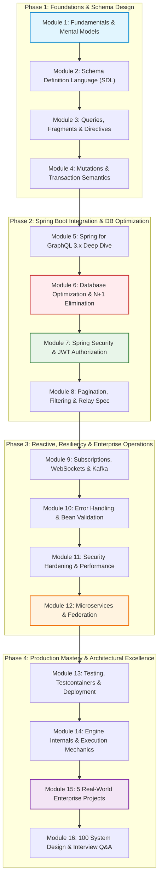

# 00. GraphQL Mastery Learning Roadmap & Strategy

Welcome to the comprehensive, production-oriented curriculum for mastering **GraphQL on the Java Spring Boot ecosystem**. This roadmap is engineered specifically for experienced Java backend developers looking to transition from REST-only architectures to enterprise-ready, high-performance GraphQL systems.

---

## 1. Executive Summary & Philosophy

Transitioning from REST to GraphQL is not simply swapping `@GetMapping` for `@QueryMapping`. It represents a fundamental paradigm shift:
- **From Server-Centric to Client-Centric Data Delivery:** REST exposes resources shaped by the server; GraphQL exposes an interconnected graph of types where the client selects the exact fields required.
- **From Endpoint-Per-Entity to Unified Graph:** Instead of dozens of micro-endpoints (`/api/v1/users`, `/api/v1/orders`), your entire domain model is accessible through a strongly-typed schema contract.
- **From Flat DTOs to Hierarchical Resolvers:** Each field in GraphQL can be resolved independently, requiring modern batching techniques (`DataLoader`, `@BatchMapping`) to prevent catastrophic database performance bottlenecks ($N+1$ query problems).



---

## 2. Assumed Knowledge vs. What You Will Learn

### What You Already Bring to the Table
- **Core Java (17+):** Records, pattern matching, `CompletableFuture`, Streams, Lambdas.
- **Spring Framework:** Spring Boot 3.x, Dependency Injection, `@Configuration`, Spring MVC.
- **Persistence:** Hibernate 6.x, Spring Data JPA, SQL queries, transactions (`@Transactional`), indexes.
- **Security:** Spring Security filters, Bearer JWT validation, Role-Based Access Control (RBAC).
- **Infrastructure:** Docker, Docker Compose, PostgreSQL 15+, Redis, Prometheus/Grafana.

### What This Guide Teaches You
1. **GraphQL Engine Internals:** Abstract Syntax Trees (AST), Query Validation, Document Execution, and Field Resolution.
2. **Schema Definition Language (SDL):** Structuring maintainable schemas using custom scalars, unions, interfaces, and directives.
3. **The Spring for GraphQL Stack:** Master `@QueryMapping`, `@MutationMapping`, `@SchemaMapping`, `@BatchMapping`, and `GraphQlSourceBuilderCustomizer`.
4. **Solving the N+1 Query Dilemma:** Master `DataLoader`, per-request registry, key extraction, batch DB fetching, and JPA projection alignment.
5. **Security at Every Layer:** Field-level security, method security (`@PreAuthorize`), query depth limiting, complexity analysis, and introspection lockdown.
6. **Relay Cursor Pagination:** Implementing industry-standard `Connection`, `Edge`, `Node`, and `PageInfo` specs with PostgreSQL keyset pagination.
7. **Reactive Subscriptions:** Utilizing WebSockets, Project Reactor (`Flux<T>`), and Kafka consumers to broadcast events.
8. **Federation & Gateways:** Integrating multiple microservices behind an Apollo Federation or Schema Stitching gateway.

---

## 3. The 30-Day Mastery Schedule

### Week 1: Core Fundamentals, SDL & Spring Boot Integration
- **Day 1–2:** [Module 1: Fundamentals](./01-fundamentals.md) – REST vs GraphQL, internal request lifecycle, single endpoint concept, trade-offs.
- **Day 3–4:** [Module 2: Schema & Types](./02-schema-and-types.md) – SDL syntax, scalars, objects, interfaces, unions, inputs, schema evolution rules.
- **Day 5:** [Module 3: Queries](./03-queries.md) & [Module 4: Mutations](./04-mutations.md) – Selection sets, fragments, variables, mutations with ACID transactions.
- **Day 6–7:** [Module 5: Spring Boot Integration](./05-spring-boot-integration.md) – Dependencies, `application.yml`, controller mappings, data fetchers, DTOs.
- **Milestone 1:** Build a basic Spring Boot GraphQL service managing a product catalog with CRUD operations.

### Week 2: Persistence Optimization, Security & Pagination
- **Day 8–10:** [Module 6: Database Integration & N+1 Optimization](./06-database-and-optimization.md) – The N+1 problem, `DataLoader`, `@BatchMapping`, Hibernate SQL inspection, fetch joins.
- **Day 11–12:** [Module 7: Security & JWT Authorization](./07-security-and-jwt.md) – Passing JWT tokens from HTTP context into GraphQL resolvers, field-level RBAC.
- **Day 13–14:** [Module 8: Pagination, Filtering & Sorting](./08-pagination-filtering-sorting.md) – Offset vs Keyset cursor pagination, Relay Connection spec, Spring Data JPA Specification integration.
- **Milestone 2:** Implement an optimized Order & Customer service handling 10,000+ records with zero N+1 queries, cursor pagination, and JWT field-level security.

### Week 3: Real-Time, Error Architecture & Operational Hardening
- **Day 15–16:** [Module 9: Subscriptions & Real-Time](./09-subscriptions.md) – WebSocket transport, Project Reactor `Flux`, Kafka event bridge.
- **Day 17:** [Module 10: Error Handling & Validation](./10-error-handling-validation.md) – RFC-7807 problem details, partial error returns, `@GraphQlExceptionHandler`.
- **Day 18–19:** [Module 11: Security & Performance](./11-security-and-performance.md) – Max depth analyzer, complexity instrumentation, Redis caching, APQ (Automated Persisted Queries).
- **Day 20–21:** [Module 12: Microservices & Federation](./12-microservices.md) – Apollo Federation v2 vs Schema Stitching, Gateway routing, distributed transactions.
- **Milestone 3:** Deploy a hardened real-time order-tracking system with WebSocket subscriptions and DDoS depth-limit defenses.

### Week 4: Enterprise Testing, Advanced Internals & Production Projects
- **Day 22–23:** [Module 13: Testing & Deployment](./13-testing-and-deployment.md) – `GraphQlTester`, Testcontainers (PostgreSQL), Docker Compose, Prometheus metrics.
- **Day 24–25:** [Module 14: Engine Internals & Execution](./14-advanced-concepts.md) – AST execution engine, custom scalars, custom directives.
- **Day 26–28:** [Module 15: 5 Real-World Projects](./15-real-world-projects.md) – Build from scratch:
  1. Student Management System (Beginner)
  2. E-Commerce Platform (Intermediate)
  3. Hospital Information System (Advanced)
  4. Real-time Collaborative Chat (Advanced)
  5. Multi-service Federated Order Management (Architectural)
- **Day 29–30:** [Module 16: Interview Prep](./16-interview-preparation.md), [Module 17: Exercises](./17-exercises.md), & [Module 18: Solutions](./18-exercise-solutions.md).
- **Milestone 4:** Complete the 100-question interview checklist and pass all 20 hands-on coding scenarios.

---

## 4. Competency Matrix: From Junior to Architect

| Competency Dimension | Junior GraphQL Developer | Mid-Level Engineer | Senior Backend Engineer | Principal / Architect |
| :--- | :--- | :--- | :--- | :--- |
| **Schema Design** | Writes basic SDL with flat types; relies on primitive types. | Uses Enums, Inputs, and Interfaces; designs clean relationship trees. | Designs evolvable schemas; avoids breaking changes; applies Relay connection specs. | Establishes enterprise SDL governance, design standards, and federated graph topologies. |
| **Data Fetching** | Maps queries directly to Spring Data JPA repository calls. | Uses `@SchemaMapping` to load child entities; understands basic lazy loading. | Eliminates N+1 queries using `@BatchMapping` and `DataLoader`; tunes SQL queries. | Designs dynamic AST-aware projection query generation, multi-level caching, and connection pooling. |
| **Security** | Protects endpoint globally via standard HTTP URL filter. | Implements method-level security (`@PreAuthorize`) on controller methods. | Implements field-level authorization; blocks unauthorized sub-trees; disables introspection. | Deploys query depth/complexity instrumentation; mitigates resource-exhaustion DDoS attacks. |
| **Real-Time** | Relies on REST polling or basic polling intervals. | Sets up basic WebSocket endpoint with `@SubscriptionMapping`. | Connects Project Reactor `Flux` to Kafka topics; manages subscription lifecycle and connection drops. | Architectures distributed WebSocket session clusters with Redis pub/sub backplanes. |
| **Architecture** | Thinks of GraphQL as an alternative to `curl` or Swagger. | Implements a monolithic GraphQL backend for a mobile app. | Designs multi-channel BFF (Backend-for-Frontend) layers; optimizes API gateway. | Evaluates Monolith vs Federated Supergraph vs gRPC; leads cross-team schema governance. |

---

## 5. Architectural Decision Matrix: When to Use What?

Use this decision matrix when evaluating architectural tradeoffs between REST, GraphQL, gRPC, and Event-Driven systems (Kafka):

| Requirement / Scenario | Recommended Protocol | Primary Justification |
| :--- | :---: | :--- |
| **Mobile Applications with constrained networks** | **GraphQL** | Eliminates over-fetching (saving cellular bandwidth) and under-fetching (reducing round-trip battery drain). |
| **Internal High-Throughput Service-to-Service** | **gRPC / HTTP/2** | Binary Protobuf serialization provides 5–10x higher throughput and minimal CPU overhead compared to JSON parsing. |
| **Public Developer APIs (Third-Party Ecosystems)** | **REST (OpenAPI)** | Universally supported by all HTTP clients, CDNs, and API gateways without specialized client tooling. |
| **Dashboard / Aggregate Views with Multiple Entities** | **GraphQL** | Client fetches User, Orders, Notifications, and Analytics in a single HTTP POST round-trip. |
| **Large File Uploads / Streaming Downloads** | **REST** | Multipart HTTP streams and binary endpoints are standardized in REST; GraphQL multipart specs are complex and non-standard. |
| **Asynchronous Background Processing & Decoupling** | **Kafka / Event-Driven** | Fire-and-forget message persistence with partitioned consumer groups for resilient scale. |
| **Dynamic Form Builders & Configurable UIs** | **GraphQL** | Dynamic UI engines can request arbitrary component configurations and relational data based on UI layout state. |

---

## 6. Project Directory Structure

Throughout this guide and the companion projects, we maintain the standard enterprise Spring Boot multi-module layout:

```text
graphql-mastery/
├── README.md                          # Master index and progress tracker
├── 00-learning-roadmap.md              # This curriculum and decision guide
├── 01-fundamentals.md                  # GraphQL architecture, engine & REST comparison
├── 02-schema-and-types.md              # SDL, Scalars, Types, Interfaces, Unions
├── 03-queries.md                       # Deep dive into query execution & AST
├── 04-mutations.md                     # Mutations, ACID transactions, Idempotency
├── 05-spring-boot-integration.md       # Spring for GraphQL 3.x annotations & wiring
├── 06-database-and-optimization.md     # Solving N+1, DataLoader, @BatchMapping
├── 07-security-and-jwt.md              # Spring Security 6, JWT, Field-level RBAC
├── 08-pagination-filtering-sorting.md  # Keyset cursor pagination, Relay spec
├── 09-subscriptions.md                 # Reactive WebSocket streams & Kafka integration
├── 10-error-handling-validation.md     # RFC-7807 error formatting & custom exceptions
├── 11-security-and-performance.md      # Query depth/complexity limits, APQ, Redis
├── 12-microservices.md                 # Apollo Federation v2 & Schema Stitching
├── 13-testing-and-deployment.md        # GraphQlTester, Testcontainers, Docker, CI/CD
├── 14-advanced-concepts.md             # AST parsers, Custom scalars, Execution hooks
├── 15-real-world-projects.md           # 5 complete enterprise reference applications
├── 16-interview-preparation.md         # 100 Senior/Architect interview questions
├── 17-exercises.md                     # 20+ practical scenario challenges
├── 18-exercise-solutions.md            # Production-grade solutions and code
├── 19-glossary.md                      # Industry terminology and quick definitions
└── diagrams/                           # Visual architecture models and sequence flows
```
