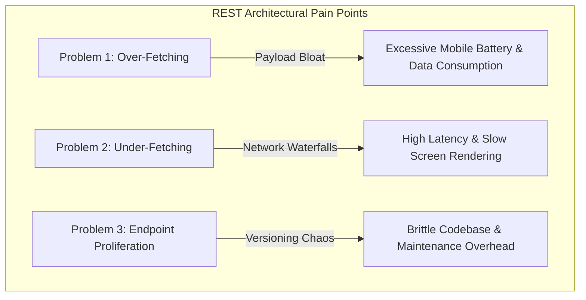
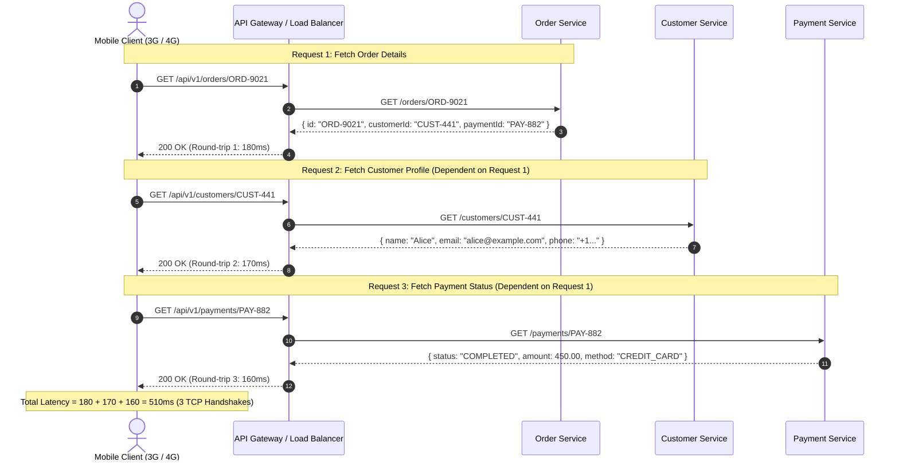
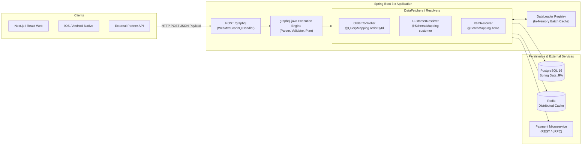
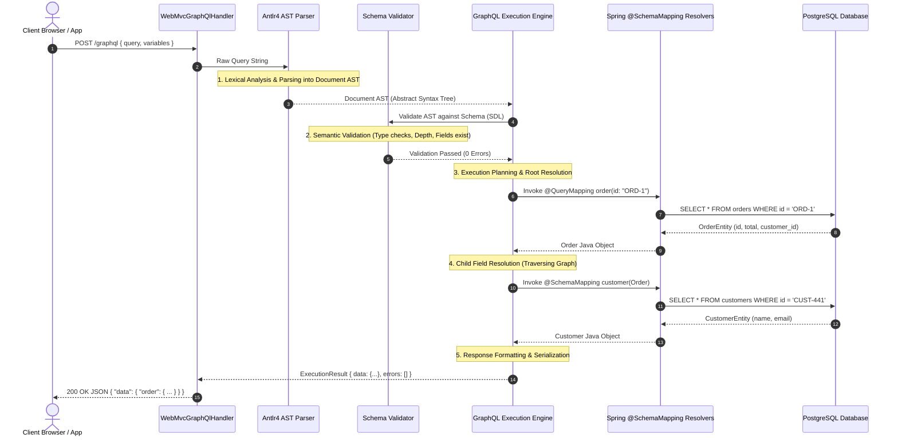
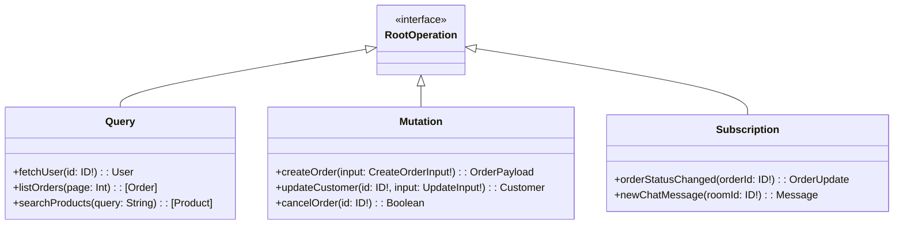

# Module 01: GraphQL Fundamentals & Architecture

Welcome to the foundational module of the **GraphQL Mastery Guide**. This module deconstructs GraphQL from its theoretical underpinnings to its low-level execution engine mechanics within the **Java 17+ and Spring Boot 3.x** ecosystem.

---

## 1. Executive Overview: What is GraphQL?

### 1.1 Simple Explanation
Imagine walking into a restaurant with a set menu (REST): if you order the "Executive Lunch Set", you receive a salad, soup, steak, mashed potatoes, and dessert. Even if you only want the steak and potatoes, the kitchen brings the entire tray, cluttering your table and wasting food. 

Now imagine an *à la carte* buffet with a personal chef (GraphQL): you hand the chef a note specifying:
> *"Bring me 200g of ribeye steak and a small portion of roasted garlic potatoes. Omit the soup, salad, and dessert."*

The chef prepares and delivers **exactly** what you requested in a single bowl.

**GraphQL is an open-source data query and manipulation language for APIs, and a runtime engine for executing those queries against your existing data sources.** Created internally by Facebook in 2012 and open-sourced in 2015, GraphQL is now governed by the vendor-neutral **GraphQL Foundation** hosted by the Linux Foundation.

### 1.2 Technical Definition
From a computer science perspective, GraphQL is:
1. **A Formal Specification:** Defining a declarative query syntax (GraphQL Query Language) and a type definition system (Schema Definition Language or SDL).
2. **A Strongly Typed Execution Engine:** A runtime that validates client queries against a server-defined type system and resolves those queries into a deterministic JSON response.
3. **An Application Layer Protocol:** Operating primarily over HTTP/HTTPS (POST method) at a single uniform endpoint (e.g., `/graphql`), returning a single structured JSON object conforming strictly to the requested shape.

---

## 2. Why GraphQL Was Introduced: The Real Problem

### 2.1 The 2012 Mobile Revolution & The Fall of REST at Scale
In 2011–2012, Facebook was transitioning from desktop web browsers to native mobile applications (iOS and Android). Their existing architecture relied on traditional REST-like RPC endpoints. Engineers ran into three critical bottlenecks:



#### Problem 1: Over-Fetching (Wasted Bandwidth & CPU Deserialization)
A mobile user viewing their Facebook Feed only needed:
- Author Name
- Author Avatar URL
- Post Timestamp
- Post Text

However, a call to `GET /api/v1/posts/{id}` returned a massive JSON blob containing 85+ fields: user permission flags, geo-coordinates, EXIF image metadata, edit history timestamps, internal tracking hashes, and comment counters. 
- **Impact:** Over 80% of the downloaded bytes were immediately discarded by the client. On 3G mobile networks, this drained battery, triggered out-of-memory errors on low-end devices, and consumed user data plans.

#### Problem 2: Under-Fetching & The "Waterfall" Latency Problem
To render a single mobile screen (e.g., an Order Details screen in an enterprise e-commerce app), a mobile client in a REST architecture is forced to chain multiple synchronous HTTP requests sequentially:



- **Impact:** The client experiences **Network Waterfall Latency**. In high-latency mobile networks (150ms+ RTT), three sequential requests add over half a second of blank loading spinners before the UI can render.

#### Problem 3: Endpoint Proliferation & Versioning Nightmares
As frontend teams developed new screens (e.g., smartwatch app, desktop web, iPad app, Android widget), each client required a different subset of data:
- The Smartwatch needed: Name and Status.
- The Desktop needed: All 85 fields including analytics.
- The Mobile App needed: Medium detail.

Backend engineers were forced to either:
1. Create custom endpoints: `/api/v1/orders/summary`, `/api/v1/orders/mobile`, `/api/v1/orders/watch`.
2. Continuously append fields to `/api/v1/orders`, bloating the payload for all existing clients.
3. Introduce versioned endpoints: `/api/v1/orders`, `/api/v2/orders`, `/api/v3/orders`, creating legacy maintenance baggage.

---

## 3. Detailed REST vs. GraphQL Architectural Comparison

| Dimension | Traditional REST API | GraphQL API |
| :--- | :--- | :--- |
| **Architectural Model** | Resource-oriented (URL points to a resource entity). | Graph-oriented (Schema defines interconnected nodes and edges). |
| **Endpoint Structure** | Multiple distinct endpoints (`/users`, `/orders`, `/products`). | Single uniform endpoint (typically `POST /graphql`). |
| **HTTP Verb Usage** | Semantically relies on HTTP verbs (`GET`, `POST`, `PUT`, `PATCH`, `DELETE`). | Primarily uses `POST` with a JSON payload; `GET` occasionally used for cached queries. |
| **Payload Control** | **Server dictates** the response structure and fields. | **Client dictates** the exact selection set of fields. |
| **Data Fetching Mode** | Prone to Over-fetching (too much data) and Under-fetching (too little). | Exact fetching: client receives strictly what was requested. |
| **Network Round-trips** | Multiple round-trips often required for relational data. | Single network round-trip can traverse complex entity relationships. |
| **Schema & Typing** | Optional (OpenAPI/Swagger is a documentation layer, not an engine core). | Mandatory, first-class Schema Definition Language (SDL) enforced at runtime. |
| **Versioning** | Explicit URL or header versioning (`/v1/`, `/v2/`, `Accept: application/vnd.app.v1+json`). | Field-level deprecation (`@deprecated(reason: "Use newField")`); continuous evolution. |
| **HTTP Caching** | Native, mature HTTP caching out of the box via `Cache-Control`, `ETag`, and CDNs. | Complex: standard HTTP caching does not work out-of-the-box (requires APQ or client-side Normalized Cache). |
| **Error Handling** | Semantic HTTP status codes (`404 Not Found`, `401 Unauthorized`, `500 Internal Error`). | Almost always returns `200 OK` with an `errors` array alongside partial `data`. |
| **File Uploads** | Standardized via `multipart/form-data`. | Non-standard; requires GraphQL Multipart Request Spec or pre-signed S3 URLs. |
| **DoS Vulnerability** | Bounded endpoints; easy to rate-limit by IP or path. | Vulnerable to malicious recursive queries and nested depth attacks unless bounded. |

---

## 4. GraphQL Architecture & Mental Models

### 4.1 High-Level Component Topology



### 4.2 The Core Mental Models

#### Mental Model 1: The API as a Graph, Not a Table
In relational databases, you think in tabular relations (`orders` joined to `customers` on `customer_id`). In REST, you think in static documents. In GraphQL, you model your entire business domain as an **attributed graph**:
- **Nodes (Types):** `User`, `Order`, `Product`, `Invoice`.
- **Edges (Fields / Relationships):** `Order.customer`, `User.orders`, `Order.lineItems`.
- **Properties (Scalars):** `id`, `name`, `price`, `createdAt`.

When a client sends a query, it is specifying a **directed traversal path through your domain graph**:
```graphql
query GetCustomerOrderDetails {
  customer(id: "101") {           # Start at Root Node: Customer
    fullName                      # Fetch scalar property
    orders {                      # Traverse Edge: customer -> orders
      id
      totalAmount
      items {                     # Traverse Edge: order -> items
        productName               # Fetch leaf scalar
        quantity
      }
    }
  }
}
```

#### Mental Model 2: Every Field Has a Resolver Function
In Spring for GraphQL, **every single field in your schema is backed by a resolver function** (called a `DataFetcher` in Java).
If you do not explicitly define a resolver for a scalar field (like `fullName`), the GraphQL engine uses a default `PropertyDataFetcher` that extracts the value via Java reflection (e.g., `customer.fullName()` or `customer.getFullName()`).

---

## 5. How GraphQL Works Internally: The Engine Execution Pipeline

When a client submits an HTTP POST request to `/graphql`, the request undergoes a deterministic 5-phase execution pipeline inside the Spring Boot application:



### Detailed Breakdown of the 5 Engine Phases:

#### Phase 1: Lexical Analysis & Parsing
- The incoming query string is tokenized and parsed using an **Antlr4 grammar** into an in-memory **Abstract Syntax Tree (AST)** composed of `Document`, `OperationDefinition`, `Field`, and `SelectionSet` nodes.
- If the syntax is malformed (e.g., missing closing brace), the pipeline aborts immediately with a `400 Bad Request` or a GraphQL syntax error without touching your database or resolvers.

#### Phase 2: Static Validation
Before running any code, the engine validates the AST against your loaded Schema Definition:
1. **Field Existence:** Do all requested fields actually exist on the target types?
2. **Type Compatibility:** Are variables supplied with matching scalar types?
3. **Selection Set Rules:** Are scalar fields leaf nodes? (A scalar cannot have sub-fields; an object type *must* have sub-fields).
4. **Security Bounds:** Instrumentations inspect AST depth and complexity rules to ensure the query is not a nested recursive attack (e.g., `user { friends { friends { friends ... } } }`).

#### Phase 3: Execution Planning & Root Field Dispatch
- The engine identifies the root operation type: `query`, `mutation`, or `subscription`.
- For `query`, root fields are executed **concurrently in parallel** using Java `CompletableFuture` threads.
- For `mutation`, root fields are executed **strictly sequentially** to guarantee deterministic side-effect execution.

#### Phase 4: Recursive Field Resolution (Graph Traversal)
- Starting at the root object, the engine iterates through each requested field in the selection set.
- It invokes the bound `DataFetcher` passing a `DataFetchingEnvironment` containing the source (parent object), arguments, execution context, and authentication principals.
- Leaf nodes (Scalars and Enums) resolve directly to JSON values. Object nodes trigger recursive resolution of their nested selection sets.

#### Phase 5: Response Formatting & Error Merging
- The engine collects all resolved field values and constructs a Map that strictly mirrors the requested query hierarchy.
- If an exception occurs during the resolution of a specific field:
  - If the field is **nullable**, the error is added to the `errors` array, the field resolves to `null`, and the rest of the response is preserved (**Graceful Degradation**).
  - If the field is **non-null (`!`)**, the `null` bubbles up to the nearest nullable parent field.

---

## 6. GraphQL Client-Server Communication & Wire Protocol

### 6.1 The Over-the-Wire JSON Payload
Unlike REST where parameters can be scattered across path variables (`/orders/{id}`), query parameters (`?status=active`), and request bodies, a standard GraphQL HTTP POST request always delivers a standardized JSON body with three attributes:

```json
{
  "query": "query GetOrderSummary($orderId: ID!) { order(id: $orderId) { id total status } }",
  "operationName": "GetOrderSummary",
  "variables": {
    "orderId": "1001"
  }
}
```

| Field Name | Type | Required? | Purpose |
| :--- | :--- | :---: | :--- |
| `query` | `String` | **Yes** | The GraphQL document string containing operations, fragments, and directives. |
| `operationName` | `String` | No | Required if the document contains multiple operations, indicating which operation to execute. |
| `variables` | `Map<String, Object>` | No | Dynamic runtime parameters bound to the query's declared variable signatures. |

### 6.2 The Unified Server Response Envelope
The response is guaranteed to follow the official GraphQL Specification format:

```json
{
  "data": {
    "order": {
      "id": "1001",
      "total": 299.95,
      "status": "SHIPPED"
    }
  },
  "errors": [
    {
      "message": "Field 'trackingNumber' is unavailable: shipping provider down",
      "locations": [{ "line": 2, "column": 25 }],
      "path": ["order", "trackingNumber"],
      "extensions": {
        "classification": "DataFetchingException",
        "errorCode": "UPSTREAM_TIMEOUT"
      }
    }
  ]
}
```

> [!IMPORTANT]
> **HTTP 200 OK with Partial Errors:**
> In REST, an error in fetching a child resource typically fails the entire HTTP request with a `500 Internal Server Error`. In GraphQL, if the parent `order` succeeds but a non-critical field fails, GraphQL returns `HTTP 200 OK` containing valid `data` for the order alongside an entry in the `errors` array explaining the field failure.

---

## 7. The Three Core Operations: Query, Mutation, and Subscription

Every operation in a GraphQL schema falls into one of three distinct root types:



### 7.1 Query (Read-Only Operations)
- **Semantic Purpose:** Safe, idempotent reads. Identical to HTTP `GET`.
- **Execution Characteristic:** Multiple root fields in a query are resolved **in parallel** by the execution engine, maximizing I/O concurrency.
- **Side Effects:** Must never alter server state.

### 7.2 Mutation (Write Operations)
- **Semantic Purpose:** State-modifying operations (Create, Update, Delete). Equivalent to HTTP `POST`, `PUT`, `PATCH`, `DELETE`.
- **Execution Characteristic:** Multiple root mutations within a single request are guaranteed to execute **strictly sequentially** in the order written. This prevents race conditions (e.g., creating an order and then charging the credit card in the same payload).
- **Return Type:** Mutations always return a selection set, allowing the client to fetch the updated state immediately without an extra round-trip.

### 7.3 Subscription (Real-Time Push Operations)
- **Semantic Purpose:** Server-initiated push notifications to clients over a persistent connection (WebSocket or HTTP Server-Sent Events).
- **Execution Characteristic:** Resolves to a reactive stream (`org.reactivestreams.Publisher<T>` or Project Reactor `Flux<T>`). Whenever an event occurs (e.g., an order moves to "OUT_FOR_DELIVERY"), the server pushes a newly evaluated GraphQL selection set down the wire.

---

## 8. Complete Working Implementation: Spring Boot 3.x Foundation

Let us build a complete, runnable foundation demonstrating these core concepts using production-grade **Java 17+ and Spring Boot 3.3.x**.

### 8.1 Maven `pom.xml` Dependencies

```xml
<?xml version="1.0" encoding="UTF-8"?>
<project xmlns="http://maven.apache.org/POM/4.0.0"
         xmlns:xsi="http://www.w3.org/2001/XMLSchema-instance"
         xsi:schemaLocation="http://maven.apache.org/POM/4.0.0 
         https://maven.apache.org/xsd/maven-4.0.0.xsd">
    <modelVersion>4.0.0</modelVersion>
    <parent>
        <groupId>org.springframework.boot</groupId>
        <artifactId>spring-boot-starter-parent</artifactId>
        <version>3.3.2</version>
        <relativePath/>
    </parent>

    <groupId>com.upskill.graphql</groupId>
    <artifactId>graphql-fundamentals</artifactId>
    <version>1.0.0-SNAPSHOT</version>
    <name>graphql-fundamentals</name>
    <description>Enterprise GraphQL Mastery Foundation Project</description>

    <properties>
        <java.version>17</java.version>
    </properties>

    <dependencies>
        <!-- Spring Boot GraphQL Starter (Includes graphql-java, Spring GraphQL runtime) -->
        <dependency>
            <groupId>org.springframework.boot</groupId>
            <artifactId>spring-boot-starter-graphql</artifactId>
        </dependency>

        <!-- Spring MVC Web Starter (Serves HTTP POST /graphql endpoint) -->
        <dependency>
            <groupId>org.springframework.boot</groupId>
            <artifactId>spring-boot-starter-web</artifactId>
        </dependency>

        <!-- WebSocket Support for Subscriptions -->
        <dependency>
            <groupId>org.springframework.boot</groupId>
            <artifactId>spring-boot-starter-websocket</artifactId>
        </dependency>

        <!-- Spring Boot Validation Starter (Jakarta Bean Validation) -->
        <dependency>
            <groupId>org.springframework.boot</groupId>
            <artifactId>spring-boot-starter-validation</artifactId>
        </dependency>

        <!-- Spring Data JPA & PostgreSQL -->
        <dependency>
            <groupId>org.springframework.boot</groupId>
            <artifactId>spring-boot-starter-data-jpa</artifactId>
        </dependency>
        <dependency>
            <groupId>org.postgresql</groupId>
            <artifactId>postgresql</artifactId>
            <scope>runtime</scope>
        </dependency>

        <!-- Testing Dependencies -->
        <dependency>
            <groupId>org.springframework.boot</groupId>
            <artifactId>spring-boot-starter-test</artifactId>
            <scope>test</scope>
        </dependency>
        <dependency>
            <groupId>org.springframework.graphql</groupId>
            <artifactId>spring-graphql-test</artifactId>
            <scope>test</scope>
        </dependency>
    </dependencies>
</project>
```

### 8.2 Application Configuration (`src/main/resources/application.yml`)

```yaml
server:
  port: 8080

spring:
  application:
    name: graphql-mastery-service

  datasource:
    url: jdbc:postgresql://localhost:5432/graphql_db
    username: postgres
    password: postgrespassword
    driver-class-name: org.postgresql.Driver

  jpa:
    hibernate:
      ddl-auto: validate
    show-sql: true
    properties:
      hibernate:
        format_sql: true
        jdbc:
          batch_size: 25

  graphql:
    graphiql:
      # Enable interactive GraphiQL in-browser IDE for testing
      enabled: true
      path: /graphiql
    schema:
      printer:
        enabled: true
      locations: classpath:graphql/**/
    websocket:
      path: /graphql
```

### 8.3 Schema Definition (`src/main/resources/graphql/schema.graphqls`)

```graphql
"""
Root Query Operation for fetching data
"""
type Query {
    """
    Fetch a single order by its unique system ID
    """
    orderById(id: ID!): Order
    
    """
    Retrieve all orders placed by a specific customer
    """
    ordersByCustomer(customerId: ID!): [Order!]!
}

"""
Root Mutation Operation for state-modifying actions
"""
type Mutation {
    """
    Create a new order in the system
    """
    createOrder(input: CreateOrderInput!): Order!
}

"""
Represents an individual commercial customer
"""
type Customer {
    id: ID!
    fullName: String!
    email: String!
}

"""
Represents a customer purchase order
"""
type Order {
    id: ID!
    orderNumber: String!
    totalAmount: Float!
    status: OrderStatus!
    createdAt: String!
    customer: Customer!
    lineItems: [LineItem!]!
}

"""
Individual item within an order
"""
type LineItem {
    id: ID!
    productSku: String!
    unitPrice: Float!
    quantity: Int!
}

"""
Possible states of an order
"""
enum OrderStatus {
    PENDING
    CONFIRMED
    SHIPPED
    DELIVERED
    CANCELLED
}

"""
Input payload for order creation
"""
input CreateOrderInput {
    customerId: ID!
    items: [OrderItemInput!]!
}

"""
Input payload for an item within an order
"""
input OrderItemInput {
    productSku: String!
    unitPrice: Float!
    quantity: Int!
}
```

### 8.4 Java Records (Immutable DTOs)

Using modern Java 17+ records for clean, immutable data carriers:

```java
package com.upskill.graphql.dto;

import java.math.BigDecimal;
import java.time.Instant;
import java.util.List;

public final class OrderModels {
    private OrderModels() {}

    public record CustomerDto(
        Long id,
        String fullName,
        String email
    ) {}

    public record LineItemDto(
        Long id,
        String productSku,
        BigDecimal unitPrice,
        Integer quantity
    ) {}

    public record OrderDto(
        Long id,
        String orderNumber,
        BigDecimal totalAmount,
        String status,
        Instant createdAt,
        Long customerId
    ) {}

    public record CreateOrderInput(
        Long customerId,
        List<OrderItemInput> items
    ) {}

    public record OrderItemInput(
        String productSku,
        BigDecimal unitPrice,
        Integer quantity
    ) {}
}
```

### 8.5 Spring GraphQL Controller Implementation

```java
package com.upskill.graphql.controller;

import com.upskill.graphql.dto.OrderModels.CreateOrderInput;
import com.upskill.graphql.dto.OrderModels.CustomerDto;
import com.upskill.graphql.dto.OrderModels.LineItemDto;
import com.upskill.graphql.dto.OrderModels.OrderDto;
import com.upskill.graphql.service.CustomerService;
import com.upskill.graphql.service.OrderService;
import org.springframework.graphql.data.method.annotation.Argument;
import org.springframework.graphql.data.method.annotation.MutationMapping;
import org.springframework.graphql.data.method.annotation.QueryMapping;
import org.springframework.graphql.data.method.annotation.SchemaMapping;
import org.springframework.stereotype.Controller;

import java.util.List;
import java.util.Objects;

@Controller
public class OrderGraphQlController {

    private final OrderService orderService;
    private final CustomerService customerService;

    // Production Best Practice: Strict Constructor Injection
    public OrderGraphQlController(OrderService orderService, CustomerService customerService) {
        this.orderService = Objects.requireNonNull(orderService, "orderService cannot be null");
        this.customerService = Objects.requireNonNull(customerService, "customerService cannot be null");
    }

    /**
     * Resolves Query.orderById(id: ID!): Order
     * Mapped via @QueryMapping matching the schema field name.
     */
    @QueryMapping
    public OrderDto orderById(@Argument Long id) {
        return orderService.findById(id);
    }

    /**
     * Resolves Query.ordersByCustomer(customerId: ID!): [Order!]!
     */
    @QueryMapping
    public List<OrderDto> ordersByCustomer(@Argument Long customerId) {
        return orderService.findByCustomerId(customerId);
    }

    /**
     * Resolves Order.customer: Customer!
     * 
     * @SchemaMapping maps a field resolver to a parent type.
     * The argument 'OrderDto order' represents the source (parent) object.
     * If the client does not request the 'customer' field in their GraphQL query,
     * THIS METHOD IS NEVER EXECUTED. This eliminates unnecessary DB queries!
     */
    @SchemaMapping(typeName = "Order", field = "customer")
    public CustomerDto customer(OrderDto order) {
        return customerService.findById(order.customerId());
    }

    /**
     * Resolves Order.lineItems: [LineItem!]!
     */
    @SchemaMapping(typeName = "Order", field = "lineItems")
    public List<LineItemDto> lineItems(OrderDto order) {
        return orderService.findLineItemsByOrderId(order.id());
    }

    /**
     * Resolves Mutation.createOrder(input: CreateOrderInput!): Order!
     */
    @MutationMapping
    public OrderDto createOrder(@Argument CreateOrderInput input) {
        return orderService.createOrder(input);
    }
}
```

---

## 9. Database Interaction & Hibernate Mechanics

### What Happens in PostgreSQL When a Query Runs?

Consider this client query:
```graphql
query GetOrderDetails {
  orderById(id: "1001") {
    id
    totalAmount
    # Note: customer and lineItems are NOT requested here!
  }
}
```

#### In Traditional Spring MVC REST:
The endpoint `GET /api/v1/orders/1001` calls `orderRepository.findById(1001L)`. If the JPA entity has eager relationships or a poorly configured DTO mapper, Hibernate executes:
```sql
SELECT o.id, o.order_number, o.total_amount, o.status, o.created_at, o.customer_id
FROM orders o WHERE o.id = 1001;

-- If customer is EAGER or referenced in the response DTO:
SELECT c.id, c.full_name, c.email FROM customers c WHERE c.id = ?;

-- If line items are mapped:
SELECT li.id, li.product_sku, li.unit_price, li.quantity, li.order_id 
FROM order_line_items li WHERE li.order_id = ?;
```

#### In Spring for GraphQL:
Because the client omitted `customer` and `lineItems` from the selection set, the GraphQL engine **never invokes** the `@SchemaMapping` methods `customer()` or `lineItems()`.
Hibernate executes **only a single SQL query**:
```sql
SELECT o.id, o.order_number, o.total_amount, o.status, o.created_at, o.customer_id
FROM orders o 
WHERE o.id = 1001;
```
**Database I/O, network bandwidth between DB and JVM, and memory footprint are cut drastically.**

---

## 10. Real-World Production Scenarios & Case Studies

1. **GitHub API v4 (Public GraphQL API):**
   - GitHub transitioned from REST (API v3) to GraphQL (API v4) because their REST endpoints were overwhelming their backend with nested calls. Fetching a repository with its pull requests, reviewers, commit history, and labels required up to 25 distinct REST API calls. In GraphQL v4, GitHub clients retrieve all of this in a single network round-trip.
2. **Shopify Storefront API:**
   - Shopify's e-commerce storefronts run across thousands of diverse consumer devices (smart TVs, POS hardware, mobile apps, headless websites). By adopting GraphQL, Shopify allows merchants to customize frontends without demanding customized backend microservices.
3. **Netflix API Architecture:**
   - Netflix uses GraphQL as an **API Gateway orchestration layer** across hundreds of microservices. Rather than forcing TV apps to coordinate with User Service, Recommendation Engine, Video Stream Service, and Billing, Netflix aggregates these subgraphs into a unified federated GraphQL layer.

---

## 11. Common Mistakes & Anti-Patterns

### Mistake 1: Treating GraphQL Exactly Like REST
- **Anti-pattern:** Writing GraphQL endpoints like `getUserOrderSummary(id: ID!): UserOrderSummaryResponse`.
- **The Fix:** Model entities as a natural interconnected graph. Let the client select the fields from `User { orders { summary } }` rather than inventing specialized endpoints for every UI variation.

### Mistake 2: Missing Lazy Resolvers (Doing All Work in the Root Resolver)
- **Anti-pattern:** Fetching all relational entities (Customer, Items, Payments) in the `@QueryMapping orderById` method and assembling a massive object graph manually.
- **Why It Fails:** Defeats the primary performance advantage of GraphQL. If the client didn't ask for items, you still performed the database JOIN. Always decompose nested relationships into separate `@SchemaMapping` resolvers.

### Mistake 3: Ignoring the N+1 Query Problem Early
- **Anti-pattern:** Writing an un-batched `@SchemaMapping customer(OrderDto order)` resolver that runs `customerRepository.findById(order.customerId())`.
- **Why It Fails:** If a client requests `ordersByCustomer` returning 50 orders, Hibernate will execute 1 query for the orders, followed by **50 separate SELECT queries** for each order's customer. (We solve this thoroughly in [Module 6](./06-database-and-optimization.md) using `DataLoader` and `@BatchMapping`).

### Mistake 4: Missing Query Depth & Complexity Guardrails
- **Anti-pattern:** Deploying an open `/graphql` endpoint to production without maximum depth limits.
- **Why It Fails:** An attacker can submit a recursive query:
  ```graphql
  query MaliciousQuery {
    user(id: 1) {
      friends {
        friends {
          friends {
            friends { id }
          }
        }
      }
    }
  }
  ```
  This crashes the database server and JVM by causing exponential query expansion (DoS vulnerability).

---

## 12. Best Practices & Production Guidelines

1. **Schema-First Design:** Write clear `.graphqls` files as the authoritative design contract between frontend and backend teams before writing any Java code.
2. **Design Evolvable Schemas:** Never delete fields from production schemas; annotate them with `@deprecated(reason: "Use newField")`.
3. **Secure the Endpoint:** Disable GraphiQL in production environments via `spring.graphql.graphiql.enabled=false`.
4. **Use Java Records for DTOs:** Records provide immutability, built-in value-based `equals`, `hashCode`, and clean accessor methods that map directly to GraphQL field names.
5. **Enforce Global Error Normalization:** Never expose raw internal Java stack traces to GraphQL clients. Use custom error handlers conforming to RFC-7807 (detailed in [Module 10](./10-error-handling-validation.md)).

---

## 13. Comprehensive Interview Questions & Deep Answers

### Question 1 (Basic): What is the core difference between REST and GraphQL in terms of client-server data negotiation?
**Answer:**
In REST, data negotiation is **server-driven and endpoint-centric**. The server predetermines the payload structure for a specific URI (`GET /users/{id}` returns whatever JSON structure the backend developer coded). Clients have no control over the fields returned, leading to over-fetching (receiving unneeded attributes) or under-fetching (requiring subsequent network calls). 

In GraphQL, data negotiation is **client-driven and schema-centric**. The server publishes a strongly typed schema (SDL) describing available types and connections, but the client submits a declarative query specifying the exact subset of fields required. The server's execution engine dynamically executes only the resolvers necessary to fulfill that selection set.

---

### Question 2 (Intermediate): How does the GraphQL execution engine process a query containing both root fields and nested relational fields?
**Answer:**
The execution engine executes in phases:
1. **Parsing & AST Construction:** The raw string is parsed into an Abstract Syntax Tree (AST).
2. **Schema Validation:** The AST is validated against the registered SDL types.
3. **Root Execution:** Root fields (`Query` or `Mutation`) are resolved. If the operation is a `Query`, root fields execute in parallel via asynchronous threads.
4. **Hierarchical Traversal (Breadth-First / Depth-First):** For each resolved root object, the engine examines child field selections. If a child field has an associated custom `DataFetcher` (or `@SchemaMapping`), the engine invokes that resolver passing the parent object as `source`.
5. **Scalar Leaves:** Resolution terminates when all leaf nodes (Scalars/Enums) are resolved into a final Map representing the exact shape of the query.

---

### Question 3 (Advanced/Architectural): Why does GraphQL almost always return an HTTP 200 OK status code, even when business errors or data fetching failures occur? How do you reconcile this with HTTP caching?
**Answer:**
GraphQL operates as an application-level protocol layered *on top of* HTTP transport. 
- In GraphQL, a single query can fetch multiple independent sub-graphs simultaneously (e.g., `userProfile` and `recentNotifications`). If `userProfile` succeeds from PostgreSQL, but `recentNotifications` fails because Redis is unreachable, the request as an entirety has not failed. The engine returns `HTTP 200 OK` with valid data in the `data.userProfile` field, and an entry in the `errors` array for `notifications`.
- **Impact on HTTP Caching:** Because all requests go to a single URI (`POST /graphql`) with dynamic bodies and return `200 OK`, standard HTTP proxy caching (Varnish, Cloudflare, Akamai) that relies on `GET` URIs, `ETag`, and `304 Not Modified` is ineffective out-of-the-box. Enterprise solutions require:
  1. **Normalized Client Caching** (Apollo Client / Relay store objects by `__typename:id`).
  2. **Automated Persisted Queries (APQ)**: Hashing the query string and issuing HTTP `GET /graphql?hash=xyz` so edge CDNs can cache responses.
