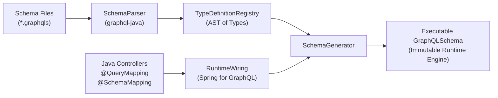
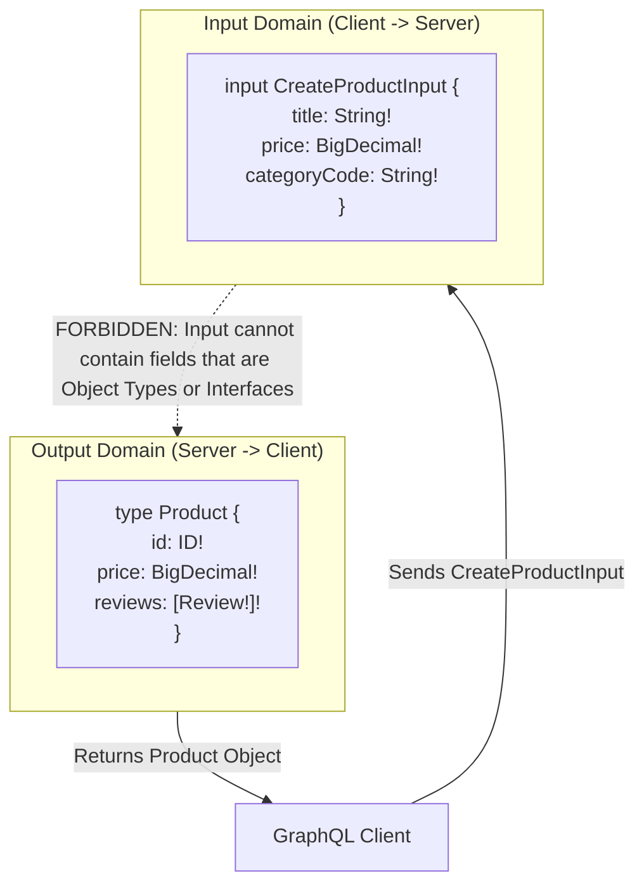
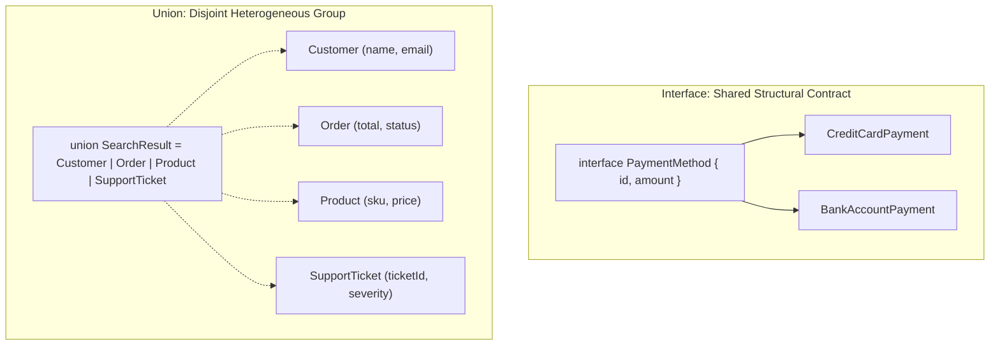
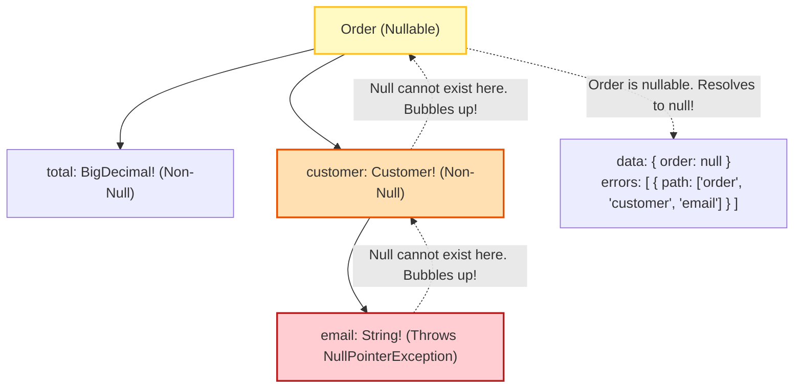

# Module 02: GraphQL Schema Definition Language (SDL) & The Type System

Welcome to Module 02 of the **GraphQL Mastery Guide**. This module explores the **GraphQL Type System** and **Schema Definition Language (SDL)**, showing how schema definitions map directly to **Java 17+ records, Spring Boot 3.x resolvers, Hibernate entities, and PostgreSQL schemas**.

---

## 1. Schema Definition Language (SDL) Overview

### 1.1 Simple Explanation
In REST, an API contract is often an afterthought: developers write code and generate a Swagger/OpenAPI spec or an informal Postman collection.
In GraphQL, the **Schema is the single source of truth**. It is a formal, human-readable contract written in **Schema Definition Language (SDL)** that dictates every data type, field, argument, and operation supported by the server.

### 1.2 Technical Definition & Internal Working
The GraphQL engine cannot execute any query without a validated schema. At application startup:
1. Spring for GraphQL discovers all `.graphqls` files inside `src/main/resources/graphql/`.
2. The `graphql-java` `SchemaParser` parses SDL files into a `TypeDefinitionRegistry` (an in-memory AST of type definitions).
3. The `SchemaGenerator` pairs this AST with your Java `@Controller` data fetchers using `RuntimeWiring` to create an immutable `GraphQLSchema` instance.
4. Any mismatch (e.g., a field declared in SDL that has no matching Java getter or `@SchemaMapping`, or incompatible type bindings) fails application startup with a `SchemaProblemException`.



---

## 2. Scalar Types (Built-in & Custom Enterprise Scalars)

### 2.1 The 5 Built-in Primitive Scalars
GraphQL defines five core leaf scalar types that serialize directly to JSON equivalents:

| GraphQL Scalar | JSON Representation | Java Equivalent | PostgreSQL Equivalent | Notes |
| :--- | :--- | :--- | :--- | :--- |
| `Int` | Number (32-bit signed) | `java.lang.Integer`, `int` | `INTEGER` | Clamped to $-2^{31}$ to $2^{31}-1$. Exceeding this causes overflow! |
| `Float` | Number (64-bit IEEE 754) | `java.lang.Double`, `double` | `DOUBLE PRECISION` | Avoid for currency/financial math due to floating-point drift. |
| `String` | String (UTF-8) | `java.lang.String` | `VARCHAR`, `TEXT` | Unbounded character stream. |
| `Boolean` | Boolean (`true`/`false`) | `java.lang.Boolean`, `boolean`| `BOOLEAN` | Strict boolean literal. |
| `ID` | String | `java.lang.String`, `java.lang.Long`, `java.util.UUID` | `BIGINT`, `UUID`, `VARCHAR` | Serialized as a String; signals a unique key to client normalized caches. |

### 2.2 Custom Scalars: Enterprise Financial & Temporal Types
Built-in scalars are insufficient for enterprise applications. You cannot represent currency with `Float` (causes rounding errors like `$0.10 + $0.20 = $0.30000000000000004`), nor can you safely represent timestamps as unformatted strings.

#### The 3 Most Critical Custom Scalars:
1. `DateTime`: ISO-8601 string representation mapping to `java.time.OffsetDateTime` or `java.time.Instant`.
2. `BigDecimal`: High-precision arbitrary decimal string mapping to `java.math.BigDecimal` (for currency/pricing).
3. `UUID`: Strict RFC-4122 format validation mapping to `java.util.UUID`.

#### SDL Definition:
```graphql
scalar DateTime
scalar BigDecimal
scalar UUID
```

#### Spring Boot Java Configuration (`ExtendedScalars`):
`graphql-java-extended-scalars` provides pre-tested, production-grade custom scalar implementations.

**Maven Dependency:**
```xml
<dependency>
    <groupId>com.graphql-java</groupId>
    <artifactId>graphql-java-extended-scalars</artifactId>
    <version>22.0</version>
</dependency>
```

**Spring Configuration Registration:**
```java
package com.upskill.graphql.config;

import graphql.scalars.ExtendedScalars;
import org.springframework.context.annotation.Bean;
import org.springframework.context.annotation.Configuration;
import org.springframework.graphql.execution.RuntimeWiringConfigurer;

@Configuration(proxyBeanMethods = false)
public class GraphQlScalarConfig {

    @Bean
    public RuntimeWiringConfigurer runtimeWiringConfigurer() {
        return wiringBuilder -> wiringBuilder
                // Registers ISO-8601 DateTime scalar
                .scalar(ExtendedScalars.DateTime)
                // Registers BigDecimal scalar for monetary precision
                .scalar(ExtendedScalars.GraphQLBigDecimal)
                // Registers RFC-4122 UUID scalar
                .scalar(ExtendedScalars.UUID);
    }
}
```

---

## 3. Object Types & Field Declarations

### 3.1 Definition
An **Object Type** is a composite type containing named fields. Each field yields either a scalar (leaf node) or another object type (traversal edge).

### 3.2 Complex Enterprise Example
```graphql
"""
Represents a financial commercial account.
"""
type CommercialAccount {
    id: UUID!
    accountNumber: String!
    balance: BigDecimal!
    currencyCode: String!
    status: AccountStatus!
    createdAt: DateTime!
    
    """
    Sub-ledger ledger entries with optional temporal filtering.
    """
    ledgerEntries(
        from: DateTime
        to: DateTime
        limit: Int = 20
    ): [LedgerEntry!]!
}

type LedgerEntry {
    id: UUID!
    amount: BigDecimal!
    entryType: EntryType!
    description: String
    postedAt: DateTime!
}

enum AccountStatus {
    ACTIVE
    DORMANT
    FROZEN
    CLOSED
}

enum EntryType {
    DEBIT
    CREDIT
}
```

### 3.3 Java 17+ Record Implementation:
```java
package com.upskill.graphql.account;

import java.math.BigDecimal;
import java.time.OffsetDateTime;
import java.util.UUID;

public final class AccountModels {
    private AccountModels() {}

    public enum AccountStatus { ACTIVE, DORMANT, FROZEN, CLOSED }
    public enum EntryType { DEBIT, CREDIT }

    public record CommercialAccountDto(
        UUID id,
        String accountNumber,
        BigDecimal balance,
        String currencyCode,
        AccountStatus status,
        OffsetDateTime createdAt
    ) {}

    public record LedgerEntryDto(
        UUID id,
        BigDecimal amount,
        EntryType entryType,
        String description,
        OffsetDateTime postedAt
    ) {}
}
```

---

## 4. Input Types: Enforcing Segregation of Inbound vs. Outbound Data

### 4.1 Why Input Types Exist (The CQS Principle)
A critical rule of GraphQL SDL:
> **Object Types can ONLY be returned in responses. Input Types (`input`) can ONLY be accepted as arguments in queries and mutations.**



#### Why Can't We Use the Same Type for Both?
1. **Circular References:** An `Order` has an `order.customer`, and `Customer` has `customer.orders`. An input type cannot have circular references because a JSON input payload must be finite.
2. **Computed/Audit Fields:** Output types include server-generated attributes like `id`, `createdAt`, `updatedAt`, and `databaseVersion`. An inbound request must never allow the client to set these fields!
3. **Validation & Partial Updates:** Input types often require different nullability constraints than output types.

### 4.2 SDL Definition & Validation
```graphql
input CreateAccountInput {
    accountNumber: String!
    currencyCode: String!
    initialDeposit: BigDecimal!
}

input UpdateAccountStatusInput {
    accountId: UUID!
    status: AccountStatus!
    reason: String
}
```

### 4.3 Java Bean Validation Integration:
```java
package com.upskill.graphql.account;

import jakarta.validation.constraints.DecimalMin;
import jakarta.validation.constraints.NotBlank;
import jakarta.validation.constraints.NotNull;
import jakarta.validation.constraints.Pattern;

import java.math.BigDecimal;
import java.util.UUID;

public final class AccountInputModels {
    private AccountInputModels() {}

    public record CreateAccountInput(
        @NotBlank(message = "Account number is mandatory")
        @Pattern(regexp = "^[A-Z0-9]{8,16}$", message = "Account number must be 8-16 alphanumeric chars")
        String accountNumber,

        @NotBlank(message = "Currency code is required")
        @Pattern(regexp = "^[A-Z]{3}$", message = "Currency must be a 3-letter ISO code")
        String currencyCode,

        @NotNull(message = "Initial deposit amount cannot be null")
        @DecimalMin(value = "0.00", message = "Deposit must be zero or positive")
        BigDecimal initialDeposit
    ) {}

    public record UpdateAccountStatusInput(
        @NotNull(message = "Account ID cannot be null")
        UUID accountId,

        @NotNull(message = "Status is mandatory")
        AccountModels.AccountStatus status,

        String reason
    ) {}
}
```

---

## 5. Interfaces: Abstract Polymorphism in GraphQL

### 5.1 Definition & How Polymorphism Works
An **Interface** in GraphQL defines an abstract contract consisting of common fields that multiple concrete Object Types must implement.

### 5.2 Real-World Enterprise Example: Payment Methods
A fintech platform supports multiple payment methods: `CreditCardPayment`, `BankAccountPayment`, and `CryptoWalletPayment`. All share audit fields (`id`, `amount`, `status`), but each has payment-specific fields.

```graphql
"""
Common abstract contract for any transaction settlement mechanism
"""
interface PaymentMethod {
    id: UUID!
    amount: BigDecimal!
    status: PaymentStatus!
    processedAt: DateTime!
}

type CreditCardPayment implements PaymentMethod {
    id: UUID!
    amount: BigDecimal!
    status: PaymentStatus!
    processedAt: DateTime!
    # Specific fields
    cardBrand: String!
    lastFourDigits: String!
    expiryMonth: Int!
    expiryYear: Int!
}

type BankAccountPayment implements PaymentMethod {
    id: UUID!
    amount: BigDecimal!
    status: PaymentStatus!
    processedAt: DateTime!
    # Specific fields
    routingNumber: String!
    accountType: BankAccountType!
}

type CryptoWalletPayment implements PaymentMethod {
    id: UUID!
    amount: BigDecimal!
    status: PaymentStatus!
    processedAt: DateTime!
    # Specific fields
    walletAddress: String!
    blockchainNetwork: String!
    transactionHash: String!
}

enum PaymentStatus {
    AUTHORIZED
    SETTLED
    FAILED
    REFUNDED
}

enum BankAccountType {
    CHECKING
    SAVINGS
}
```

### 5.3 Querying Interfaces with Inline Fragments
Clients query the common interface and use **Inline Fragments (`... on ConcreteType`)** to select type-specific fields:

```graphql
query GetCustomerPayments {
  customer(id: "CUST-10") {
    payments {
      id
      amount
      status
      # Inline fragment conditional selection
      ... on CreditCardPayment {
        cardBrand
        lastFourDigits
      }
      ... on BankAccountPayment {
        routingNumber
        accountType
      }
      ... on CryptoWalletPayment {
        blockchainNetwork
        transactionHash
      }
    }
  }
}
```

### 5.4 Java & Spring Boot Type Resolution
When the execution engine evaluates a list of `PaymentMethod` interfaces, it must determine which concrete GraphQL type (`CreditCardPayment`, `BankAccountPayment`, etc.) corresponds to each Java instance.

#### Spring Boot Auto-Resolution:
By default, Spring for GraphQL uses `ClassNameTypeResolver`, which matches the Java class simple name (`CreditCardPayment`) to the GraphQL type name.

#### Explicit Type Resolver Configuration (Production Best Practice):
```java
package com.upskill.graphql.config;

import com.upskill.graphql.payment.PaymentModels.BankAccountPayment;
import com.upskill.graphql.payment.PaymentModels.CreditCardPayment;
import com.upskill.graphql.payment.PaymentModels.CryptoWalletPayment;
import graphql.schema.TypeResolver;
import org.springframework.context.annotation.Bean;
import org.springframework.context.annotation.Configuration;
import org.springframework.graphql.execution.RuntimeWiringConfigurer;

@Configuration(proxyBeanMethods = false)
public class InterfaceWiringConfig {

    @Bean
    public RuntimeWiringConfigurer paymentMethodTypeResolverConfigurer() {
        TypeResolver paymentMethodResolver = env -> {
            Object javaObject = env.getObject();
            if (javaObject instanceof CreditCardPayment) {
                return env.getSchema().getObjectType("CreditCardPayment");
            } else if (javaObject instanceof BankAccountPayment) {
                return env.getSchema().getObjectType("BankAccountPayment");
            } else if (javaObject instanceof CryptoWalletPayment) {
                return env.getSchema().getObjectType("CryptoWalletPayment");
            }
            throw new IllegalArgumentException("Unknown payment method type: " + javaObject.getClass());
        };

        return wiring -> wiring.type("PaymentMethod", type -> type.typeResolver(paymentMethodResolver));
    }
}
```

---

## 6. Unions: Heterogeneous Type Grouping

### 6.1 Definition: Union vs. Interface
- An **Interface** requires member types to share a set of identical common fields (e.g., `id`, `amount`).
- A **Union** groups together types that have **zero fields in common**.



### 6.2 Real-World Enterprise Example: Global Search Engine
In an enterprise ERP, the global search bar returns customers, orders, warehouse products, and support tickets:

```graphql
union GlobalSearchResult = Customer | Order | Product | SupportTicket

type Query {
    search(keyword: String!, limit: Int = 10): [GlobalSearchResult!]!
}
```

### 6.3 Querying Unions Using `__typename`:
Every GraphQL object automatically exposes a meta-field named `__typename` returning the concrete schema name as a string:

```graphql
query UniversalSearch($term: String!) {
  search(keyword: $term) {
    __typename
    ... on Customer {
      id
      fullName
      email
    }
    ... on Order {
      id
      orderNumber
      totalAmount
    }
    ... on Product {
      sku
      unitPrice
    }
    ... on SupportTicket {
      ticketNumber
      priority
    }
  }
}
```

---

## 7. Lists and Non-Null Modifiers: The 4 Nullability Permutations

One of GraphQL's greatest strengths is strict **nullability contracts**. In REST, any JSON field can unpredictably return `null` or be omitted entirely, forcing frontend code into endless defensive checks (`if (user && user.address && user.address.street)`).

In GraphQL, types are **nullable by default**. Appending an exclamation mark (`!`) marks a type as **Non-Null**.

### 7.1 The 4 Array Nullability Combinations
Understanding the four permutations of array nullability is a mandatory senior backend competency:

| SDL Syntax | Can the List Itself be Null? | Can Items Inside the List be Null? | Valid Server Responses | Invalid Server Responses |
| :--- | :---: | :---: | :--- | :--- |
| `[String]` | **Yes** | **Yes** | `null`, `[]`, `["A", null, "B"]` | None (all valid) |
| `[String!]` | **Yes** | **NO** | `null`, `[]`, `["A", "B"]` | `["A", null]` ❌ |
| `[String]!` | **NO** | **Yes** | `[]`, `["A", null, "B"]` | `null` ❌ |
| `[String!]!` | **NO** | **NO** | `[]`, `["A", "B"]` | `null` ❌, `["A", null]` ❌ |

> [!TIP]
> **Production Standard:** In 95% of enterprise cases, collections should be typed as **`[Item!]!`**. 
> An empty collection should be represented as an empty array `[]`, not `null`, and items within a collection should never be `null`.

### 7.2 Null Propagation (Error Bubbling)
What happens if your Java resolver returns `null` (or throws an unhandled exception) for a field declared as `Non-Null (!)`?



1. `Customer.email` is marked `String!`, but the database contains a `NULL` email.
2. The GraphQL execution engine catches the violation. Because `email` cannot be `null`, it sets its parent (`customer`) to `null`.
3. But `Order.customer` is ALSO marked `Customer!` (Non-Null). Therefore, the engine bubbles the `null` up again to `Order`.
4. If `Order` is nullable, the response returns `data: { order: null }` alongside an error entry.
5. If the root `Query.order` was ALSO marked non-null, the entire response payload collapses: `data: null`.

> [!WARNING]
> **Overusing Non-Null (`!`) can destroy partial response resilience!**
> Only mark a field `!` if the parent object is completely unusable without that field. Otherwise, keep fields nullable so a failure in an optional field does not wipe out valid sibling data.

---

## 8. Schema Evolution & Backward Compatibility

### 8.1 The Zero-Downtime Rule: Never Break Existing Clients
In REST, breaking changes are handled by deploying brand-new URL versions (`/api/v2/orders`).
In GraphQL, there is only **one schema**. You evolve the schema continuously without breaking older mobile clients that may not update their app for years.

### 8.2 Safe vs. Breaking Schema Changes

| Change Type | Action | Safe or Breaking? | Architectural Justification |
| :--- | :--- | :---: | :--- |
| **Adding a new field to an Object** | `address: String` | ✅ **SAFE** | Existing clients do not select it; new clients can immediately use it. |
| **Adding a new nullable input field** | `input { timeout: Int }` | ✅ **SAFE** | Old clients omitting the argument will receive default or null handling. |
| **Adding a new enum value** | `NEW_STATUS` | ⚠️ **CONDITIONAL** | Can break older client switches unless client handles unknown values. |
| **Deleting a field** | Remove `total` | ❌ **BREAKING** | Any legacy client still selecting `total` will immediately fail validation. |
| **Renaming a field** | `name` $\rightarrow$ `fullName` | ❌ **BREAKING** | Equivalent to deleting the old field and adding a new one. |
| **Changing Nullable to Non-Null** | `String` $\rightarrow$ `String!` | ❌ **BREAKING** | Client queries that expected nullable data or omitted arguments will fail. |
| **Adding a required input argument** | `input { id: ID! }` | ❌ **BREAKING** | Existing client mutations that do not supply this field will be rejected by the validator. |

### 8.3 The Deprecation Lifecycle
Instead of deleting or renaming a field, use the built-in `@deprecated` directive:

```graphql
type Customer {
    id: ID!
    
    """
    @deprecated Migrated to firstName and lastName. Will be sunset on 2027-01-01.
    """
    fullName: String! @deprecated(reason: "Use 'firstName' and 'lastName' instead.")
    
    firstName: String!
    lastName: String!
}
```
1. Schema introspection tools (GraphiQL, Apollo Studio) automatically hide deprecated fields from autocompletion.
2. Production metrics monitor telemetry to track when traffic to `fullName` drops to 0 before the field is safely deleted from the codebase.

---

## 9. Common Mistakes & Pitfalls

### Mistake 1: Modeling Input Types with Output Object Types
Developers try to reuse `type Customer` as an argument:
```graphql
# INVALID SDL! THIS WILL NOT COMPILE!
type Mutation {
    saveCustomer(customer: Customer!): Customer! 
}
```
**Fix:** Always define a dedicated `input SaveCustomerInput { ... }`.

### Mistake 2: Missing Deprecation Directives Before Refactoring
Deleting an old field in Git immediately causes older mobile apps in the wild to crash when users open the app. Always deprecate first, monitor client usage logs, and remove only when call count is zero.

### Mistake 3: Blindly Marking Every Field `!`
Marking everything non-null causes entire trees to collapse to `null` if a single secondary database column is empty or throws a transient timeout.

---

## 10. Senior Interview Questions & Production Scenarios

### Question 1 (Basic): What is the difference between a GraphQL Interface and a Union?
**Answer:**
An **Interface** defines an abstract contract with common fields that all implementing types must contain (e.g., `PaymentMethod` requiring `id` and `amount`). Clients can query these common fields directly without type assertions.
A **Union** defines a type that is a choice between multiple disjoint Object Types that share **no common fields** (e.g., `union SearchResult = Customer | Order`). In a Union query, the client *must* use inline fragments (`... on Customer`) to access any field on the member types.

---

### Question 2 (Intermediate): Explain how GraphQL null propagation works and how it affects resilient system design.
**Answer:**
When a field marked with `!` (Non-Null) resolves to `null` (or throws an unhandled exception), the GraphQL engine cannot return `null` for that specific field because it would violate the schema contract. 
To preserve contract integrity, the engine **bubbles the null value upward** to the parent field. If the parent field is also marked `!`, the null continues bubbling up the AST tree until it reaches either a nullable ancestor field or the root operation. 
If the root operation field is non-null, the entire `data` envelope is wiped and replaced with `data: null`. In resilient system design, optional relational fields should remain nullable so that isolated database or microservice failures do not invalidate valid sibling data.

---

### Question 3 (Advanced): How do you handle schema evolution when migrating a monetary field from `Float` to `BigDecimal` without causing downtime or breaking mobile clients?
**Answer:**
Changing a field type from `Float` to `BigDecimal` is a breaking change because clients parsing JSON numbers might fail if the custom scalar serializes as a String.
The zero-downtime evolution pattern is:
1. Retain the old field `price: Float!` and mark it `@deprecated(reason: "Use exactPrice")`.
2. Add a new field: `exactPrice: BigDecimal!`.
3. In the Java entity / DTO, populate both fields. The `price` getter converts `BigDecimal.doubleValue()` for legacy clients, while `exactPrice` delivers the exact string representation to new clients.
4. Log usage metrics on the deprecated field. When client traffic to `price` reaches zero (after mobile forced upgrades), remove `price` from the SDL.
