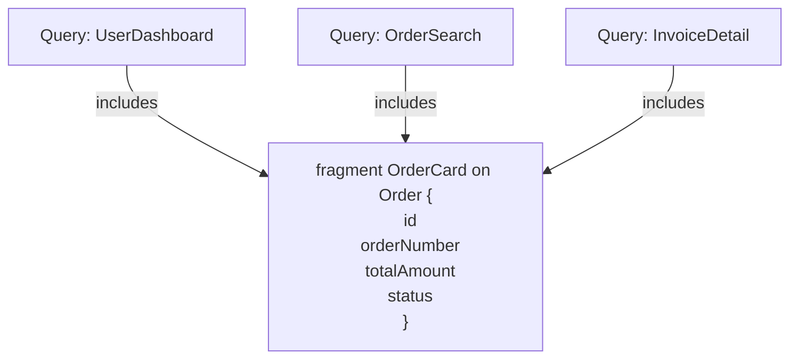
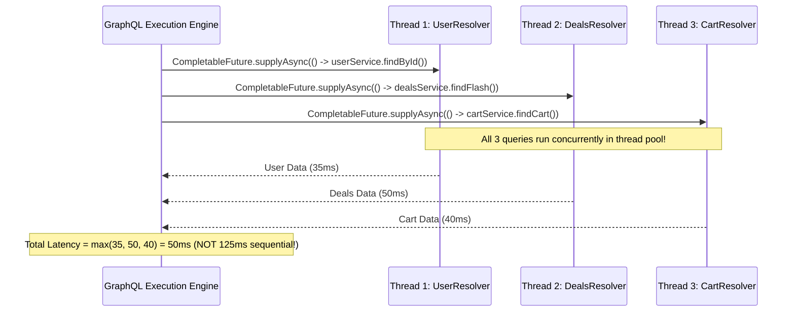

# Module 03: GraphQL Queries Deep Dive

Welcome to Module 03 of the **GraphQL Mastery Guide**. This module explores the client-side and server-side mechanics of **GraphQL Queries**, comparing them with Spring MVC REST controllers and examining how Spring for GraphQL executes selection sets, handles arguments, resolves fragments, and processes directives.

---

## 1. Basic Queries & Selection Sets

### 1.1 Simple Explanation
In Spring MVC REST, if you need an order's status and total, you issue a `GET /orders/101` and receive everything.
In GraphQL, you write a **Query** specifying only the exact fields you need. The requested fields are called the **Selection Set**.

```graphql
query GetOrderHeader {
    orderById(id: "101") {
        orderNumber
        totalAmount
        status
    }
}
```

### 1.2 REST Equivalent vs. GraphQL Comparison
#### Spring MVC REST Controller Equivalent:
To achieve identical flexibility in REST, you would need to implement dynamic filtering (e.g., using JSON:API or Jackson `@JsonFilter` / Squidb / JSON Path):

```java
// Spring MVC REST approach - rigid or complex custom filtering
@GetMapping("/orders/{id}")
public ResponseEntity<OrderDto> getOrder(
        @PathVariable Long id,
        @RequestParam(name = "fields", required = false) List<String> fields) {
    // Requires manual parsing of 'fields' query params or Jackson FilterProvider
    OrderDto dto = orderService.findById(id);
    return ResponseEntity.ok(dto);
}
```

#### Spring for GraphQL Controller Implementation:
```java
package com.upskill.graphql.controller;

import com.upskill.graphql.dto.OrderModels.OrderDto;
import com.upskill.graphql.service.OrderService;
import org.springframework.graphql.data.method.annotation.Argument;
import org.springframework.graphql.data.method.annotation.QueryMapping;
import org.springframework.stereotype.Controller;

@Controller
public class OrderQueryController {

    private final OrderService orderService;

    public OrderQueryController(OrderService orderService) {
        this.orderService = orderService;
    }

    /**
     * Maps to SDL:
     * type Query {
     *     orderById(id: ID!): Order
     * }
     */
    @QueryMapping
    public OrderDto orderById(@Argument Long id) {
        return orderService.findById(id);
    }
}
```
The Spring GraphQL execution engine automatically inspects the incoming Selection Set and discards any fields on `OrderDto` that were not requested before serializing to JSON.

---

## 2. Query Arguments & Type Validation

### 2.1 Simple & Complex Arguments
In GraphQL, **any field** at any level of the graph can take arguments, not just root fields.

#### SDL Definition:
```graphql
type Query {
    """
    Search orders with filtering, pagination and sorting arguments
    """
    orders(
        customerId: ID
        status: OrderStatus
        minTotal: BigDecimal
        limit: Int = 20
        offset: Int = 0
    ): [Order!]!
}

type Order {
    id: ID!
    orderNumber: String!
    totalAmount: BigDecimal!
    """
    Child field taking an argument: filter line items by category
    """
    lineItems(category: String): [LineItem!]!
}
```

### 2.2 Spring Boot Implementation with `@Argument`
```java
package com.upskill.graphql.controller;

import com.upskill.graphql.dto.OrderModels.LineItemDto;
import com.upskill.graphql.dto.OrderModels.OrderDto;
import com.upskill.graphql.dto.OrderModels.OrderStatus;
import com.upskill.graphql.service.OrderService;
import org.springframework.graphql.data.method.annotation.Argument;
import org.springframework.graphql.data.method.annotation.QueryMapping;
import org.springframework.graphql.data.method.annotation.SchemaMapping;
import org.springframework.stereotype.Controller;

import java.math.BigDecimal;
import java.util.List;

@Controller
public class AdvancedOrderQueryController {

    private final OrderService orderService;

    public AdvancedOrderQueryController(OrderService orderService) {
        this.orderService = orderService;
    }

    @QueryMapping
    public List<OrderDto> orders(
            @Argument(name = "customerId") Long customerId,
            @Argument(name = "status") OrderStatus status,
            @Argument(name = "minTotal") BigDecimal minTotal,
            @Argument(name = "limit") Integer limit,
            @Argument(name = "offset") Integer offset) {
        
        int pageSize = (limit != null) ? limit : 20;
        int pageOffset = (offset != null) ? offset : 0;
        
        return orderService.searchOrders(customerId, status, minTotal, pageSize, pageOffset);
    }

    @SchemaMapping(typeName = "Order", field = "lineItems")
    public List<LineItemDto> lineItems(OrderDto order, @Argument(name = "category") String category) {
        if (category == null || category.isBlank()) {
            return orderService.findLineItemsByOrderId(order.id());
        }
        return orderService.findLineItemsByOrderIdAndCategory(order.id(), category);
    }
}
```

---

## 3. Aliases: Renaming & Avoiding Result Key Collisions

### 3.1 Why Aliases Exist
What happens if a client needs to fetch **two different orders** in a single HTTP request?

#### The Problem: Key Collision
```graphql
# INVALID QUERY! Both return the JSON key "orderById"!
query GetTwoOrders {
    orderById(id: "101") {
        totalAmount
    }
    orderById(id: "202") {
        totalAmount
    }
}
```
Because JSON keys must be unique within an object, the GraphQL engine rejects this query with a validation error.

### 3.2 The Solution: Aliases
An **Alias** allows the client to rename any field in the response JSON by prefixing it with `customName:`:

```graphql
query GetTwoOrders {
    primaryOrder: orderById(id: "101") {
        orderNumber
        totalAmount
    }
    secondaryOrder: orderById(id: "202") {
        orderNumber
        totalAmount
    }
}
```

#### JSON Response Received by Client:
```json
{
  "data": {
    "primaryOrder": {
      "orderNumber": "ORD-101",
      "totalAmount": 150.00
    },
    "secondaryOrder": {
      "orderNumber": "ORD-202",
      "totalAmount": 420.50
    }
  }
}
```
**No backend code changes are required!** Spring for GraphQL automatically binds the alias to the JSON response map.

---

## 4. Fragments: The DRY (Don't Repeat Yourself) Principle

### 4.1 Simple Explanation
In frontend development (React / Next.js / Vue), a single UI component often requires a specific set of fields. A **Fragment** is a reusable selection set that can be shared across multiple queries.



### 4.2 Fragment Syntax & Spread Operator (`...FragmentName`)

```graphql
# 1. Define the reusable fragment
fragment OrderSummaryFields on Order {
    id
    orderNumber
    totalAmount
    status
    createdAt
}

# 2. Spread the fragment into queries
query GetCustomerDashboard($customerId: ID!) {
    recentOrders: ordersByCustomer(customerId: $customerId) {
        ...OrderSummaryFields
        lineItems {
            productSku
            quantity
        }
    }
    
    highlightedOrder: orderById(id: "999") {
        ...OrderSummaryFields
    }
}
```

---

## 5. Variables: Decoupling Query Structure from Runtime Data

### 5.1 Why You Must NEVER Concatenate Strings in GraphQL
In production applications, **never** build GraphQL queries using string interpolation:
```typescript
// ❌ SECURITY & PERFORMANCE ANTI-PATTERN!
const query = `{ orderById(id: "${userInputId}") { totalAmount } }`;
```
- **Security Vulnerability:** Vulnerable to GraphQL Injection if parameters are not sanitized.
- **Performance Degradation:** The GraphQL engine must re-parse and re-validate the AST every time the string changes. With variables, the AST is parsed once and cached in memory!

### 5.2 Enterprise Query with Typed Variables
A production GraphQL request separates the static query string from the dynamic variables:

#### 1. Query Document (`POST` body `query` property):
```graphql
query SearchCustomerOrders(
    $custId: ID!
    $orderStatus: OrderStatus = PENDING
    $pageSize: Int = 10
) {
    orders(
        customerId: $custId
        status: $orderStatus
        limit: $pageSize
    ) {
        id
        orderNumber
        totalAmount
    }
}
```

#### 2. Variables JSON Object (`POST` body `variables` property):
```json
{
  "custId": "CUST-4091",
  "orderStatus": "CONFIRMED",
  "pageSize": 25
}
```

---

## 6. Directives: Dynamic Conditional Selection

### 6.1 Built-in Directives: `@include` and `@skip`
GraphQL includes two built-in client directives that allow dynamic inclusion or omission of fields based on runtime boolean variables:

1. `@include(if: Boolean)`: Includes the field **only if** the argument is `true`.
2. `@skip(if: Boolean)`: Skips (omits) the field **if** the argument is `true`.

```graphql
query GetOrderDetails(
    $orderId: ID!
    $includeCustomerProfile: Boolean!
    $hideAuditTimestamps: Boolean!
) {
    orderById(id: $orderId) {
        id
        orderNumber
        totalAmount
        
        # Only fetch customer if the boolean flag is true
        customer @include(if: $includeCustomerProfile) {
            fullName
            email
        }
        
        # Skip audit timestamp if hideAuditTimestamps is true
        createdAt @skip(if: $hideAuditTimestamps)
    }
}
```

#### How Spring for GraphQL Processes Directives:
The directive is evaluated inside the **GraphQL Engine execution layer** before resolver dispatch:
- If `$includeCustomerProfile` is `false`, the engine removes the `customer` node from the AST execution plan.
- The `@SchemaMapping customer` resolver is **never invoked**, saving database trips completely.

---

## 7. Multiple Fields in a Single Query & Parallel Execution

### 7.1 Single Round-Trip Multi-Entity Query
A major strength of GraphQL is aggregating unrelated domain aggregates in a single network request:

```graphql
query GetECommerceHomeScreen($userId: ID!) {
    # 1. User Profile
    currentUser(id: $userId) {
        fullName
        loyaltyTier
    }
    
    # 2. Daily Flash Deals (Completely independent domain)
    flashDeals(limit: 5) {
        productSku
        discountPercentage
    }
    
    # 3. Cart Summary
    activeCart(userId: $userId) {
        itemCount
        estimatedTotal
    }
}
```

### 7.2 Under the Hood: Asynchronous Parallel Execution
In `graphql-java` and Spring Boot, root fields in a `Query` operation are executed **concurrently in parallel**:



---

## 8. Database Interaction & Hibernate SQL Output

Let us trace the SQL generated by Hibernate for the following nested query:

```graphql
query TraceDeepOrder {
    orderById(id: "501") {
        orderNumber
        totalAmount
        customer {
            fullName
        }
        lineItems {
            productSku
            quantity
        }
    }
}
```

### Step 1: Root Resolution (`@QueryMapping orderById`)
```sql
-- Executed by OrderRepository.findById(501L)
SELECT 
    o.id AS id1_1_0_,
    o.created_at AS created_2_1_0_,
    o.customer_id AS customer_5_1_0_,
    o.order_number AS order_nu3_1_0_,
    o.status AS status4_1_0_,
    o.total_amount AS total_am6_1_0_
FROM orders o 
WHERE o.id = 501;
```

### Step 2: Customer Resolution (`@SchemaMapping customer`)
The engine extracts `customer_id` from the parent `OrderDto` and invokes the customer data fetcher:
```sql
-- Executed by CustomerRepository.findById(order.customerId())
SELECT 
    c.id AS id1_0_0_,
    c.email AS email2_0_0_,
    c.full_name AS full_nam3_0_0_
FROM customers c 
WHERE c.id = 42;
```

### Step 3: Line Items Resolution (`@SchemaMapping lineItems`)
```sql
-- Executed by LineItemRepository.findByOrderId(order.id())
SELECT 
    li.id AS id1_2_0_,
    li.order_id AS order_id5_2_0_,
    li.product_sku AS product_2_2_0_,
    li.quantity AS quantity3_2_0_,
    li.unit_price AS unit_pri4_2_0_
FROM order_line_items li 
WHERE li.order_id = 501;
```

**Key Takeaway:** The database is queried in stages matching the tree traversal. Only the requested tables are touched.

---

## 9. Common Mistakes & Pitfalls

### Mistake 1: Client Query Injection via String Concatenation
```java
// ❌ WRONG: Passing raw user inputs directly into query strings
String query = "query { orderById(id: " + userInput + ") { id } }";
```
**Fix:** Always use parameterized GraphQL variables (`$id: ID!`).

### Mistake 2: Forgetting to Return Parent DTO Identity in Nested Queries
When creating nested `@SchemaMapping` resolvers, the parent method must return the foreign keys (e.g., `customerId`) in the parent DTO. If the parent DTO discards `customerId`, the child resolver has no ID to query!

### Mistake 3: Unbounded Selection Sets
Allowing clients to query unlimited nested levels (`order { customer { orders { customer { orders ... } } } }`) without configuring query depth limits.

---

## 10. Senior Interview Questions & Production Scenarios

### Question 1 (Basic): What is the purpose of Aliases in GraphQL?
**Answer:**
Aliases allow the client to assign a custom key name to a field in the response JSON. They are primarily used to:
1. Fetch the same field multiple times with different arguments in a single query (avoiding JSON key collisions).
2. Match the backend GraphQL field name to the naming conventions expected by frontend UI components.

---

### Question 2 (Intermediate): How do Directives (`@include`, `@skip`) improve backend performance in Spring Boot?
**Answer:**
Directives alter the Abstract Syntax Tree (AST) execution plan *before* field resolution occurs. If a field or relationship (e.g., `customer @include(if: $hasPermission)`) evaluates to `false`, the execution engine omits the node entirely from the resolution graph. As a result, the associated `@SchemaMapping` Java resolver method is never executed, completely eliminating the corresponding database query or downstream microservice call.

---

### Question 3 (Advanced): How does the concurrency model differ between a single GraphQL Query containing 5 root fields and a Mutation containing 5 root fields?
**Answer:**
In `graphql-java` and the GraphQL specification:
- **Queries:** Root fields are executed **concurrently in parallel** using asynchronous execution (`CompletableFuture`). If 5 root fields query 5 independent repositories or microservices, all 5 execute at the same time, bounded only by the application's thread pool executor.
- **Mutations:** Root fields are executed **strictly sequentially** in the exact order declared in the document. This serial execution guarantees ACID transaction isolation and prevents race conditions when multiple state changes depend on prior writes within the same HTTP payload.
