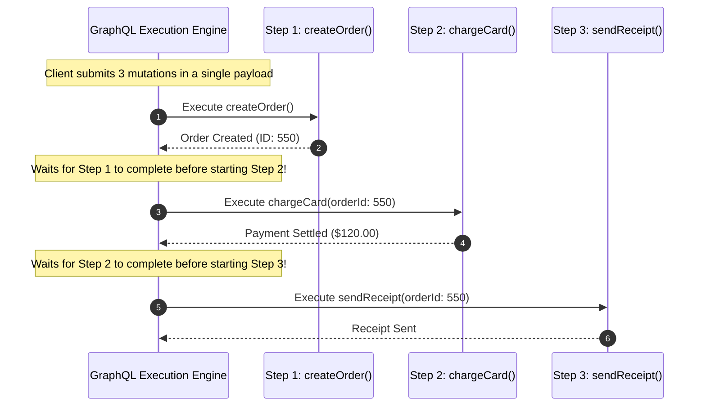
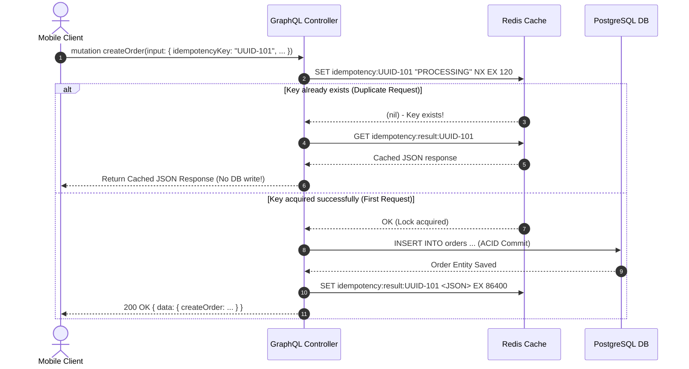

# Module 04: GraphQL Mutations & Transaction Semantics

Welcome to Module 04 of the **GraphQL Mastery Guide**. This module covers the implementation of state-modifying operations (**Mutations**) in **Spring Boot 3.x, Spring Data JPA, and PostgreSQL**. We explore transaction management, optimistic locking, idempotency with Redis, validation, and the Mutation Payload Design Pattern.

---

## 1. What Are Mutations?

### 1.1 Simple Explanation
In REST, you use HTTP verbs to modify state: `POST` to create, `PUT`/`PATCH` to update, and `DELETE` to remove.
In GraphQL, all state-modifying operations are explicitly declared under the root **`Mutation`** type. 

A mutation doesn't just perform a write; **it also asks the client what data should be returned immediately after the write completes**. This eliminates the secondary `GET` request typically required in REST.

```graphql
mutation PlaceNewOrder($input: CreateOrderInput!) {
    createOrder(input: $input) {
        id
        orderNumber
        status
        totalAmount
        customer {
            fullName
        }
    }
}
```

### 1.2 The Sequential Execution Guarantee
While root fields in a `Query` are executed concurrently in parallel, **root fields in a `Mutation` are guaranteed by the GraphQL specification to execute strictly serially (one after another)**.


This sequential guarantee prevents race conditions when multiple dependent state mutations are submitted in a single request.

---

## 2. The Mutation Payload Design Pattern (Enterprise Standard)

### 2.1 Why You Should NOT Return Entities Directly
A common beginner mistake is returning the domain entity directly from a mutation:
```graphql
# ❌ ANTI-PATTERN: Direct entity return
type Mutation {
    updateCustomer(id: ID!, input: UpdateInput!): Customer!
}
```
**Why this is fragile:**
1. **No room for operation metadata:** What if you need to return success flags, warnings, generated tokens, or business validation messages?
2. **Brittle error handling:** If an update fails due to a business rule (e.g., "Account suspended"), returning null or throwing an exception complicates client error parsing.

### 2.2 The Enterprise Solution: Dedicated Payload Objects
Every mutation should accept a single `input` argument and return a dedicated `Payload` type:

```graphql
type Mutation {
    createCustomer(input: CreateCustomerInput!): CreateCustomerPayload!
    updateCustomer(input: UpdateCustomerInput!): UpdateCustomerPayload!
    deleteCustomer(input: DeleteCustomerInput!): DeleteCustomerPayload!
}

input CreateCustomerInput {
    clientMutationId: String
    fullName: String!
    email: String!
    phoneNumber: String
}

type CreateCustomerPayload {
    clientMutationId: String
    customer: Customer
    success: Boolean!
    userErrors: [UserError!]!
}

type UserError {
    field: String
    message: String!
    code: String!
}
```

---

## 3. Complete CRUD Implementation with Spring Boot 3.x & PostgreSQL

Let us build an end-to-end enterprise CRUD implementation for Customer management, integrating **Jakarta Validation, Spring Data JPA, Hibernate, and Spring for GraphQL**.

### 3.1 PostgreSQL Database DDL
```sql
CREATE TABLE customers (
    id BIGSERIAL PRIMARY KEY,
    full_name VARCHAR(255) NOT NULL,
    email VARCHAR(255) NOT NULL UNIQUE,
    phone_number VARCHAR(50),
    status VARCHAR(50) NOT NULL DEFAULT 'ACTIVE',
    version BIGINT NOT NULL DEFAULT 0,
    created_at TIMESTAMP WITH TIME ZONE NOT NULL DEFAULT NOW(),
    updated_at TIMESTAMP WITH TIME ZONE NOT NULL DEFAULT NOW()
);

CREATE INDEX idx_customers_email ON customers (email);
```

### 3.2 JPA Entity with Optimistic Locking
```java
package com.upskill.graphql.customer.entity;

import jakarta.persistence.*;
import org.hibernate.annotations.CreationTimestamp;
import org.hibernate.annotations.UpdateTimestamp;

import java.time.Instant;

@Entity
@Table(name = "customers")
public class CustomerEntity {

    @Id
    @GeneratedValue(strategy = GenerationType.IDENTITY)
    private Long id;

    @Column(name = "full_name", nullable = false)
    private String fullName;

    @Column(name = "email", nullable = false, unique = true)
    private String email;

    @Column(name = "phone_number")
    private String phoneNumber;

    @Column(name = "status", nullable = false)
    private String status = "ACTIVE";

    /**
     * Optimistic locking counter. Hibernate increments this automatically on each UPDATE.
     * Prevents lost updates in concurrent environments!
     */
    @Version
    @Column(name = "version", nullable = false)
    private Long version;

    @CreationTimestamp
    @Column(name = "created_at", nullable = false, updatable = false)
    private Instant createdAt;

    @UpdateTimestamp
    @Column(name = "updated_at", nullable = false)
    private Instant updatedAt;

    public CustomerEntity() {}

    public CustomerEntity(String fullName, String email, String phoneNumber) {
        this.fullName = fullName;
        this.email = email;
        this.phoneNumber = phoneNumber;
    }

    // Getters and Setters omitted for brevity, standard Java bean conventions
    public Long getId() { return id; }
    public String getFullName() { return fullName; }
    public void setFullName(String fullName) { this.fullName = fullName; }
    public String getEmail() { return email; }
    public void setEmail(String email) { this.email = email; }
    public String getPhoneNumber() { return phoneNumber; }
    public void setPhoneNumber(String phoneNumber) { this.phoneNumber = phoneNumber; }
    public String getStatus() { return status; }
    public void setStatus(String status) { this.status = status; }
    public Long getVersion() { return version; }
    public Instant getCreatedAt() { return createdAt; }
    public Instant getUpdatedAt() { return updatedAt; }
}
```

### 3.3 Spring Data JPA Repository
```java
package com.upskill.graphql.customer.repository;

import com.upskill.graphql.customer.entity.CustomerEntity;
import org.springframework.data.jpa.repository.JpaRepository;
import org.springframework.stereotype.Repository;

import java.util.Optional;

@Repository
public interface CustomerRepository extends JpaRepository<CustomerEntity, Long> {
    boolean existsByEmail(String email);
    Optional<CustomerEntity> findByEmail(String email);
}
```

### 3.4 Inbound DTOs with Validation
```java
package com.upskill.graphql.customer.dto;

import jakarta.validation.constraints.Email;
import jakarta.validation.constraints.NotBlank;
import jakarta.validation.constraints.NotNull;
import jakarta.validation.constraints.Pattern;

public final class CustomerMutationInputs {
    private CustomerMutationInputs() {}

    public record CreateCustomerInput(
        String clientMutationId,

        @NotBlank(message = "Customer full name is required")
        String fullName,

        @NotBlank(message = "Email is required")
        @Email(message = "Invalid email format")
        String email,

        @Pattern(regexp = "^\\+?[1-9]\\d{1,14}$", message = "Invalid phone number")
        String phoneNumber
    ) {}

    public record UpdateCustomerInput(
        String clientMutationId,

        @NotNull(message = "Customer ID is required")
        Long customerId,

        @NotBlank(message = "Full name cannot be blank")
        String fullName,

        @Email(message = "Invalid email format")
        String email,

        String phoneNumber,

        @NotNull(message = "Expected version is required for concurrency control")
        Long expectedVersion
    ) {}

    public record DeleteCustomerInput(
        String clientMutationId,

        @NotNull(message = "Customer ID is required")
        Long customerId
    ) {}
}
```

### 3.5 Outbound Payload DTOs
```java
package com.upskill.graphql.customer.dto;

import java.time.Instant;
import java.util.Collections;
import java.util.List;

public final class CustomerPayloads {
    private CustomerPayloads() {}

    public record CustomerDto(
        Long id,
        String fullName,
        String email,
        String phoneNumber,
        String status,
        Long version,
        Instant createdAt
    ) {}

    public record UserError(String field, String message, String code) {}

    public record CreateCustomerPayload(
        String clientMutationId,
        CustomerDto customer,
        boolean success,
        List<UserError> userErrors
    ) {
        public static CreateCustomerPayload success(String mutationId, CustomerDto customer) {
            return new CreateCustomerPayload(mutationId, customer, true, Collections.emptyList());
        }

        public static CreateCustomerPayload error(String mutationId, String field, String msg, String code) {
            return new CreateCustomerPayload(mutationId, null, false, List.of(new UserError(field, msg, code)));
        }
    }

    public record UpdateCustomerPayload(
        String clientMutationId,
        CustomerDto customer,
        boolean success,
        List<UserError> userErrors
    ) {}

    public record DeleteCustomerPayload(
        String clientMutationId,
        Long deletedCustomerId,
        boolean success,
        List<UserError> userErrors
    ) {}
}
```

### 3.6 Transactional Service Layer
```java
package com.upskill.graphql.customer.service;

import com.upskill.graphql.customer.dto.CustomerMutationInputs.*;
import com.upskill.graphql.customer.dto.CustomerPayloads.*;
import com.upskill.graphql.customer.entity.CustomerEntity;
import com.upskill.graphql.customer.repository.CustomerRepository;
import org.springframework.orm.ObjectOptimisticLockingFailureException;
import org.springframework.stereotype.Service;
import org.springframework.transaction.annotation.Isolation;
import org.springframework.transaction.annotation.Propagation;
import org.springframework.transaction.annotation.Transactional;

import java.util.Collections;
import java.util.List;
import java.util.Objects;

@Service
public class CustomerServiceImpl implements CustomerService {

    private final CustomerRepository customerRepository;

    public CustomerServiceImpl(CustomerRepository customerRepository) {
        this.customerRepository = customerRepository;
    }

    @Override
    @Transactional(propagation = Propagation.REQUIRED, isolation = Isolation.READ_COMMITTED)
    public CreateCustomerPayload createCustomer(CreateCustomerInput input) {
        if (customerRepository.existsByEmail(input.email())) {
            return CreateCustomerPayload.error(
                input.clientMutationId(),
                "email",
                "Email address is already registered",
                "DUPLICATE_EMAIL"
            );
        }

        CustomerEntity entity = new CustomerEntity(
            input.fullName(),
            input.email(),
            input.phoneNumber()
        );

        CustomerEntity saved = customerRepository.save(entity);
        return CreateCustomerPayload.success(input.clientMutationId(), toDto(saved));
    }

    @Override
    @Transactional(propagation = Propagation.REQUIRED, isolation = Isolation.READ_COMMITTED)
    public UpdateCustomerPayload updateCustomer(UpdateCustomerInput input) {
        CustomerEntity entity = customerRepository.findById(input.customerId())
            .orElse(null);

        if (entity == null) {
            return new UpdateCustomerPayload(
                input.clientMutationId(),
                null,
                false,
                List.of(new UserError("customerId", "Customer not found", "NOT_FOUND"))
            );
        }

        // Verify Optimistic Lock Version
        if (!Objects.equals(entity.getVersion(), input.expectedVersion())) {
            return new UpdateCustomerPayload(
                input.clientMutationId(),
                null,
                false,
                List.of(new UserError(
                    "expectedVersion",
                    "Record was updated by another transaction. Please reload.",
                    "CONCURRENT_MODIFICATION"
                ))
            );
        }

        entity.setFullName(input.fullName());
        if (input.email() != null && !input.email().equalsIgnoreCase(entity.getEmail())) {
            if (customerRepository.existsByEmail(input.email())) {
                return new UpdateCustomerPayload(
                    input.clientMutationId(),
                    null,
                    false,
                    List.of(new UserError("email", "Email already in use", "DUPLICATE_EMAIL"))
                );
            }
            entity.setEmail(input.email());
        }
        entity.setPhoneNumber(input.phoneNumber());

        CustomerEntity updated = customerRepository.save(entity);
        return new UpdateCustomerPayload(input.clientMutationId(), toDto(updated), true, Collections.emptyList());
    }

    @Override
    @Transactional
    public DeleteCustomerPayload deleteCustomer(DeleteCustomerInput input) {
        if (!customerRepository.existsById(input.customerId())) {
            return new DeleteCustomerPayload(
                input.clientMutationId(),
                input.customerId(),
                false,
                List.of(new UserError("customerId", "Customer does not exist", "NOT_FOUND"))
            );
        }

        customerRepository.deleteById(input.customerId());
        return new DeleteCustomerPayload(input.clientMutationId(), input.customerId(), true, Collections.emptyList());
    }

    private CustomerDto toDto(CustomerEntity entity) {
        return new CustomerDto(
            entity.getId(),
            entity.getFullName(),
            entity.getEmail(),
            entity.getPhoneNumber(),
            entity.getStatus(),
            entity.getVersion(),
            entity.getCreatedAt()
        );
    }
}
```

### 3.7 Spring GraphQL Mutation Controller
```java
package com.upskill.graphql.customer.controller;

import com.upskill.graphql.customer.dto.CustomerMutationInputs.*;
import com.upskill.graphql.customer.dto.CustomerPayloads.*;
import com.upskill.graphql.customer.service.CustomerService;
import jakarta.validation.Valid;
import org.springframework.graphql.data.method.annotation.Argument;
import org.springframework.graphql.data.method.annotation.MutationMapping;
import org.springframework.stereotype.Controller;

@Controller
public class CustomerMutationController {

    private final CustomerService customerService;

    public CustomerMutationController(CustomerService customerService) {
        this.customerService = customerService;
    }

    @MutationMapping
    public CreateCustomerPayload createCustomer(@Argument @Valid CreateCustomerInput input) {
        return customerService.createCustomer(input);
    }

    @MutationMapping
    public UpdateCustomerPayload updateCustomer(@Argument @Valid UpdateCustomerInput input) {
        return customerService.updateCustomer(input);
    }

    @MutationMapping
    public DeleteCustomerPayload deleteCustomer(@Argument @Valid DeleteCustomerInput input) {
        return customerService.deleteCustomer(input);
    }
}
```

---

## 4. Mutation Idempotency with Redis

### 4.1 The Double-Submit Problem
In mobile networks, a user taps "Pay Now". The phone sends the GraphQL mutation `createOrder`. The server processes the payment and writes to PostgreSQL. However, before the HTTP `200 OK` response reaches the mobile phone, the cell tower connection drops.
The mobile app automatically retries the request 3 seconds later. 
**Without idempotency, the customer is charged twice.**

### 4.2 Idempotency Filter Pattern using Redis `SETNX`


---

## 5. Database Interaction & Hibernate SQL Output

When `updateCustomer` is executed with optimistic locking:

```sql
-- Step 1: Read current record including current version
SELECT 
    c.id, c.full_name, c.email, c.phone_number, c.status, c.version, c.created_at, c.updated_at
FROM customers c 
WHERE c.id = 1;

-- Step 2: Update with version predicate
UPDATE customers 
SET 
    full_name = 'Alice Smith',
    email = 'alice.new@example.com',
    phone_number = '+1234567890',
    version = version + 1,
    updated_at = NOW()
WHERE id = 1 AND version = 0;  -- <-- Version check guarantees no dirty write!
```
If another transaction updated the record concurrently, `version` is already `1`. The `UPDATE` modifies 0 rows, and Hibernate immediately throws `ObjectOptimisticLockingFailureException`.

---

## 6. Common Mistakes & Pitfalls

### Mistake 1: Relying on Parallel Execution for Mutations
Assuming mutations run concurrently like queries. Root mutation fields **always run serially**.

### Mistake 2: Missing Optimistic Locking
Updating records without `@Version` fields leads to the "Lost Update Problem" in concurrent environments.

### Mistake 3: Throwing Unchecked Exceptions for Expected Business Violations
Throwing a raw `RuntimeException("Email already exists")` crashes the resolver and creates generic `INTERNAL_ERROR` responses.
**Fix:** Use the Payload pattern with `userErrors: [UserError!]!` for expected business validation failures, reserving exceptions for unexpected infrastructure crashes.

---

## 7. Senior Interview Questions & Production Scenarios

### Question 1 (Basic): Why does GraphQL guarantee serial execution for Mutations but parallel execution for Queries?
**Answer:**
Queries are side-effect-free read operations; running them concurrently maximizes throughput. Mutations perform state-modifying writes (inserts, updates, financial charges). If multiple mutations within a single request executed in parallel, non-deterministic race conditions would occur (e.g., executing `transferFunds` and `closeAccount` concurrently). Serial execution guarantees deterministic transaction ordering.

---

### Question 2 (Intermediate): How does the Mutation Payload pattern improve client cache synchronization?
**Answer:**
Client-side GraphQL caches (Apollo Client, Relay) maintain a normalized in-memory graph where objects are indexed by their unique compound key `__typename:id`. When a mutation returns the updated entity within its payload (e.g., `UpdateCustomerPayload.customer`), the client cache automatically intercepts the updated attributes and updates every UI component viewing that customer across the entire application—without requiring manual cache invalidation or re-querying.

---

### Question 3 (Advanced): How do you implement robust idempotency for financial GraphQL mutations in a distributed Spring Boot cluster?
**Answer:**
Idempotency requires:
1. An explicit client-supplied `idempotencyKey: String!` in the mutation input.
2. In the service/resolver layer, before executing any logic, execute a Redis atomic `SET key "IN_PROGRESS" NX EX 120`.
3. If `SET` returns false, poll or read `key:response` from Redis. If the transaction already completed, return the cached payload immediately.
4. If `SET` succeeds, execute the mutation within a `@Transactional` boundary in PostgreSQL.
5. Upon successful commit, store the response payload in Redis (`SET key:response <payload> EX 86400`) and release the lock.
