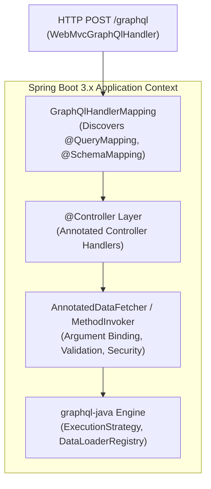
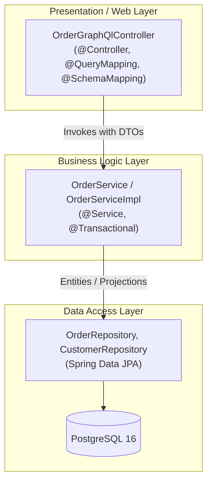

# Module 05: Spring Boot 3.x for GraphQL Deep Dive

Welcome to Module 05 of the **GraphQL Mastery Guide**. This module provides a master-level technical deep dive into **Spring for GraphQL** (introduced in Spring Boot 2.7 and refined in Spring Boot 3.x), which bridges the low-level `graphql-java` execution engine with the declarative, annotation-driven programming model of Spring.

---

## 1. Architectural Foundation: Spring for GraphQL vs. Low-Level `graphql-java`

### 1.1 The Evolution of GraphQL in Java
Before Spring for GraphQL, Java developers had to write manual `DataFetcher<T>` classes and wire them using verbose procedural code:

```java
// ❌ Legacy manual graphql-java wiring (Pre-Spring GraphQL)
RuntimeWiring wiring = RuntimeWiring.newRuntimeWiring()
    .type("Query", typeWiring -> typeWiring
        .dataFetcher("orderById", new DataFetcher<Order>() {
            @Override
            public Order get(DataFetchingEnvironment env) {
                Long id = Long.valueOf(env.getArgument("id"));
                return orderService.findById(id);
            }
        }))
    .build();
```
**Spring for GraphQL replaces this imperative boilerplate with declarative Spring MVC-style annotations** (`@Controller`, `@QueryMapping`, `@SchemaMapping`, `@BatchMapping`), while preserving full access to the underlying `graphql-java` engine.



---

## 2. Project Setup & Dependency Configuration

### 2.1 Complete Enterprise `pom.xml`

```xml
<?xml version="1.0" encoding="UTF-8"?>
<project xmlns="http://maven.apache.org/POM/4.0.0"
         xmlns:xsi="http://www.w3.org/2001/XMLSchema-instance"
         xsi:schemaLocation="http://maven.apache.org/POM/4.0.0 
         https://maven.apache.org/xsd/maven-4.0.0.xsd">
    <modelVersion>4.0.0</modelVersion>
    <parent>
        <groupId>org.springframework.boot</groupId>
        <artifactId>spring-boot-starter-parent</artifactId>
        <version>3.3.2</version>
        <relativePath/>
    </parent>

    <groupId>com.upskill.graphql</groupId>
    <artifactId>spring-graphql-integration</artifactId>
    <version>1.0.0-SNAPSHOT</version>
    <name>spring-graphql-integration</name>

    <properties>
        <java.version>17</java.version>
        <graphql-extended-scalars.version>22.0</graphql-extended-scalars.version>
    </properties>

    <dependencies>
        <!-- Spring for GraphQL Starter -->
        <dependency>
            <groupId>org.springframework.boot</groupId>
            <artifactId>spring-boot-starter-graphql</artifactId>
        </dependency>

        <!-- WebMVC Transport -->
        <dependency>
            <groupId>org.springframework.boot</groupId>
            <artifactId>spring-boot-starter-web</artifactId>
        </dependency>

        <!-- WebSocket Transport (for Subscriptions) -->
        <dependency>
            <groupId>org.springframework.boot</groupId>
            <artifactId>spring-boot-starter-websocket</artifactId>
        </dependency>

        <!-- Spring Data JPA & PostgreSQL -->
        <dependency>
            <groupId>org.springframework.boot</groupId>
            <artifactId>spring-boot-starter-data-jpa</artifactId>
        </dependency>
        <dependency>
            <groupId>org.postgresql</groupId>
            <artifactId>postgresql</artifactId>
            <scope>runtime</scope>
        </dependency>

        <!-- Jakarta Bean Validation -->
        <dependency>
            <groupId>org.springframework.boot</groupId>
            <artifactId>spring-boot-starter-validation</artifactId>
        </dependency>

        <!-- Extended Scalars (DateTime, BigDecimal, UUID) -->
        <dependency>
            <groupId>com.graphql-java</groupId>
            <artifactId>graphql-java-extended-scalars</artifactId>
            <version>${graphql-extended-scalars.version}</version>
        </dependency>

        <!-- Spring Security & JWT -->
        <dependency>
            <groupId>org.springframework.boot</groupId>
            <artifactId>spring-boot-starter-security</artifactId>
        </dependency>
        <dependency>
            <groupId>org.springframework.boot</groupId>
            <artifactId>spring-boot-starter-oauth2-resource-server</artifactId>
        </dependency>

        <!-- Testing -->
        <dependency>
            <groupId>org.springframework.boot</groupId>
            <artifactId>spring-boot-starter-test</artifactId>
            <scope>test</scope>
        </dependency>
        <dependency>
            <groupId>org.springframework.graphql</groupId>
            <artifactId>spring-graphql-test</artifactId>
            <scope>test</scope>
        </dependency>
    </dependencies>
</project>
```

### 2.2 Production `application.yml` Configuration

```yaml
server:
  port: 8080
  compression:
    enabled: true
    mime-types: application/json,application/graphql-response+json

spring:
  application:
    name: enterprise-graphql-service

  datasource:
    url: jdbc:postgresql://localhost:5432/enterprise_db
    username: postgres
    password: postgrespassword
    hikari:
      maximum-pool-size: 20
      minimum-idle: 5
      idle-timeout: 30000
      connection-timeout: 20000

  jpa:
    open-in-view: false  # CRITICAL: Always disable OSIV to prevent silent DB leaks!
    hibernate:
      ddl-auto: validate
    show-sql: false
    properties:
      hibernate:
        format_sql: false
        jdbc:
          batch_size: 50

  graphql:
    path: /graphql
    graphiql:
      enabled: true     # Enable in DEV; set to false in PROD
      path: /graphiql
    schema:
      locations: classpath:graphql/**/
      file-extensions: .graphqls, .gqls
      printer:
        enabled: true
      inspection:
        # Fails application startup if SDL fields lack matching Java data fetchers!
        enabled: true
    websocket:
      path: /graphql
      connection-init-timeout: 60s
      keep-alive: 30s
```

> [!CRITICAL]
> **Why `spring.jpa.open-in-view=false` is Mandatory in GraphQL:**
> Open-In-View (OSIV) keeps the database connection open throughout the entire HTTP request lifecycle. In GraphQL, where resolvers can execute across multiple asynchronous thread pools, OSIV causes connection pool starvation and masks lazy-initialization bugs that should be solved with proper batching!

---

## 3. Schema Organization & Modular SDL Files

Spring for GraphQL automatically scans `src/main/resources/graphql/` recursively. You should split your domain into clean, cohesive modules:

```text
src/main/resources/graphql/
├── schema.graphqls          # Root Operation types (Query, Mutation, Subscription)
├── common/
│   ├── directives.graphqls  # Custom directives
│   └── scalars.graphqls     # Custom scalars (DateTime, BigDecimal, UUID)
├── customer/
│   ├── customer.graphqls    # Customer Object, Enums, Inputs
│   └── customer-ops.graphqls# Extend Type Query & Mutation
└── order/
    ├── order.graphqls       # Order, LineItem types
    └── order-ops.graphqls   # Extend Type Query & Mutation
```

### Using Type Extensions (`extend type Query`):
```graphql
# customer/customer-ops.graphqls
extend type Query {
    customerById(id: ID!): Customer
    searchCustomers(keyword: String!): [Customer!]!
}

extend type Mutation {
    createCustomer(input: CreateCustomerInput!): Customer!
}
```

---

## 4. Master-Level Annotations Deep Dive

### 4.1 `@QueryMapping`
Maps a Spring controller method directly to a field under the root `Query` type.
- **Convention:** The method name must match the SDL field name unless overridden via `@QueryMapping(name = "customFieldName")`.

### 4.2 `@MutationMapping`
Maps a method directly to a field under the root `Mutation` type.
- Guarantees sequential execution if multiple root mutations are included in the request.

### 4.3 `@SchemaMapping` (The Engine Core)
Connects a Java resolver method to **any arbitrary type and field** in the schema.
- **`typeName`:** The GraphQL Object type (e.g., `Order`, `Customer`). Defaults to the method's first parameter type simple name if omitted.
- **`field`:** The field name on that type. Defaults to the method name.

```java
// Resolves Order.customer: Customer!
@SchemaMapping(typeName = "Order", field = "customer")
public CustomerDto customer(OrderDto order) {
    return customerService.findById(order.customerId());
}
```

### 4.4 `@Argument`
Binds a named GraphQL query or mutation argument to a Java method parameter.
- Supports automatic type conversion (e.g., GraphQL `ID` string converted to Java `Long` or `UUID`).
- Integrates with Jakarta Bean Validation (`@Valid`, `@NotNull`, `@Min`).

### 4.5 `@BatchMapping` (The Modern DataLoader)
Solves the $N+1$ query problem with a single annotation, replacing verbose manual `DataLoader` registration. (Fully explored in [Module 6](./06-database-and-optimization.md)).

```java
@BatchMapping(typeName = "Order", field = "customer")
public Map<OrderDto, CustomerDto> customer(List<OrderDto> orders) {
    return customerService.batchLoadCustomersForOrders(orders);
}
```

---

## 5. Complete Layered Architecture Implementation

Let us build a complete, production-grade Spring Boot GraphQL micro-system for an e-commerce Catalog and Order service.



### 5.1 Entities (JPA Domain Model)

```java
package com.upskill.graphql.domain.entity;

import jakarta.persistence.*;
import java.math.BigDecimal;
import java.time.Instant;
import java.util.ArrayList;
import java.util.List;

@Entity
@Table(name = "orders")
public class OrderEntity {

    @Id
    @GeneratedValue(strategy = GenerationType.IDENTITY)
    private Long id;

    @Column(name = "order_number", nullable = false, unique = true)
    private String orderNumber;

    @Column(name = "total_amount", nullable = false)
    private BigDecimal totalAmount;

    @Column(name = "customer_id", nullable = false)
    private Long customerId;

    @Column(name = "status", nullable = false)
    private String status;

    @Column(name = "created_at", nullable = false, updatable = false)
    private Instant createdAt = Instant.now();

    @OneToMany(mappedBy = "order", cascade = CascadeType.ALL, orphanRemoval = true, fetch = FetchType.LAZY)
    private List<LineItemEntity> lineItems = new ArrayList<>();

    // Standard constructor, getters, setters
    public Long getId() { return id; }
    public String getOrderNumber() { return orderNumber; }
    public BigDecimal getTotalAmount() { return totalAmount; }
    public Long getCustomerId() { return customerId; }
    public String getStatus() { return status; }
    public Instant getCreatedAt() { return createdAt; }
    public List<LineItemEntity> getLineItems() { return lineItems; }
}
```

### 5.2 Clean DTOs (Java 17+ Records)

```java
package com.upskill.graphql.domain.dto;

import java.math.BigDecimal;
import java.time.Instant;
import java.util.List;

public final class CatalogDtos {
    private CatalogDtos() {}

    public record OrderDto(
        Long id,
        String orderNumber,
        BigDecimal totalAmount,
        Long customerId,
        String status,
        Instant createdAt
    ) {}

    public record CustomerDto(
        Long id,
        String fullName,
        String email,
        String tier
    ) {}

    public record LineItemDto(
        Long id,
        String productSku,
        BigDecimal unitPrice,
        Integer quantity
    ) {}
}
```

### 5.3 Spring Data JPA Repositories

```java
package com.upskill.graphql.domain.repository;

import com.upskill.graphql.domain.entity.OrderEntity;
import org.springframework.data.jpa.repository.JpaRepository;
import org.springframework.data.jpa.repository.Query;
import org.springframework.data.repository.query.Param;
import org.springframework.stereotype.Repository;

import java.util.List;

@Repository
public interface OrderRepository extends JpaRepository<OrderEntity, Long> {
    
    List<OrderEntity> findByCustomerId(Long customerId);

    @Query("SELECT o FROM OrderEntity o WHERE o.status = :status")
    List<OrderEntity> findByStatus(@Param("status") String status);
}
```

### 5.4 Production Controller Implementation

```java
package com.upskill.graphql.controller;

import com.upskill.graphql.domain.dto.CatalogDtos.CustomerDto;
import com.upskill.graphql.domain.dto.CatalogDtos.LineItemDto;
import com.upskill.graphql.domain.dto.CatalogDtos.OrderDto;
import com.upskill.graphql.service.CustomerService;
import com.upskill.graphql.service.OrderService;
import org.springframework.graphql.data.method.annotation.Argument;
import org.springframework.graphql.data.method.annotation.BatchMapping;
import org.springframework.graphql.data.method.annotation.QueryMapping;
import org.springframework.graphql.data.method.annotation.SchemaMapping;
import org.springframework.stereotype.Controller;

import java.util.List;
import java.util.Map;
import java.util.Objects;

@Controller
public class EnterpriseOrderController {

    private final OrderService orderService;
    private final CustomerService customerService;

    public EnterpriseOrderController(OrderService orderService, CustomerService customerService) {
        this.orderService = Objects.requireNonNull(orderService);
        this.customerService = Objects.requireNonNull(customerService);
    }

    @QueryMapping
    public OrderDto orderById(@Argument Long id) {
        return orderService.findById(id);
    }

    @QueryMapping
    public List<OrderDto> ordersByStatus(@Argument String status) {
        return orderService.findByStatus(status);
    }

    /**
     * Resolves single-order customer relationship when NOT batched
     */
    @SchemaMapping(typeName = "Order", field = "customer")
    public CustomerDto customer(OrderDto order) {
        return customerService.findById(order.customerId());
    }

    /**
     * Resolves line items for a given order lazily
     */
    @SchemaMapping(typeName = "Order", field = "lineItems")
    public List<LineItemDto> lineItems(OrderDto order) {
        return orderService.findLineItemsByOrderId(order.id());
    }
}
```

---

## 6. Global Exception Handling with `@GraphQlExceptionHandler`

In Spring for GraphQL, unhandled runtime exceptions are intercepted by `DataFetcherExceptionResolver`. Spring 3.x provides the `@GraphQlExceptionHandler` annotation, mimicking Spring MVC's `@ExceptionHandler`.

```java
package com.upskill.graphql.exception;

import graphql.GraphQLError;
import graphql.GraphqlErrorBuilder;
import graphql.schema.DataFetchingEnvironment;
import jakarta.persistence.EntityNotFoundException;
import org.springframework.graphql.data.method.annotation.GraphQlExceptionHandler;
import org.springframework.graphql.execution.ErrorType;
import org.springframework.web.bind.annotation.ControllerAdvice;

import java.util.Map;

@ControllerAdvice
public class GlobalGraphQlExceptionHandler {

    @GraphQlExceptionHandler
    public GraphQLError handleEntityNotFound(EntityNotFoundException ex, DataFetchingEnvironment env) {
        return GraphqlErrorBuilder.newError(env)
                .errorType(ErrorType.NOT_FOUND)
                .message(ex.getMessage())
                .extensions(Map.of(
                        "errorCode", "RESOURCE_NOT_FOUND",
                        "field", env.getField().getName()
                ))
                .build();
    }

    @GraphQlExceptionHandler
    public GraphQLError handleIllegalArgument(IllegalArgumentException ex, DataFetchingEnvironment env) {
        return GraphqlErrorBuilder.newError(env)
                .errorType(ErrorType.BAD_REQUEST)
                .message(ex.getMessage())
                .extensions(Map.of(
                        "errorCode", "INVALID_INPUT_ARGUMENT"
                ))
                .build();
    }
}
```

---

## 7. Common Mistakes & Pitfalls

### Mistake 1: Keeping Spring Open-Session-In-View (OSIV) Enabled
Leaving `spring.jpa.open-in-view=true` causes Hibernate to hold database connections open across the entire GraphQL execution tree, exhausting database connection pools under concurrent load. Always set `spring.jpa.open-in-view=false`.

### Mistake 2: Returning JPA Entities Directly from Resolvers
Returning JPA entities directly into the GraphQL engine allows Jackson or GraphQL reflection to accidentally trigger lazy-loaded collections outside a transaction, throwing `LazyInitializationException`. Always return immutable DTOs / Records.

### Mistake 3: Mismatched Parameter Names in `@Argument`
If your Java method parameter name does not match the SDL argument name (e.g., SDL has `id: ID!` but Java method has `Long orderId`), you must specify `@Argument(name = "id") Long orderId`.

---

## 8. Senior Interview Questions & Production Scenarios

### Question 1 (Basic): What is the difference between `@QueryMapping` and `@SchemaMapping` in Spring for GraphQL?
**Answer:**
`@QueryMapping` is a specialized convenience annotation that binds a controller method specifically to a field on the root `Query` type. 
`@SchemaMapping` is the fundamental, generalized mapping annotation that can bind a resolver method to **any type** in the schema (e.g., `@SchemaMapping(typeName = "Order", field = "customer")`). In fact, `@QueryMapping` is meta-annotated with `@SchemaMapping(typeName = "Query")`.

---

### Question 2 (Intermediate): What happens if a field defined in `schema.graphqls` has no matching `@SchemaMapping` method or Java getter?
**Answer:**
By default, the `graphql-java` engine uses `PropertyDataFetcher`, which looks for a matching Java getter method (e.g., `getCustomer()` or `customer()`) on the source object. 
If no method exists and `spring.graphql.schema.inspection.enabled=true` is set, Spring Boot throws a `SchemaProblemException` at application startup, failing the build immediately. If inspection is disabled, queries requesting that field return `null` and log a reflection resolution warning.

---

### Question 3 (Advanced): How does Spring for GraphQL propagate the Spring `SecurityContext` to child `@SchemaMapping` resolvers that execute asynchronously?
**Answer:**
Spring for GraphQL uses `ThreadLocalAccessor` (from the `io.micrometer.context-propagation` library). When the engine dispatches a field resolution to a worker thread or reactive pipeline, Spring's `SecurityContextThreadLocalAccessor` extracts the `SecurityContext` from the initiating HTTP thread, snapshots it, and restores it on the target worker thread before executing the resolver. This allows method security annotations (`@PreAuthorize`) to function seamlessly across all levels of the nested GraphQL execution tree.
