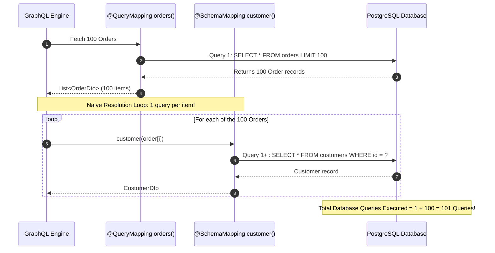

# Module 06: Database Integration & Eliminating the N+1 Query Problem

Welcome to Module 06 of the **GraphQL Mastery Guide**. This is arguably the most critical technical module for any Java backend engineer building GraphQL APIs. We deconstruct the infamous **N+1 Query Problem**, examine the internal mechanics of `DataLoader`, master Spring Boot's modern `@BatchMapping`, and optimize **Hibernate 6.x and PostgreSQL** query execution.

---

## 1. The N+1 Query Problem Explained

### 1.1 Simple Explanation
Imagine a teacher who has a list of 50 students and needs to find out each student's home address.
- **The Inefficient Way (N+1):** The teacher walks up to the school registry and asks for the list of 50 students (Query 1). Then, the teacher walks back to the registry 50 separate times, asking for one student's address on each trip (Queries 2 through 51). Total trips = $1 + 50 = 51$.
- **The Batched Way (DataLoader):** The teacher gets the list of 50 students (Query 1), writes down all 50 student IDs on a single sheet of paper, walks to the registry once, and says: *"Give me the addresses for IDs (101, 102, 103... 150) in one batch"* (Query 2). Total trips = $1 + 1 = 2$.

### 1.2 Mathematical & Architectural Anatomy
In a GraphQL system, when a client requests a list of parent entities along with a nested child relationship:

```graphql
query GetAllOrdersWithCustomers {
    orders(limit: 100) {
        id
        totalAmount
        customer {
            fullName
            email
        }
    }
}
```



If 100 orders are returned:
- **1 query** fetches the orders.
- **100 individual queries** fetch each order's customer.
- **Total:** $1 + N = 101$ database round-trips! Under concurrent user traffic, this exhausts connection pools, saturates database CPU, and spikes API latency from 20ms to 2,500ms.

---

## 2. Inefficient vs. Optimized Hibernate SQL Side-by-Side

Let us observe the actual SQL statements generated by Hibernate in both architectures:

### 2.1 The Inefficient Implementation (Naive `@SchemaMapping`)
```java
// ❌ ANTI-PATTERN: Triggers 1 + N SQL queries!
@SchemaMapping(typeName = "Order", field = "customer")
public CustomerDto customer(OrderDto order) {
    return customerRepository.findById(order.customerId())
            .map(this::toDto)
            .orElse(null);
}
```

#### Actual SQL Generated in PostgreSQL:
```sql
-- Query 1 (Root Orders)
SELECT o.id, o.order_number, o.total_amount, o.customer_id FROM orders o LIMIT 100;

-- Queries 2 through 101 (Fired sequentially or in thread burst!)
SELECT c.id, c.full_name, c.email FROM customers c WHERE c.id = 1;
SELECT c.id, c.full_name, c.email FROM customers c WHERE c.id = 2;
SELECT c.id, c.full_name, c.email FROM customers c WHERE c.id = 3;
...
SELECT c.id, c.full_name, c.email FROM customers c WHERE c.id = 100;
```

---

### 2.2 The Optimized Implementation (`@BatchMapping`)
```java
// ✅ PRODUCTION STANDARD: Automatically batched into 1 SQL query!
@BatchMapping(typeName = "Order", field = "customer")
public Map<OrderDto, CustomerDto> customer(List<OrderDto> orders) {
    List<Long> customerIds = orders.stream()
            .map(OrderDto::customerId)
            .distinct()
            .toList();

    Map<Long, CustomerDto> customerById = customerRepository.findAllById(customerIds)
            .stream()
            .collect(Collectors.toMap(CustomerEntity::getId, this::toDto));

    return orders.stream()
            .collect(Collectors.toMap(
                    order -> order,
                    order -> customerById.get(order.customerId())
            ));
}
```

#### Actual SQL Generated in PostgreSQL:
```sql
-- Query 1 (Root Orders)
SELECT o.id, o.order_number, o.total_amount, o.customer_id FROM orders o LIMIT 100;

-- Query 2 (Batched Customer Fetch with IN Predicate)
SELECT c.id, c.full_name, c.email 
FROM customers c 
WHERE c.id IN (1, 2, 3, 4, 5, ..., 100);
```
**Database round-trips reduced from 101 to exactly 2.**

---

## 3. DataLoader Internals: How Batching Works Behind the Scenes

`DataLoader` was originally written in JavaScript by Lee Byron (Facebook) and ported to Java in `graphql-java`. Understanding its internal state machine is essential for senior backend engineers.

```mermaid
flowchart TD
    subgraph ExecutionFrame["GraphQL Level Execution Frame"]
        Order1["Order 1\n(customerId: 10)"] -->|dataLoader.load(10)| Queue["DataLoader Internal Queue\n[10, 20, 10, 30]"]
        Order2["Order 2\n(customerId: 20)"] -->|dataLoader.load(20)| Queue
        Order3["Order 3\n(customerId: 10)"] -->|dataLoader.load(10)| Queue
        Order4["Order 4\n(customerId: 30)"] -->|dataLoader.load(30)| Queue
    end

    subgraph DispatchPhase["Dispatch Execution Phase"]
        Queue --> Dedupe["Deduplication & Keys Extraction\nDistinct Keys: [10, 20, 30]"]
        Dedupe --> BatchFunc["BatchLoaderFunction.load([10, 20, 30])"]
        BatchFunc --> SingleSQL["SELECT * FROM customers WHERE id IN (10, 20, 30)"]
    end

    SingleSQL --> Distribute["Resolve CompletableFutures\nMap results back to Order 1, 2, 3, 4"]
```

### The 4 Phases of DataLoader Execution:
1. **Queuing (`load(K key)`):** When a resolver needs a customer, it does not query the database. Instead, it calls `dataLoader.load(key)` which returns a Java `CompletableFuture<V>` and enqueues the key in an internal buffer.
2. **Deduplication:** DataLoader deduplicates keys automatically. If 20 orders belong to the same `customerId: 10`, `10` is added to the batch list only once.
3. **Dispatch:** When the GraphQL execution engine finishes evaluating the current level of the AST tree, it triggers `dataLoader.dispatch()`.
4. **Batch Execution & Promise Resolution:** The registered `BatchLoader` function executes a single database query with the deduplicated keys. When the result returns, DataLoader completes each individual `CompletableFuture` with its matching object.

---

## 4. Spring Boot 3.x `@BatchMapping` Deep Dive

Spring for GraphQL provides `@BatchMapping`, which transparently creates and manages `DataLoader` instances without requiring you to manually register them in `DataLoaderRegistry`.

### 4.1 Return Type Variations for `@BatchMapping`

Spring supports three primary return signatures for `@BatchMapping`:

#### Option A: Returning `Map<K, V>` (Most Explicit & Safe)
```java
@BatchMapping(typeName = "Order", field = "customer")
public Map<OrderDto, CustomerDto> customer(List<OrderDto> orders) {
    // Return a map mapping each parent OrderDto to its resolved CustomerDto
}
```

#### Option B: Returning `List<V>` (Position-Aligned)
```java
@BatchMapping(typeName = "Order", field = "customer")
public List<CustomerDto> customer(List<OrderDto> orders) {
    // MUST return a List of the exact same size and order as the input 'orders'!
    // If order[3] belongs to customer 42, result[3] MUST be customer 42.
}
```
> [!CAUTION]
> **Risk of `List<V>` in BatchMapping:** If your database query omits a row (e.g., customer was deleted) or returns results in a different order, positional alignment is corrupted, causing data to be assigned to the wrong parent! **Prefer returning `Map<K, V>` in production.**

#### Option C: Reactive Streams (`Mono<Map<K, V>>` or `Flux<V>`)
```java
@BatchMapping(typeName = "Order", field = "customer")
public Mono<Map<OrderDto, CustomerDto>> customer(List<OrderDto> orders) {
    return customerReactiveService.batchLoad(orders);
}
```

---

## 5. One-to-Many Batching: Orders to Line Items

Batching a **One-to-Many** relationship (e.g., fetching line items for 50 orders) requires grouping items by their parent foreign key.

```graphql
type Order {
    id: ID!
    lineItems: [LineItem!]!
}
```

### 5.1 Repository Implementation with Grouped IN Query
```java
package com.upskill.graphql.repository;

import com.upskill.graphql.entity.LineItemEntity;
import org.springframework.data.jpa.repository.JpaRepository;
import org.springframework.data.jpa.repository.Query;
import org.springframework.data.repository.query.Param;
import org.springframework.stereotype.Repository;

import java.util.List;

@Repository
public interface LineItemRepository extends JpaRepository<LineItemEntity, Long> {

    @Query("SELECT li FROM LineItemEntity li WHERE li.order.id IN :orderIds")
    List<LineItemEntity> findByOrderIdIn(@Param("orderIds") List<Long> orderIds);
}
```

### 5.2 One-to-Many `@BatchMapping` Controller
```java
package com.upskill.graphql.controller;

import com.upskill.graphql.dto.CatalogDtos.LineItemDto;
import com.upskill.graphql.dto.CatalogDtos.OrderDto;
import com.upskill.graphql.entity.LineItemEntity;
import com.upskill.graphql.repository.LineItemRepository;
import org.springframework.graphql.data.method.annotation.BatchMapping;
import org.springframework.stereotype.Controller;

import java.util.ArrayList;
import java.util.List;
import java.util.Map;
import java.util.stream.Collectors;

@Controller
public class LineItemBatchController {

    private final LineItemRepository lineItemRepository;

    public LineItemBatchController(LineItemRepository lineItemRepository) {
        this.lineItemRepository = lineItemRepository;
    }

    @BatchMapping(typeName = "Order", field = "lineItems")
    public Map<OrderDto, List<LineItemDto>> lineItems(List<OrderDto> orders) {
        // 1. Extract Order IDs
        List<Long> orderIds = orders.stream().map(OrderDto::id).toList();

        // 2. Fetch all line items for all orders in ONE single SQL query
        List<LineItemEntity> entities = lineItemRepository.findByOrderIdIn(orderIds);

        // 3. Group line items by their parent orderId
        Map<Long, List<LineItemDto>> itemsByOrderId = entities.stream()
                .collect(Collectors.groupingBy(
                        item -> item.getOrder().getId(),
                        Collectors.mapping(this::toDto, Collectors.toList())
                ));

        // 4. Map back to each input OrderDto, ensuring empty lists for orders without items
        return orders.stream().collect(Collectors.toMap(
                order -> order,
                order -> itemsByOrderId.getOrDefault(order.id(), new ArrayList<>())
        ));
    }

    private LineItemDto toDto(LineItemEntity entity) {
        return new LineItemDto(entity.getId(), entity.getProductSku(), entity.getUnitPrice(), entity.getQuantity());
    }
}
```

#### Actual SQL Generated in PostgreSQL:
```sql
SELECT 
    li.id, li.order_id, li.product_sku, li.unit_price, li.quantity 
FROM order_line_items li 
WHERE li.order_id IN (101, 102, 103, ..., 150);
```

---

## 6. JPA / Hibernate Optimization Strategies

### 6.1 Why `FetchType.EAGER` is Strictly Forbidden in GraphQL
In REST, developers sometimes mark JPA relationships `@ManyToOne(fetch = FetchType.EAGER)`. 
In GraphQL, this is an **architectural disaster**:
- If a client runs:
  ```graphql
  query JustOrderNumbers {
      orders { orderNumber }
  }
  ```
- Because of `FetchType.EAGER`, Hibernate will generate SQL `LEFT OUTER JOIN customers` or execute secondary queries to load `Customer`, **even though the GraphQL client never asked for the customer!**
- **Golden Rule:** Every relationship in JPA entities used with GraphQL **MUST be `FetchType.LAZY`**. Allow the GraphQL selection set to drive data fetching.

### 6.2 Fetch Joins & Spring Data `@EntityGraph` for Fixed Aggregates
When a root query frequently requires immediate relations, use `@EntityGraph` to fetch the aggregate in a single SQL query:

```java
@Repository
public interface OrderRepository extends JpaRepository<OrderEntity, Long> {

    @EntityGraph(attributePaths = {"customer", "lineItems"})
    @Query("SELECT o FROM OrderEntity o WHERE o.id = :id")
    Optional<OrderEntity> findByIdWithDetails(@Param("id") Long id);
}
```

---

## 7. Query Depth & Complexity Limiting (DDoS Prevention)

Because GraphQL allows clients to specify recursive queries, an attacker can crash your database by requesting deeply nested graphs:

```graphql
# Malicious recursive query
query CrashTheDatabase {
    customer(id: "1") {
        orders {
            customer {
                orders {
                    customer {
                        orders { id }
                    }
                }
            }
        }
    }
}
```

### Configuring Max Query Depth with `graphql-java`:
Register an `Instrumentation` bean that inspects the AST before execution:

```java
package com.upskill.graphql.config;

import graphql.analysis.MaxQueryComplexityInstrumentation;
import graphql.analysis.MaxQueryDepthInstrumentation;
import graphql.execution.instrumentation.Instrumentation;
import org.springframework.context.annotation.Bean;
import org.springframework.context.annotation.Configuration;

@Configuration(proxyBeanMethods = false)
public class GraphQlSecurityConfig {

    /**
     * Rejects any query whose nesting exceeds 7 levels
     */
    @Bean
    public Instrumentation maxQueryDepthInstrumentation() {
        return new MaxQueryDepthInstrumentation(7);
    }

    /**
     * Rejects queries exceeding 200 total complexity points
     */
    @Bean
    public Instrumentation maxQueryComplexityInstrumentation() {
        return new MaxQueryComplexityInstrumentation(200);
    }
}
```

---

## 8. Common Mistakes & Pitfalls

### Mistake 1: Relying on Position-Based `List<V>` in `@BatchMapping`
Returning a raw `List<V>` assumes the database returns rows in the exact same order and quantity as the input `List<K>`. If any record is missing, data shifts and matches the wrong parent. Always return `Map<Parent, Child>`.

### Mistake 2: Missing PostgreSQL IN Clause Parameter Limits
PostgreSQL supports up to 65,535 parameters in an `IN` clause, but performance degrades sharply if the batch exceeds 1,000 items. Partition large batches using Google Guava `Lists.partition(keys, 500)` or custom chunking.

### Mistake 3: Creating DataLoader Instances Manually per Thread
A `DataLoader` instance has an in-memory cache intended strictly for a **single HTTP request execution**. Never store a `DataLoader` in a singleton Spring service or share it across requests, or users will see stale or cached cross-tenant data!

---

## 9. Senior Interview Questions & Production Scenarios

### Question 1 (Basic): What is the N+1 problem in GraphQL and why is it more prevalent than in REST?
**Answer:**
The N+1 problem occurs when an application executes 1 query to fetch $N$ parent records, followed by $N$ additional queries to fetch child data for each parent. 
It is significantly more prevalent in GraphQL because GraphQL resolvers are **field-centric and modular**. In REST, a backend engineer writes a dedicated endpoint and manually writes a JOIN query. In GraphQL, the client dynamically decides whether to include nested fields; without batching mechanisms like `DataLoader` or `@BatchMapping`, each child resolver executes independently in isolation for each parent node, triggering $N$ sequential database hits.

---

### Question 2 (Intermediate): How does Spring for GraphQL's `@BatchMapping` work under the hood?
**Answer:**
`@BatchMapping` is a high-level abstraction built on top of `graphql-java`'s `DataLoader` and `BatchLoaderRegistry`. At startup, Spring registers a synthetic `DataLoader` whose batch function points to the annotated method. When the engine executes field resolution for a list of parent objects, instead of invoking the resolver $N$ times, it queues the parent objects and invokes the `@BatchMapping` method **once** with the entire collection of parents. The method returns a `Map<Parent, Child>`, which Spring decomposes to complete each individual item's `CompletableFuture`.

---

### Question 3 (Advanced): How do you handle pagination within a child field without reintroducing the N+1 problem?
**Answer:**
Fetching paginated children (e.g., each customer's latest 5 orders) across 50 customers cannot be solved with a simple `WHERE customer_id IN (...) LIMIT 5`, because the `LIMIT` applies to the entire query rather than *per customer*.
Solutions include:
1. **PostgreSQL Window Functions:** Execute a single batch query using `ROW_NUMBER() OVER (PARTITION BY customer_id ORDER BY created_at DESC)` and filter `WHERE row_num <= 5`.
2. **PostgreSQL Lateral Joins:** Using `CROSS JOIN LATERAL (SELECT * FROM orders WHERE customer_id = c.id ORDER BY created_at DESC LIMIT 5)`.
3. In Spring Data JPA, map a native query returning a projection and group by parent ID in the `@BatchMapping` method.
