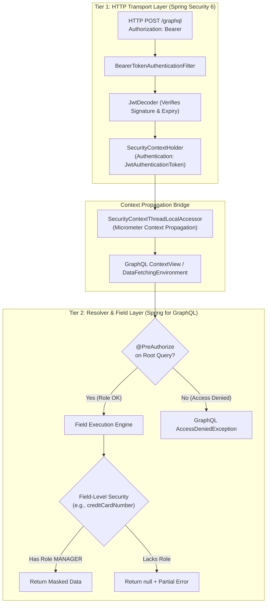

# Module 07: Authentication & Authorization with Spring Security 6 & JWT

Welcome to Module 07 of the **GraphQL Mastery Guide**. This module explores how to secure GraphQL APIs within the **Spring Boot 3.x and Spring Security 6.x** ecosystem. We examine HTTP-level JWT authentication, context propagation across async threads, method-level RBAC (`@PreAuthorize`), **field-level authorization**, multi-tenant data isolation, and defenses against BOLA/IDOR vulnerabilities.

---

## 1. GraphQL Security Architecture: The Two-Tier Model

### 1.1 Simple Explanation
In REST, authorization is usually tied to URLs:
- `GET /api/v1/admin/users` $\rightarrow$ Requires `ROLE_ADMIN`
- `GET /api/v1/orders` $\rightarrow$ Requires `ROLE_USER`

In GraphQL, **there is only one URL (`POST /graphql`)**. You cannot secure your application using URL-based path rules alone!
Instead, enterprise GraphQL security uses a **Two-Tier Architecture**:
1. **Tier 1 (HTTP Transport Layer - Authentication):** Validates the Bearer JWT token, verifies the digital signature, extracts roles/claims, and populates the `SecurityContext`.
2. **Tier 2 (Resolver / Field Layer - Authorization):** Enforces fine-grained permissions at the operation, resolver, and individual field levels.



---

## 2. Tier 1: Spring Security 6 & JWT Configuration

### 2.1 Dependencies (`pom.xml`)
```xml
<!-- Spring Security & OAuth2 Resource Server -->
<dependency>
    <groupId>org.springframework.boot</groupId>
    <artifactId>spring-boot-starter-security</artifactId>
</dependency>
<dependency>
    <groupId>org.springframework.boot</groupId>
    <artifactId>spring-boot-starter-oauth2-resource-server</artifactId>
</dependency>
```

### 2.2 Security Filter Chain Configuration
In Spring Boot 3.x / Spring Security 6.x, we configure a stateless `SecurityFilterChain`:

```java
package com.upskill.graphql.security;

import org.springframework.context.annotation.Bean;
import org.springframework.context.annotation.Configuration;
import org.springframework.core.convert.converter.Converter;
import org.springframework.http.HttpMethod;
import org.springframework.security.config.annotation.method.configuration.EnableMethodSecurity;
import org.springframework.security.config.annotation.web.builders.HttpSecurity;
import org.springframework.security.config.annotation.web.configuration.EnableWebSecurity;
import org.springframework.security.config.annotation.web.configurers.AbstractHttpConfigurer;
import org.springframework.security.config.http.SessionCreationPolicy;
import org.springframework.security.core.GrantedAuthority;
import org.springframework.security.core.authority.SimpleGrantedAuthority;
import org.springframework.security.oauth2.jwt.Jwt;
import org.springframework.security.oauth2.server.resource.authentication.JwtAuthenticationConverter;
import org.springframework.security.web.SecurityFilterChain;
import org.springframework.web.cors.CorsConfiguration;
import org.springframework.web.cors.CorsConfigurationSource;
import org.springframework.web.cors.UrlBasedCorsConfigurationSource;

import java.util.Collection;
import java.util.Collections;
import java.util.List;
import java.util.stream.Collectors;

@Configuration(proxyBeanMethods = false)
@EnableWebSecurity
@EnableMethodSecurity(prePostEnabled = true, securedEnabled = true)
public class SecurityConfiguration {

    @Bean
    public SecurityFilterChain securityFilterChain(HttpSecurity http) throws Exception {
        return http
            // CSRF is not required for stateless JWT APIs
            .csrf(AbstractHttpConfigurer::disable)
            .cors(cors -> cors.configurationSource(corsConfigurationSource()))
            .sessionManagement(session -> session.sessionCreationPolicy(SessionCreationPolicy.STATELESS))
            .authorizeHttpRequests(auth -> auth
                // Allow public access to schema introspection / GraphiQL in non-prod
                .requestMatchers("/graphiql/**").permitAll()
                .requestMatchers(HttpMethod.GET, "/graphql").permitAll()
                // Require authentication for all GraphQL POST requests
                .requestMatchers(HttpMethod.POST, "/graphql").authenticated()
                .anyRequest().authenticated()
            )
            .oauth2ResourceServer(oauth2 -> oauth2
                .jwt(jwt -> jwt.jwtAuthenticationConverter(jwtAuthenticationConverter()))
            )
            .build();
    }

    /**
     * Converts Keycloak / Auth0 / Custom JWT 'roles' claim to Spring Security GrantedAuthorities
     */
    @Bean
    public JwtAuthenticationConverter jwtAuthenticationConverter() {
        JwtAuthenticationConverter converter = new JwtAuthenticationConverter();
        converter.setJwtGrantedAuthoritiesConverter(new CustomJwtAuthoritiesConverter());
        return converter;
    }

    private static class CustomJwtAuthoritiesConverter implements Converter<Jwt, Collection<GrantedAuthority>> {
        @Override
        public Collection<GrantedAuthority> convert(Jwt jwt) {
            List<String> roles = jwt.getClaimAsStringList("roles");
            if (roles == null || roles.isEmpty()) {
                return Collections.emptyList();
            }
            return roles.stream()
                .map(role -> new SimpleGrantedAuthority("ROLE_" + role.toUpperCase()))
                .collect(Collectors.toList());
        }
    }

    @Bean
    public CorsConfigurationSource corsConfigurationSource() {
        CorsConfiguration config = new CorsConfiguration();
        config.setAllowedOrigins(List.of("http://localhost:3000", "https://app.enterprise.com"));
        config.setAllowedMethods(List.of("GET", "POST", "OPTIONS"));
        config.setAllowedHeaders(List.of("Authorization", "Content-Type"));
        config.setAllowCredentials(true);

        UrlBasedCorsConfigurationSource source = new UrlBasedCorsConfigurationSource();
        source.registerCorsConfiguration("/graphql", config);
        return source;
    }
}
```

---

## 3. Context Propagation Across Async Resolver Threads

### 3.1 The Asynchronous Security Trap
In Spring MVC REST, the entire request runs on a single servlet thread (`http-nio-8080-exec-1`). The `SecurityContext` stored in `ThreadLocal` is always accessible.
In GraphQL, the execution engine dispatches child resolvers and `@BatchMapping` data fetchers onto **asynchronous worker thread pools**. 
**Without explicit context propagation, the child thread's `SecurityContextHolder` is empty, causing `@PreAuthorize` to throw false `AccessDeniedException` errors!**

### 3.2 Micrometer Context Propagation Integration
Spring Boot 3.x and Spring for GraphQL automatically leverage `io.micrometer.context-propagation`. To enable it globally across all asynchronous thread boundaries, add the configuration bean:

```java
package com.upskill.graphql.config;

import jakarta.annotation.PostConstruct;
import org.springframework.context.annotation.Configuration;
import org.springframework.security.core.context.SecurityContextHolder;

@Configuration(proxyBeanMethods = false)
public class ContextPropagationConfig {

    @PostConstruct
    public void init() {
        // Enables automatic propagation of SecurityContext across CompletableFuture threads
        SecurityContextHolder.setStrategyName(SecurityContextHolder.MODE_INHERITABLETHREADLOCAL);
    }
}
```

---

## 4. Tier 2: Resolver & Method-Level Authorization (RBAC)

With authentication established, we use standard Spring Security `@PreAuthorize` annotations on `@QueryMapping`, `@MutationMapping`, and `@SchemaMapping` methods.

### 4.1 Enterprise Role-Based Access Control
We define three standard enterprise roles:
- `ROLE_USER`: Standard customer; can only access own data.
- `ROLE_MANAGER`: Regional manager; can access store data and audit summaries.
- `ROLE_ADMIN`: Global administrator; unrestricted access.

```java
package com.upskill.graphql.controller;

import com.upskill.graphql.dto.CatalogDtos.CustomerDto;
import com.upskill.graphql.dto.CatalogDtos.OrderDto;
import com.upskill.graphql.service.CustomerService;
import com.upskill.graphql.service.OrderService;
import org.springframework.graphql.data.method.annotation.Argument;
import org.springframework.graphql.data.method.annotation.MutationMapping;
import org.springframework.graphql.data.method.annotation.QueryMapping;
import org.springframework.security.access.prepost.PreAuthorize;
import org.springframework.security.core.Authentication;
import org.springframework.stereotype.Controller;

import java.util.List;

@Controller
public class SecureOrderController {

    private final OrderService orderService;
    private final CustomerService customerService;

    public SecureOrderController(OrderService orderService, CustomerService customerService) {
        this.orderService = orderService;
        this.customerService = customerService;
    }

    /**
     * Accessible by USER, MANAGER, and ADMIN
     */
    @PreAuthorize("hasAnyRole('USER', 'MANAGER', 'ADMIN')")
    @QueryMapping
    public OrderDto orderById(@Argument Long id, Authentication authentication) {
        // Enforce ownership: USER can only access their own order!
        return orderService.findOrderSecured(id, authentication);
    }

    /**
     * Accessible ONLY by MANAGER and ADMIN
     */
    @PreAuthorize("hasAnyRole('MANAGER', 'ADMIN')")
    @QueryMapping
    public List<OrderDto> allOrders(@Argument int limit, @Argument int offset) {
        return orderService.findAllOrders(limit, offset);
    }

    /**
     * Destructive operations restricted exclusively to ADMIN
     */
    @PreAuthorize("hasRole('ADMIN')")
    @MutationMapping
    public boolean purgeDeletedOrders() {
        return orderService.purgeOldRecords();
    }
}
```

---

## 5. Field-Level Authorization (Fine-Grained Redaction)

### 5.1 The Business Requirement
Consider a `Customer` type in an enterprise application:
```graphql
type Customer {
    id: ID!
    fullName: String!
    email: String!
    creditRatingScore: Int        # SENSITIVE: Only visible to MANAGER or ADMIN!
    taxIdentificationNumber: String # HIGHLY CONFIDENTIAL: Only visible to ADMIN!
}
```
If a standard `USER` queries:
```graphql
query GetCustomer {
    customer(id: "101") {
        fullName
        creditRatingScore
    }
}
```
**We do NOT want to fail the entire query!** The user should still receive `fullName`, while `creditRatingScore` should resolve to `null` alongside a specific field authorization error.

### 5.2 Field-Level Resolver Security Implementation

```java
package com.upskill.graphql.controller;

import com.upskill.graphql.dto.CatalogDtos.CustomerDto;
import org.springframework.graphql.data.method.annotation.SchemaMapping;
import org.springframework.security.core.Authentication;
import org.springframework.security.core.context.SecurityContextHolder;
import org.springframework.stereotype.Controller;

@Controller
public class CustomerFieldSecurityController {

    /**
     * Sensitive field resolver: Enforces role check specifically for creditRatingScore
     */
    @SchemaMapping(typeName = "Customer", field = "creditRatingScore")
    public Integer creditRatingScore(CustomerDto customer) {
        Authentication auth = SecurityContextHolder.getContext().getAuthentication();
        
        boolean hasManagerRole = auth != null && auth.getAuthorities().stream()
                .anyMatch(a -> a.getAuthority().equals("ROLE_MANAGER") || a.getAuthority().equals("ROLE_ADMIN"));

        if (!hasManagerRole) {
            // Returning null gracefully redacts the sensitive field for unauthorized users!
            return null;
        }

        return customer.creditRatingScore();
    }

    /**
     * Confidential field resolver: Restricted strictly to ADMIN
     */
    @SchemaMapping(typeName = "Customer", field = "taxIdentificationNumber")
    public String taxIdentificationNumber(CustomerDto customer) {
        Authentication auth = SecurityContextHolder.getContext().getAuthentication();
        
        boolean isAdmin = auth != null && auth.getAuthorities().stream()
                .anyMatch(a -> a.getAuthority().equals("ROLE_ADMIN"));

        if (!isAdmin) {
            return null; // Masked for non-admins
        }

        return customer.taxIdentificationNumber();
    }
}
```

---

## 6. Multi-Tenancy & Preventing BOLA / IDOR Attacks

### 6.1 What is Broken Object Level Authorization (BOLA)?
BOLA (formerly IDOR - Insecure Direct Object Reference) is the **#1 vulnerability in modern APIs**.
- **The Attack:** User `Alice` (ID 101) logs in. She inspects her network traffic and sees:
  ```graphql
  query { order(id: "900") { totalAmount items { sku } } }
  ```
- Alice simply changes the argument to `order(id: "901")` (which belongs to `Bob`).
- **If the resolver executes `orderRepository.findById(901L)` without checking ownership, Alice steals Bob's financial data!**

### 6.2 Defensive Multi-Tenant Service Architecture
Every query must be scoped by the authenticated user's ID or `tenant_id` at the database level:

```java
package com.upskill.graphql.service;

import com.upskill.graphql.dto.CatalogDtos.OrderDto;
import com.upskill.graphql.entity.OrderEntity;
import com.upskill.graphql.repository.OrderRepository;
import org.springframework.security.access.AccessDeniedException;
import org.springframework.security.core.Authentication;
import org.springframework.security.oauth2.jwt.Jwt;
import org.springframework.stereotype.Service;
import org.springframework.transaction.annotation.Transactional;

@Service
public class SecuredOrderServiceImpl implements OrderService {

    private final OrderRepository orderRepository;

    public SecuredOrderServiceImpl(OrderRepository orderRepository) {
        this.orderRepository = orderRepository;
    }

    @Override
    @Transactional(readOnly = true)
    public OrderDto findOrderSecured(Long orderId, Authentication authentication) {
        Jwt jwt = (Jwt) authentication.getPrincipal();
        Long authenticatedUserId = jwt.getClaim("user_id");
        String tenantId = jwt.getClaim("tenant_id");
        boolean isStaff = authentication.getAuthorities().stream()
                .anyMatch(a -> a.getAuthority().equals("ROLE_MANAGER") || a.getAuthority().equals("ROLE_ADMIN"));

        OrderEntity entity = orderRepository.findById(orderId)
                .orElseThrow(() -> new IllegalArgumentException("Order not found: " + orderId));

        // Enforce Multi-Tenant Isolation
        if (!entity.getTenantId().equals(tenantId)) {
            throw new AccessDeniedException("Unauthorized cross-tenant access attempt detected!");
        }

        // Enforce Object Ownership (BOLA Prevention)
        if (!isStaff && !entity.getCustomerId().equals(authenticatedUserId)) {
            throw new AccessDeniedException("Access denied: You do not own this order!");
        }

        return toDto(entity);
    }
    
    private OrderDto toDto(OrderEntity entity) {
        return new OrderDto(entity.getId(), entity.getOrderNumber(), entity.getTotalAmount(), 
                            entity.getCustomerId(), entity.getStatus(), entity.getCreatedAt());
    }
}
```

#### SQL Generated in PostgreSQL:
Notice that security checks happen inside PostgreSQL indexed filters:
```sql
SELECT 
    o.id, o.order_number, o.total_amount, o.customer_id, o.tenant_id, o.status 
FROM orders o 
WHERE o.id = 901 AND o.tenant_id = 'TENANT_ALPHA';
```

---

## 7. Production Hardening: Disabling Introspection & CSRF

### 7.1 Why Introspection Must Be Disabled in Production
Schema introspection allows tools like GraphiQL or malicious actors to download your entire database schema and field definitions using `__schema` queries.

#### Spring Boot Production Config (`application-prod.yml`):
```yaml
spring:
  graphql:
    graphiql:
      enabled: false  # Disable interactive UI in production
    schema:
      introspection:
        enabled: false # Strictly disable introspection queries in production!
```

---

## 8. Common Mistakes & Pitfalls

### Mistake 1: Relying on URL-Based Security Alone
Securing `/graphql` with `hasRole('USER')` only checks if the user has a valid login. It provides zero protection against unauthorized access to administrative queries or sensitive fields inside the schema!

### Mistake 2: Missing Context Propagation
Failing to configure `SecurityContextHolder.MODE_INHERITABLETHREADLOCAL` or Micrometer Context Propagation leads to mysterious random `AccessDeniedExceptions` in asynchronous `@BatchMapping` resolvers.

### Mistake 3: Throwing Exceptions for Expected Field Redactions
Throwing a hard exception from a field resolver crashes the entire parent selection set if the field is non-null. Always return `null` for redacted fields and leave the field nullable in the SDL.

---

## 9. Senior Interview Questions & Production Scenarios

### Question 1 (Basic): Why is URL-based authorization insufficient for GraphQL APIs?
**Answer:**
In REST architectures, each resource has a distinct URL path (e.g., `/admin/users` vs `/public/products`), making servlet filters like Spring Security's `authorizeHttpRequests` effective. 
In GraphQL, the entire API is served from a single endpoint (typically `POST /graphql`). Both public read queries, sensitive financial mutations, and admin operations pass through the exact same URL. Therefore, authorization must be enforced inside the application engine at the resolver and field levels.

---

### Question 2 (Intermediate): How do you implement field-level authorization without causing an entire query to fail when a user lacks permissions for one field?
**Answer:**
1. In the SDL, mark the sensitive field as **nullable** (e.g., `ssn: String`, NOT `ssn: String!`).
2. Implement a dedicated `@SchemaMapping` resolver for that field.
3. Inside the resolver, inspect the `Authentication` principal from the `SecurityContext`.
4. If the user lacks the required authority, return `null` (or a masked value like `***-**-1234`).
5. Optionally register a warning or field error in the GraphQL execution context using `DataFetcherResult.newResult().data(null).error(...).build()`. The client receives all authorized sibling data while only the restricted field is redacted.

---

### Question 3 (Advanced): How do you prevent Broken Object Level Authorization (BOLA) when clients supply arbitrary IDs to GraphQL query arguments?
**Answer:**
BOLA mitigation requires two architectural rules:
1. **Never trust client-supplied identity claims:** Extract the user's authentic `userId` and `tenantId` directly from the validated JWT token in the `SecurityContext`.
2. **Push ownership filters into the database query:** Instead of calling `findById(id)` and then checking if `entity.getUserId() == authUserId` in Java memory, execute repository queries with composite predicates:
   `findByOrderIdAndTenantIdAndCustomerId(orderId, tenantId, authUserId)`.
   If the record belongs to another user, the query returns empty, resulting in a safe `404 Not Found` or GraphQL error without leaking existence information.
