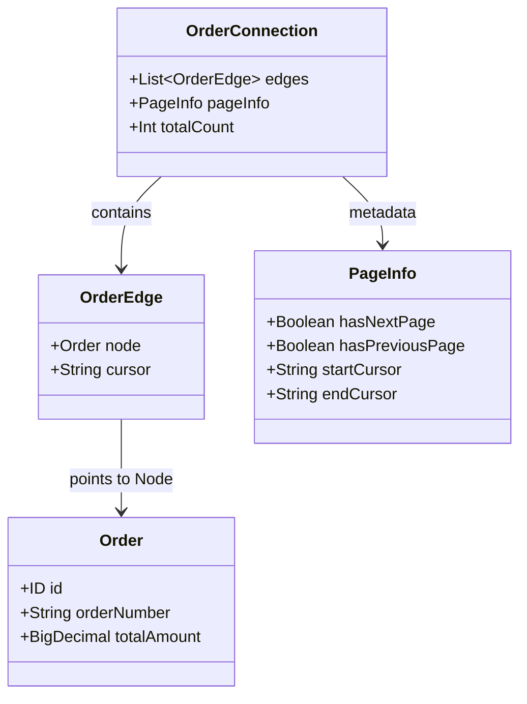

# Module 08: Pagination, Filtering & Sorting (The Relay Connection Spec)

Welcome to Module 08 of the **GraphQL Mastery Guide**. This module covers how to design and implement enterprise-grade **Pagination, Dynamic Filtering, and Multi-Column Sorting** in **Spring Boot 3.x, Spring Data JPA, and PostgreSQL**. We deconstruct the difference between Offset and Keyset Cursor pagination, dissect the **Relay Connection Specification**, and implement high-performance keyset SQL queries.

---

## 1. Offset Pagination vs. Keyset Cursor Pagination

### 1.1 Simple Explanation
Imagine searching through a 1,000-page telephone directory:
- **Offset Pagination (Page Number):** The system says: *"Start at page 1. Flip through 850 pages one by one, count 850 pages of names, discard them, and read page 851."* 
- **Keyset Cursor Pagination (Bookmark):** You place a bookmark on the last name you saw: `"Miller, Zachary, ID: 90210"`. To get the next page, you tell the database: *"Jump directly to the index after 'Miller, Zachary, 90210' and give me the next 20 names."*

### 1.2 Mathematical & Architectural Comparison

```mermaid
flowchart TD
    subgraph OffsetModel["Offset Pagination: SELECT * FROM orders LIMIT 20 OFFSET 500000"]
        O1["PostgreSQL Engine"] --> O2["Reads & Scans 500,000 Rows from Disk"]
        O2 --> O3["Discards 500,000 Rows in Memory"]
        O3 --> O4["Returns 20 Rows"]
        O4 --> O5["Performance: O(N) Linear Degradation (Terrible at Scale!)"]
    end

    subgraph CursorModel["Cursor Pagination: WHERE (created_at, id) < (:cursorTime, :cursorId) LIMIT 20"]
        C1["PostgreSQL Engine"] --> C2["B-Tree Index Direct Seek O(log N)"]
        C2 --> C3["Reads Exactly 20 Rows from Index"]
        C3 --> C4["Returns 20 Rows Instantly"]
        C4 --> C5["Performance: O(1) Constant Time (Zero Degradation!)"]
    end
```



| Dimension | Offset Pagination (`page`, `size`) | Keyset Cursor Pagination (`first`, `after`) |
| :--- | :--- | :--- |
| **SQL Mechanism** | `LIMIT :size OFFSET :offset` | `WHERE (sort_col, id) < (:cursor_val, :cursor_id) LIMIT :size` |
| **Time Complexity** | $\mathcal{O}(N)$ where $N$ is the offset depth. | $\mathcal{O}(1)$ constant time (Index seek $\mathcal{O}(\log N)$). |
| **Performance at Scale** | Severely degrades on deep pages (e.g., page 50,000 takes 4+ seconds). | Constant speed (1ms) whether fetching page 1 or page 100,000. |
| **Data Drift / Duplication**| **High Risk:** If a row is inserted while the user flips pages, records shift, causing duplicates or skipped rows. | **Immune:** The cursor points to an immutable anchor record; inserts do not shift pagination windows. |
| **Jump to Page #** | Yes (Can jump directly to page 45). | No (Can only navigate forward/backward from current cursor). |
| **Best Used For** | Internal admin tables with small datasets (< 5,000 rows). | Infinite scrolling, mobile feeds, public APIs, and high-volume datasets. |

---

## 2. The Relay Connection Specification

The **Relay Connection Spec** is the industry standard for GraphQL pagination designed by Facebook. It introduces a formal terminology:



### 2.1 The 4 Core Relay Concepts:
1. **`Connection`:** The paginated wrapper representing a slice of the list.
2. **`Edge`:** A wrapper around a record containing the actual object (`node`) and its opaque position string (`cursor`).
3. **`Node`:** The actual domain entity (e.g., `Order`, `Customer`).
4. **`PageInfo`:** Metadata indicating if more records exist (`hasNextPage`, `hasPreviousPage`) and boundary cursors (`startCursor`, `endCursor`).

### 2.2 SDL Definition (Relay-Compliant)
```graphql
type Query {
    orders(
        first: Int
        after: String
        last: Int
        before: String
        filter: OrderFilterInput
        orderBy: OrderSortInput
    ): OrderConnection!
}

type OrderConnection {
    edges: [OrderEdge!]!
    pageInfo: PageInfo!
    totalCount: Int!
}

type OrderEdge {
    node: Order!
    cursor: String!
}

type PageInfo {
    hasNextPage: Boolean!
    hasPreviousPage: Boolean!
    startCursor: String
    endCursor: String
}

input OrderFilterInput {
    status: OrderStatus
    minTotal: BigDecimal
    maxTotal: BigDecimal
    customerEmail: String
    createdAfter: DateTime
}

input OrderSortInput {
    field: OrderSortField!
    direction: SortDirection!
}

enum OrderSortField {
    CREATED_AT
    TOTAL_AMOUNT
}

enum SortDirection {
    ASC
    DESC
}
```

---

## 3. High-Performance Spring Data JPA & PostgreSQL Implementation

Let us implement production-grade cursor pagination that executes an optimized B-Tree index scan in PostgreSQL.

### 3.1 PostgreSQL Composite Index Requirement
For cursor pagination to run in constant time $\mathcal{O}(1)$, PostgreSQL must have a **composite B-Tree index** covering the sort field and the primary key:

```sql
-- Composite index for fast Keyset traversal:
CREATE INDEX idx_orders_created_at_id ON orders (created_at DESC, id DESC);
```

### 3.2 Opaque Cursor Utility (Base64 Encoding)
A cursor should always be **opaque** to the client. We encode the sort value and entity ID into a Base64 string:

```java
package com.upskill.graphql.pagination;

import java.nio.charset.StandardCharsets;
import java.time.Instant;
import java.util.Base64;

public final class CursorUtils {
    private CursorUtils() {}

    public record OrderCursor(Instant createdAt, Long id) {}

    public static String encode(Instant createdAt, Long id) {
        String raw = createdAt.toEpochMilli() + ":" + id;
        return Base64.getUrlEncoder().encodeToString(raw.getBytes(StandardCharsets.UTF_8));
    }

    public static OrderCursor decode(String cursor) {
        if (cursor == null || cursor.isBlank()) {
            return null;
        }
        byte[] decoded = Base64.getUrlDecoder().decode(cursor);
        String raw = new String(decoded, StandardCharsets.UTF_8);
        String[] parts = raw.split(":");
        Instant createdAt = Instant.ofEpochMilli(Long.parseLong(parts[0]));
        Long id = Long.parseLong(parts[1]);
        return new OrderCursor(createdAt, id);
    }
}
```

### 3.3 Dynamic JPA Specification for Filtering & Keyset Seek
```java
package com.upskill.graphql.order.repository;

import com.upskill.graphql.domain.entity.OrderEntity;
import com.upskill.graphql.pagination.CursorUtils.OrderCursor;
import jakarta.persistence.criteria.Predicate;
import org.springframework.data.jpa.domain.Specification;

import java.math.BigDecimal;
import java.time.Instant;
import java.util.ArrayList;
import java.util.List;

public final class OrderSpecifications {
    private OrderSpecifications() {}

    public static Specification<OrderEntity> buildDynamicQuery(
            String status,
            BigDecimal minTotal,
            BigDecimal maxTotal,
            Instant createdAfter,
            OrderCursor cursor) {

        return (root, query, cb) -> {
            List<Predicate> predicates = new ArrayList<>();

            // Dynamic Filters
            if (status != null && !status.isBlank()) {
                predicates.add(cb.equal(root.get("status"), status));
            }
            if (minTotal != null) {
                predicates.add(cb.greaterThanOrEqualTo(root.get("totalAmount"), minTotal));
            }
            if (maxTotal != null) {
                predicates.add(cb.lessThanOrEqualTo(root.get("totalAmount"), maxTotal));
            }
            if (createdAfter != null) {
                predicates.add(cb.greaterThanOrEqualTo(root.get("createdAt"), createdAfter));
            }

            // Keyset Seek Predicate: WHERE (created_at < :cursorTime) OR (created_at = :cursorTime AND id < :cursorId)
            if (cursor != null) {
                Predicate timeBefore = cb.lessThan(root.get("createdAt"), cursor.createdAt());
                Predicate timeEqual = cb.equal(root.get("createdAt"), cursor.createdAt());
                Predicate idBefore = cb.lessThan(root.get("id"), cursor.id());
                
                Predicate keysetPredicate = cb.or(timeBefore, cb.and(timeEqual, idBefore));
                predicates.add(keysetPredicate);
            }

            return cb.and(predicates.toArray(new Predicate[0]));
        };
    }
}
```

### 3.4 Service Implementation: Building the Relay Connection
```java
package com.upskill.graphql.order.service;

import com.upskill.graphql.domain.dto.CatalogDtos.OrderDto;
import com.upskill.graphql.domain.entity.OrderEntity;
import com.upskill.graphql.order.repository.OrderRepository;
import com.upskill.graphql.order.repository.OrderSpecifications;
import com.upskill.graphql.pagination.CursorUtils;
import com.upskill.graphql.pagination.CursorUtils.OrderCursor;
import com.upskill.graphql.pagination.RelayModels.*;
import org.springframework.data.domain.PageRequest;
import org.springframework.data.domain.Sort;
import org.springframework.data.jpa.domain.Specification;
import org.springframework.stereotype.Service;
import org.springframework.transaction.annotation.Transactional;

import java.util.List;

@Service
public class OrderPaginationService {

    private final OrderRepository orderRepository;

    public OrderPaginationService(OrderRepository orderRepository) {
        this.orderRepository = orderRepository;
    }

    @Transactional(readOnly = true)
    public OrderConnection fetchOrdersConnection(
            Integer first, String after,
            String status, java.math.BigDecimal minTotal) {

        int limit = (first != null && first > 0) ? Math.min(first, 50) : 20;
        OrderCursor cursor = (after != null) ? CursorUtils.decode(after) : null;

        // Construct Dynamic Specification
        Specification<OrderEntity> spec = OrderSpecifications.buildDynamicQuery(
                status, minTotal, null, null, cursor);

        // Fetch limit + 1 records to determine hasNextPage without an extra COUNT(*) query!
        PageRequest pageRequest = PageRequest.of(0, limit + 1, Sort.by(Sort.Direction.DESC, "createdAt", "id"));
        List<OrderEntity> results = orderRepository.findAll(spec, pageRequest).getContent();

        boolean hasNextPage = results.size() > limit;
        List<OrderEntity> pagedEntities = hasNextPage ? results.subList(0, limit) : results;

        List<OrderEdge> edges = pagedEntities.stream()
                .map(entity -> new OrderEdge(
                        toDto(entity),
                        CursorUtils.encode(entity.getCreatedAt(), entity.getId())
                ))
                .toList();

        String startCursor = edges.isEmpty() ? null : edges.get(0).cursor();
        String endCursor = edges.isEmpty() ? null : edges.get(edges.size() - 1).cursor();
        PageInfo pageInfo = new PageInfo(hasNextPage, after != null, startCursor, endCursor);

        return new OrderConnection(edges, pageInfo, edges.size());
    }

    private OrderDto toDto(OrderEntity e) {
        return new OrderDto(e.getId(), e.getOrderNumber(), e.getTotalAmount(), e.getCustomerId(), e.getStatus(), e.getCreatedAt());
    }
}
```

### 3.5 GraphQL Pagination Controller
```java
package com.upskill.graphql.order.controller;

import com.upskill.graphql.order.service.OrderPaginationService;
import com.upskill.graphql.pagination.RelayModels.OrderConnection;
import org.springframework.graphql.data.method.annotation.Argument;
import org.springframework.graphql.data.method.annotation.QueryMapping;
import org.springframework.stereotype.Controller;

import java.math.BigDecimal;

@Controller
public class OrderPaginationController {

    private final OrderPaginationService paginationService;

    public OrderPaginationController(OrderPaginationService paginationService) {
        this.paginationService = paginationService;
    }

    @QueryMapping
    public OrderConnection orders(
            @Argument Integer first,
            @Argument String after,
            @Argument String status,
            @Argument BigDecimal minTotal) {
        return paginationService.fetchOrdersConnection(first, after, status, minTotal);
    }
}
```

---

## 4. Database Interaction & Hibernate SQL Output

### What PostgreSQL Executes for Cursor Pagination:
```sql
SELECT 
    o.id, o.created_at, o.customer_id, o.order_number, o.status, o.total_amount 
FROM orders o 
WHERE 
    (o.status = 'CONFIRMED')
    AND (
        (o.created_at < '2026-11-18 14:30:00+00') 
        OR (o.created_at = '2026-11-18 14:30:00+00' AND o.id < 9481)
    )
ORDER BY 
    o.created_at DESC, o.id DESC 
LIMIT 21;  -- limit + 1
```

#### Performance Analysis:
Because of the composite index `(created_at DESC, id DESC)`, PostgreSQL performs an **Index Scan**. It jumps directly to the entry matching the cursor in $\mathcal{O}(\log N)$ time, scans 21 rows sequentially, and returns immediately. **Execution time remains ~1.2ms even with 50,000,000 orders in the table.**

---

## 5. Common Mistakes & Pitfalls

### Mistake 1: Relying on Transparent Cursors (Raw IDs)
Exposing raw IDs directly as cursors (`cursor: "105"`) breaks if the list is sorted by another field (e.g., `created_at` or `total_amount`). Always serialize composite sorting parameters into an opaque Base64 string.

### Mistake 2: Missing the Primary Key Tie-Breaker
Sorting by a non-unique column alone (e.g., `ORDER BY created_at DESC`) without appending a unique tie-breaker (`id DESC`) causes non-deterministic results if two rows share the exact same timestamp.

### Mistake 3: Running `COUNT(*)` on Every Paginated Request
Running `SELECT COUNT(*) FROM orders` on a table with 20 million rows takes seconds in PostgreSQL. Only compute `totalCount` when explicitly requested in the GraphQL selection set!

---

## 6. Senior Interview Questions & Production Scenarios

### Question 1 (Basic): What are the 4 fundamental types defined in the Relay Connection specification?
**Answer:**
1. **Connection:** The root container representing a page of data.
2. **Edge:** A wrapper object linking the parent connection to a node, containing a `node` field and an opaque `cursor` string.
3. **Node:** The target domain object being paginated.
4. **PageInfo:** A metadata object containing navigation flags (`hasNextPage`, `hasPreviousPage`) and boundary cursors (`startCursor`, `endCursor`).

---

### Question 2 (Intermediate): Why does Keyset cursor pagination avoid the data drift problem seen in Offset pagination?
**Answer:**
In Offset pagination (`LIMIT 10 OFFSET 10`), pagination is calculated relative to row position from the top of the table. If an item is inserted at the top of the table while the user is browsing, every record shifts down by 1 position. When the user loads page 2, the last item from page 1 appears again at the top of page 2 (duplicate record).
In Keyset pagination, navigation is anchored to the specific values of the last retrieved record (`created_at < cursorTime`). New rows inserted above the anchor do not affect the `WHERE` predicate, ensuring the client never sees duplicates or skips items.

---

### Question 3 (Advanced): How do you determine `hasNextPage` in Keyset pagination without executing an expensive `COUNT(*)` query in PostgreSQL?
**Answer:**
Instead of requesting $N$ records (`LIMIT N`), query for **$N + 1$ records** (`LIMIT N + 1`).
- If the database returns $N + 1$ records, you know with certainty that at least one more record exists beyond the current window; set `hasNextPage = true`, truncate the extra row, and return the first $N$ records.
- If the database returns $\le N$ records, you have reached the end of the dataset; set `hasNextPage = false`.
This eliminates the need for an expensive `COUNT(*)` scan on multi-million row tables.
