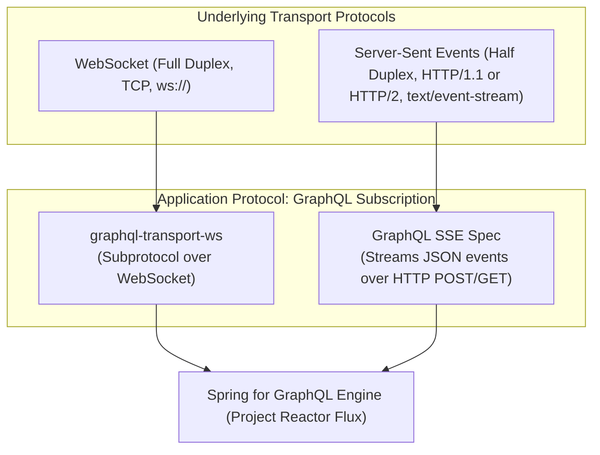
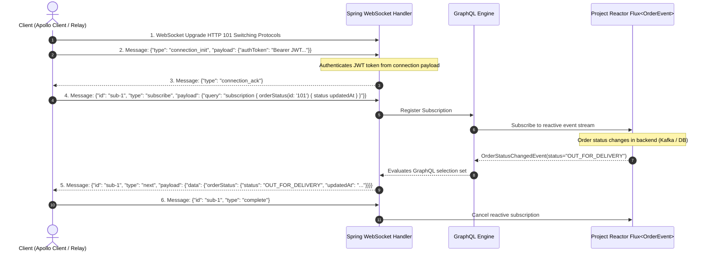
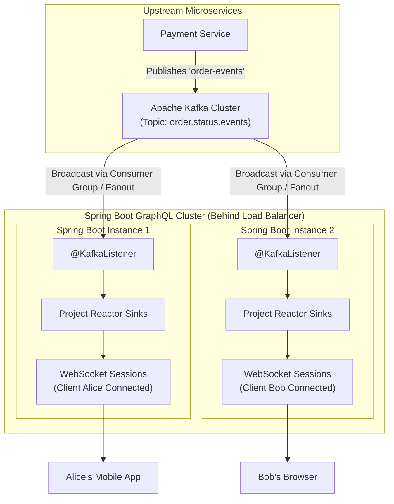

# Module 09: GraphQL Subscriptions & Real-Time Reactive Systems

Welcome to Module 09 of the **GraphQL Mastery Guide**. This module explores real-time event streaming using **GraphQL Subscriptions, Spring for GraphQL, Project Reactor (`Flux<T>`), WebSockets, Server-Sent Events (SSE)**, and distributed event fanning with **Apache Kafka and Redis Pub/Sub**.

---

## 1. What Are Subscriptions?

### 1.1 Simple Explanation
Imagine waiting for a ride-share driver (Uber/Lyft):
- **HTTP Polling (REST):** Every 2 seconds, your phone calls the server: *"Is the driver here? Is the driver here? Is the driver here?"* 99% of requests return "No", wasting battery, CPU, and network bandwidth.
- **GraphQL Subscription:** You open a persistent connection (WebSocket) and say: *"Notify me whenever the driver's GPS location or status changes."* The server remains silent until an event occurs, immediately pushing the newly updated data shape down to your device.

### 1.2 Subscriptions vs. WebSockets vs. Server-Sent Events (SSE)



| Dimension | Raw WebSocket | Server-Sent Events (SSE) | GraphQL Subscription |
| :--- | :--- | :--- | :--- |
| **Transport** | TCP (Bi-directional full duplex). | HTTP/1.1 or HTTP/2 (Unidirectional server-to-client). | Layered on top of WebSocket or SSE. |
| **Payload Format** | Arbitrary text or binary. | Plain text (`data: ...`). | **Strictly Typed GraphQL Selection Set**. |
| **Data Shaping** | Hardcoded by server. | Hardcoded by server. | **Client selects exact fields** needed for the event. |
| **Connection Overhead** | Requires WebSocket handshake & ping/pong frames. | Simple HTTP stream; works through strict corporate firewalls. | Managed via formal protocol (`graphql-transport-ws`). |
| **Best Used For** | Low-latency bi-directional gaming. | Unidirectional notification feeds. | Reactive domain events where clients require dynamic field selection. |

---

## 2. The Subscription Lifecycle & Wire Protocol (`graphql-transport-ws`)

The modern standard protocol for GraphQL over WebSockets is **`graphql-transport-ws`** (replacing the deprecated `subscriptions-transport-ws`).



---

## 3. Spring Boot 3.x Subscription Implementation

Spring for GraphQL uses **Project Reactor** (`Mono<T>` and `Flux<T>`). A subscription method annotated with `@SubscriptionMapping` must return a **`org.reactivestreams.Publisher<T>`** (typically `reactor.core.publisher.Flux<T>`).

### 3.1 SDL Schema Definition
```graphql
type Query {
    orderById(id: ID!): Order
}

type Subscription {
    """
    Real-time stream of order status transitions for a specific order
    """
    orderStatusUpdated(orderId: ID!): OrderStatusEvent!

    """
    Live chat message stream for a specific customer support room
    """
    chatMessageReceived(roomId: ID!): ChatMessage!
}

type OrderStatusEvent {
    orderId: ID!
    orderNumber: String!
    status: OrderStatus!
    updatedAt: DateTime!
    notes: String
}

type ChatMessage {
    id: ID!
    senderId: ID!
    senderName: String!
    text: String!
    sentAt: DateTime!
}
```

### 3.2 In-Memory Reactive Event Publisher (`Sinks.Many<T>`)
In a single-instance Spring Boot application, Project Reactor's `Sinks.Many<T>` provides a thread-safe, high-performance hot event multicaster:

```java
package com.upskill.graphql.realtime.publisher;

import com.upskill.graphql.realtime.dto.OrderStatusEvent;
import org.springframework.stereotype.Component;
import reactor.core.publisher.Flux;
import reactor.core.publisher.Sinks;

import java.util.Map;
import java.util.concurrent.ConcurrentHashMap;

@Component
public class OrderEventPublisher {

    // Maps orderId to an isolated reactive multicast sink
    private final Map<Long, Sinks.Many<OrderStatusEvent>> orderSinks = new ConcurrentHashMap<>();

    /**
     * Publishes a new status event to all active subscribers for the given order
     */
    public void publish(OrderStatusEvent event) {
        Sinks.Many<OrderStatusEvent> sink = orderSinks.get(event.orderId());
        if (sink != null) {
            // Emit next event with backpressure drop handling
            sink.emitNext(event, Sinks.EmitFailureHandler.FAIL_FAST);
        }
    }

    /**
     * Subscribes a client to the event stream for a specific order
     */
    public Flux<OrderStatusEvent> getOrderEventStream(Long orderId) {
        return orderSinks
                .computeIfAbsent(orderId, id -> Sinks.many().multicast().onBackpressureBuffer())
                .asFlux()
                .doOnCancel(() -> cleanUpSinkIfEmpty(orderId));
    }

    private void cleanUpSinkIfEmpty(Long orderId) {
        Sinks.Many<OrderStatusEvent> sink = orderSinks.get(orderId);
        if (sink != null && sink.currentSubscriberCount() == 0) {
            orderSinks.remove(orderId);
        }
    }
}
```

### 3.3 Spring GraphQL Subscription Controller
```java
package com.upskill.graphql.realtime.controller;

import com.upskill.graphql.realtime.dto.OrderStatusEvent;
import com.upskill.graphql.realtime.publisher.OrderEventPublisher;
import org.springframework.graphql.data.method.annotation.Argument;
import org.springframework.graphql.data.method.annotation.SubscriptionMapping;
import org.springframework.stereotype.Controller;
import reactor.core.publisher.Flux;

@Controller
public class OrderSubscriptionController {

    private final OrderEventPublisher eventPublisher;

    public OrderSubscriptionController(OrderEventPublisher eventPublisher) {
        this.eventPublisher = eventPublisher;
    }

    /**
     * Resolves Subscription.orderStatusUpdated(orderId: ID!): OrderStatusEvent!
     * 
     * Spring for GraphQL automatically registers the client's WebSocket connection
     * to this returned Flux<T> publisher.
     */
    @SubscriptionMapping
    public Flux<OrderStatusEvent> orderStatusUpdated(@Argument Long orderId) {
        return eventPublisher.getOrderEventStream(orderId);
    }
}
```

---

## 4. Distributed Multi-Node Architecture: Kafka to GraphQL Subscriptions

### 4.1 The Distributed Cluster Problem
In production, your Spring Boot GraphQL backend runs across multiple Docker containers or EC2 instances behind an Application Load Balancer:
- User `Alice` is connected via WebSocket to **Instance 1**.
- The payment service processes an order and publishes an event to an **Apache Kafka topic**.
- **Instance 2** consumes the Kafka event.
- **Problem:** If Instance 2 receives the event, how does Alice on Instance 1 receive the WebSocket push?



### 4.2 Kafka Consumer Bridge Implementation
Each Spring Boot instance listens to the distributed event stream and fans out updates to its locally connected WebSocket subscribers:

```java
package com.upskill.graphql.realtime.kafka;

import com.upskill.graphql.realtime.dto.OrderStatusEvent;
import com.upskill.graphql.realtime.publisher.OrderEventPublisher;
import org.apache.kafka.clients.consumer.ConsumerRecord;
import org.slf4j.Logger;
import org.slf4j.LoggerFactory;
import org.springframework.kafka.annotation.KafkaListener;
import org.springframework.stereotype.Component;

@Component
public class KafkaOrderEventBridge {

    private static final Logger log = LoggerFactory.getLogger(KafkaOrderEventBridge.class);
    private final OrderEventPublisher eventPublisher;

    public KafkaOrderEventBridge(OrderEventPublisher eventPublisher) {
        this.eventPublisher = eventPublisher;
    }

    /**
     * Consumes domain events from Apache Kafka and forwards them to active GraphQL WebSocket subscribers
     */
    @KafkaListener(
        topics = "order.status.events",
        groupId = "#{T(java.util.UUID).randomUUID().toString()}", // Unique group ID per instance for broadcast fanout!
        containerFactory = "kafkaListenerContainerFactory"
    )
    public void consumeOrderEvent(ConsumerRecord<String, OrderStatusEvent> record) {
        OrderStatusEvent event = record.value();
        log.info("Received Kafka event for orderId: {}, status: {}", event.orderId(), event.status());
        
        // Pushes event into Spring GraphQL reactive sink on this instance
        eventPublisher.publish(event);
    }
}
```

---

## 5. Security & Authentication in Subscriptions

Because WebSockets initiate via an HTTP `GET /graphql` upgrade request, authentication differs from standard HTTP `POST` requests:

```java
package com.upskill.graphql.security;

import org.springframework.context.annotation.Bean;
import org.springframework.context.annotation.Configuration;
import org.springframework.graphql.server.WebSocketGraphQlInterceptor;
import org.springframework.graphql.server.WebSocketSessionInfo;
import org.springframework.security.authentication.UsernamePasswordAuthenticationToken;
import org.springframework.security.core.context.SecurityContextHolder;
import org.springframework.security.oauth2.jwt.JwtDecoder;
import reactor.core.publisher.Mono;

import java.util.Map;

@Configuration(proxyBeanMethods = false)
public class WebSocketSecurityConfig {

    private final JwtDecoder jwtDecoder;

    public WebSocketSecurityConfig(JwtDecoder jwtDecoder) {
        this.jwtDecoder = jwtDecoder;
    }

    @Bean
    public WebSocketGraphQlInterceptor webSocketGraphQlInterceptor() {
        return new WebSocketGraphQlInterceptor() {
            @Override
            public Mono<Object> handleConnectionInitialization(
                    WebSocketSessionInfo sessionInfo, Map<String, Object> connectionInitPayload) {
                
                // Extract authToken from GraphQL connection_init payload: {"authToken": "Bearer xyz..."}
                String authHeader = (String) connectionInitPayload.get("authToken");
                if (authHeader == null || !authHeader.startsWith("Bearer ")) {
                    return Mono.error(new IllegalAccessException("Missing or invalid Bearer token"));
                }

                String token = authHeader.substring(7);
                try {
                    var jwt = jwtDecoder.decode(token);
                    var authentication = new UsernamePasswordAuthenticationToken(jwt, null, null);
                    // Store authentication in session attributes for reactive subscription access
                    sessionInfo.getAttributes().put(SecurityContextHolder.class.getName(), authentication);
                    return Mono.empty();
                } catch (Exception ex) {
                    return Mono.error(new IllegalAccessException("Invalid JWT token"));
                }
            }
        };
    }
}
```

---

## 6. Common Mistakes & Pitfalls

### Mistake 1: Memory Leaks from Orphaned Reactive Sinks
Failing to unregister subscriber sinks when a client disconnects. Always attach `.doOnCancel()` to remove empty sinks from your in-memory map.

### Mistake 2: Missing Unique Kafka Consumer Groups for Fanout
If multiple Spring Boot instances share the same Kafka `group.id`, Kafka will partition records across instances. Only ONE instance will receive the event, leaving WebSocket clients connected to sibling instances with stale screens! Broadcast fanout requires each instance to generate a dynamic or broadcast consumer group.

### Mistake 3: Unbounded Backpressure
Pushing events faster than a mobile client can consume over high-latency cellular networks without configuring `.onBackpressureBuffer()` or `.onBackpressureDrop()` triggers OutOfMemoryErrors in the JVM.

---

## 7. Senior Interview Questions & Production Scenarios

### Question 1 (Basic): What is the difference between GraphQL Queries and Subscriptions in terms of network protocol?
**Answer:**
Queries use standard stateless request-response semantics (typically HTTP POST) where the connection terminates once the JSON payload is delivered.
Subscriptions establish an ongoing, persistent stateful connection (typically over WebSocket using the `graphql-transport-ws` protocol or Server-Sent Events). The client sends a subscription query once, and the server retains the selection set, pushing newly resolved JSON payloads whenever an upstream event triggers the underlying reactive stream.

---

### Question 2 (Intermediate): How does Spring for GraphQL handle backpressure in subscriptions?
**Answer:**
Spring for GraphQL is built entirely on the Reactive Streams specification via **Project Reactor**. A subscription controller returns a `Flux<T>`. If a slow client (e.g., on a poor 3G mobile network) cannot process incoming events at the server's emission rate, Project Reactor propagates demand signals upstream. The backend can apply reactive backpressure strategies like `onBackpressureBuffer(int capacity)` or `onBackpressureDrop()` to ensure memory usage remains bounded and JVM buffers do not overflow.

---

### Question 3 (Advanced): How do you scale GraphQL Subscriptions across a horizontally scaled cluster of 10 Spring Boot instances?
**Answer:**
Because WebSockets are stateful, a client is pinned to one specific container instance. Scaling horizontally requires:
1. **Load Balancer Configuration:** Configure AWS ALB / NGINX with sticky sessions and WebSocket upgrade support.
2. **Distributed Pub/Sub Backplane:** Connect all Spring Boot instances to a central message bus (Apache Kafka or Redis Pub/Sub).
3. When any service updates domain state, it publishes a message to the message bus.
4. Each of the 10 Spring Boot instances consumes the message, checks its local registry of active WebSocket sessions, and dispatches the GraphQL selection set only to the local clients subscribed to that specific entity.
