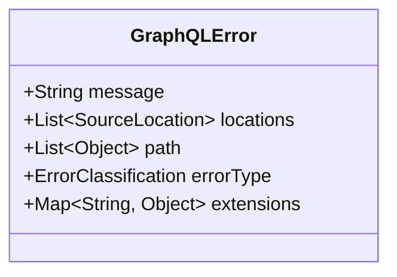
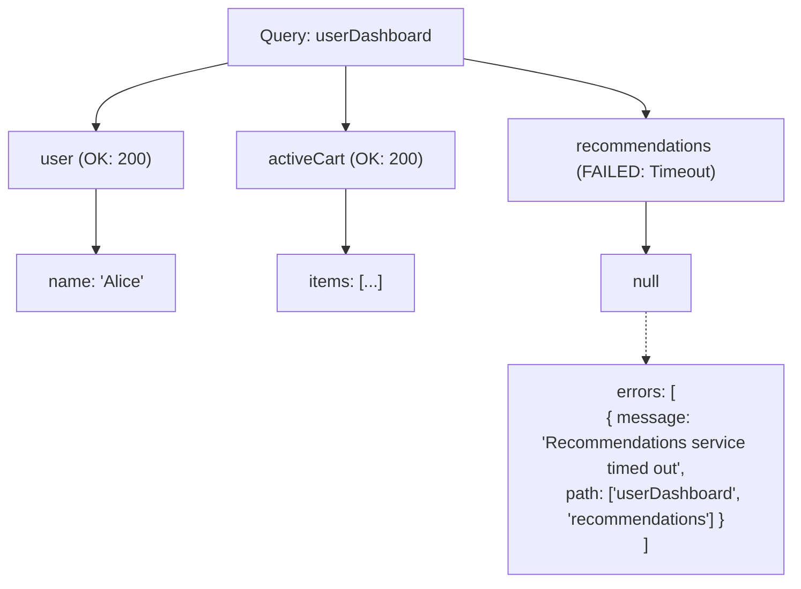

# Module 10: Error Handling & Validation Architecture

Welcome to Module 10 of the **GraphQL Mastery Guide**. This module explores enterprise-grade **Error Handling, Input Validation, and Exception Management** in **Spring Boot 3.x and Spring for GraphQL**. We examine the official GraphQL error specification, Jakarta Bean Validation, `@GraphQlExceptionHandler`, `DataFetcherResult`, and production error sanitization.

---

## 1. The GraphQL Error Specification & Response Structure

### 1.1 The Official Specification Format
According to the GraphQL Specification (June 2018+), any failure during parsing, validation, or execution must be formatted inside a top-level **`errors`** JSON array alongside the **`data`** envelope:

```json
{
  "data": {
    "order": null
  },
  "errors": [
    {
      "message": "Order with ID 'ORD-999' was not found",
      "locations": [
        {
          "line": 2,
          "column": 5
        }
      ],
      "path": [
        "order"
      ],
      "extensions": {
        "classification": "NOT_FOUND",
        "errorCode": "ERR_ORDER_NOT_FOUND",
        "timestamp": "2026-11-18T15:45:00Z",
        "invalidId": "ORD-999"
      }
    }
  ]
}
```

### 1.2 Anatomical Breakdown of Error Fields



| Field Name | Type | Presence | Description |
| :--- | :--- | :---: | :--- |
| **`message`** | `String` | **Mandatory** | A human-readable description of the error intended for debugging or user notification. |
| **`locations`** | `List<{line, column}>` | Optional | Line and column numbers in the client query string where the error occurred. |
| **`path`** | `List<String \| Int>` | Optional | The exact traversal path in the response tree where the error was triggered (e.g., `["customers", 0, "orders", 2, "trackingNumber"]`). |
| **`extensions`** | `Map<String, Object>` | **Enterprise Standard** | Reserved dictionary for application-specific metadata (error classification codes, validation violation maps, correlation IDs, timestamps). |

---

## 2. Partial Responses & Graceful Degradation

### 2.1 The Distributed Reality: Some Data is Better than No Data
In traditional REST, if a client calls `GET /api/v1/user-dashboard` and the secondary recommendations microservice fails, the entire HTTP response fails with a `500 Internal Server Error`.
In GraphQL, the execution engine isolates field failures. If the recommendation service throws a timeout, the engine sets `recommendations: null`, appends an error to `errors`, but **still delivers the user profile, billing summary, and active notifications in `data`**!



---

## 3. Spring Boot 3.x Exception Resolution: `@GraphQlExceptionHandler`

Spring Boot 3.x introduces `@GraphQlExceptionHandler` inside `@Controller` or `@ControllerAdvice` classes, providing an experience identical to Spring MVC's `@ExceptionHandler`.

### 3.1 Custom Domain Exceptions
```java
package com.upskill.graphql.exception;

public final class DomainExceptions {
    private DomainExceptions() {}

    public static class ResourceNotFoundException extends RuntimeException {
        private final String resourceName;
        private final Object identifier;

        public ResourceNotFoundException(String resourceName, Object identifier) {
            super(String.format("%s with ID '%s' does not exist", resourceName, identifier));
            this.resourceName = resourceName;
            this.identifier = identifier;
        }

        public String getResourceName() { return resourceName; }
        public Object getIdentifier() { return identifier; }
    }

    public static class InsufficientInventoryException extends RuntimeException {
        private final String productSku;
        private final int requested;
        private final int available;

        public InsufficientInventoryException(String productSku, int requested, int available) {
            super(String.format("Insufficient stock for SKU '%s'. Requested: %d, Available: %d", 
                    productSku, requested, available));
            this.productSku = productSku;
            this.requested = requested;
            this.available = available;
        }

        public String getProductSku() { return productSku; }
        public int getRequested() { return requested; }
        public int getAvailable() { return available; }
    }
}
```

### 3.2 Production Global Exception Handler (`@ControllerAdvice`)
```java
package com.upskill.graphql.exception;

import com.upskill.graphql.exception.DomainExceptions.InsufficientInventoryException;
import com.upskill.graphql.exception.DomainExceptions.ResourceNotFoundException;
import graphql.GraphQLError;
import graphql.GraphqlErrorBuilder;
import graphql.schema.DataFetchingEnvironment;
import jakarta.validation.ConstraintViolationException;
import org.slf4j.Logger;
import org.slf4j.LoggerFactory;
import org.springframework.dao.DataIntegrityViolationException;
import org.springframework.graphql.data.method.annotation.GraphQlExceptionHandler;
import org.springframework.graphql.execution.ErrorType;
import org.springframework.security.access.AccessDeniedException;
import org.springframework.web.bind.MethodArgumentNotValidException;
import org.springframework.web.bind.annotation.ControllerAdvice;

import java.time.Instant;
import java.util.HashMap;
import java.util.Map;
import java.util.UUID;

@ControllerAdvice
public class GlobalGraphQlErrorAdvisor {

    private static final Logger log = LoggerFactory.getLogger(GlobalGraphQlErrorAdvisor.class);

    @GraphQlExceptionHandler
    public GraphQLError handleResourceNotFound(ResourceNotFoundException ex, DataFetchingEnvironment env) {
        log.warn("Resource not found: {}", ex.getMessage());
        return GraphqlErrorBuilder.newError(env)
                .errorType(ErrorType.NOT_FOUND)
                .message(ex.getMessage())
                .extensions(Map.of(
                        "errorCode", "RESOURCE_NOT_FOUND",
                        "resourceType", ex.getResourceName(),
                        "identifier", String.valueOf(ex.getIdentifier()),
                        "timestamp", Instant.now().toString()
                ))
                .build();
    }

    @GraphQlExceptionHandler
    public GraphQLError handleAccessDenied(AccessDeniedException ex, DataFetchingEnvironment env) {
        log.warn("Access denied during GraphQL execution: {}", ex.getMessage());
        return GraphqlErrorBuilder.newError(env)
                .errorType(ErrorType.FORBIDDEN)
                .message("You do not have permission to access this resource or field")
                .extensions(Map.of(
                        "errorCode", "ACCESS_DENIED",
                        "timestamp", Instant.now().toString()
                ))
                .build();
    }

    @GraphQlExceptionHandler
    public GraphQLError handleBusinessRuleViolation(InsufficientInventoryException ex, DataFetchingEnvironment env) {
        return GraphqlErrorBuilder.newError(env)
                .errorType(ErrorType.BAD_REQUEST)
                .message(ex.getMessage())
                .extensions(Map.of(
                        "errorCode", "INSUFFICIENT_INVENTORY",
                        "productSku", ex.getProductSku(),
                        "requested", ex.getRequested(),
                        "available", ex.getAvailable()
                ))
                .build();
    }

    /**
     * Catches unexpected infrastructure crashes (PostgreSQL disconnect, NPE).
     * SANITIZES output to prevent leaking internal stack traces!
     */
    @GraphQlExceptionHandler
    public GraphQLError handleGenericException(Throwable ex, DataFetchingEnvironment env) {
        String correlationId = UUID.randomUUID().toString();
        log.error("Internal Server Error [CorrelationId: {}]: ", correlationId, ex);

        return GraphqlErrorBuilder.newError(env)
                .errorType(ErrorType.INTERNAL_ERROR)
                .message("An unexpected internal error occurred. Please quote the correlation ID to support.")
                .extensions(Map.of(
                        "correlationId", correlationId,
                        "timestamp", Instant.now().toString()
                ))
                .build();
    }
}
```

---

## 4. Input Validation with Jakarta Bean Validation

Spring for GraphQL natively integrates with `jakarta.validation` annotations on `@Argument` parameters.

### 4.1 Validated Mutation Input Record
```java
package com.upskill.graphql.dto;

import jakarta.validation.constraints.*;
import java.math.BigDecimal;

public record RegisterProductInput(
    @NotBlank(message = "Product title is mandatory")
    @Size(min = 3, max = 120, message = "Title must be between 3 and 120 characters")
    String title,

    @NotBlank(message = "SKU cannot be blank")
    @Pattern(regexp = "^[A-Z0-9]{6,12}$", message = "SKU must be 6-12 uppercase alphanumeric characters")
    String sku,

    @NotNull(message = "Unit price is required")
    @DecimalMin(value = "0.01", message = "Unit price must be at least 0.01")
    BigDecimal unitPrice,

    @Min(value = 0, message = "Initial inventory cannot be negative")
    int initialStock
) {}
```

### 4.2 Handling Validation Failures in Exception Handler
When validation fails, Spring throws `ConstraintViolationException` or `MethodArgumentNotValidException`. We map each field violation into a structured error extensions payload:

```java
@GraphQlExceptionHandler
public GraphQLError handleValidationException(ConstraintViolationException ex, DataFetchingEnvironment env) {
    Map<String, String> fieldViolations = new HashMap<>();
    ex.getConstraintViolations().forEach(violation -> {
        String path = violation.getPropertyPath().toString();
        fieldViolations.put(path, violation.getMessage());
    });

    return GraphqlErrorBuilder.newError(env)
            .errorType(ErrorType.BAD_REQUEST)
            .message("Input argument validation failed")
            .extensions(Map.of(
                    "errorCode", "VALIDATION_FAILED",
                    "violations", fieldViolations,
                    "timestamp", Instant.now().toString()
            ))
            .build();
}
```

#### Client Receives Clear, Actionable Field Errors:
```json
{
  "errors": [
    {
      "message": "Input argument validation failed",
      "path": ["createProduct"],
      "extensions": {
        "errorCode": "VALIDATION_FAILED",
        "violations": {
          "title": "Title must be between 3 and 120 characters",
          "unitPrice": "Unit price must be at least 0.01"
        }
      }
    }
  ]
}
```

---

## 5. Returning Data AND Errors: `DataFetcherResult<T>`

In advanced enterprise scenarios, a resolver might want to return partial data **and simultaneously append a non-fatal warning or error**. `DataFetcherResult<T>` allows this:

```java
package com.upskill.graphql.controller;

import com.upskill.graphql.dto.CatalogDtos.OrderDto;
import graphql.GraphqlErrorBuilder;
import graphql.execution.DataFetcherResult;
import graphql.schema.DataFetchingEnvironment;
import org.springframework.graphql.data.method.annotation.Argument;
import org.springframework.graphql.data.method.annotation.QueryMapping;
import org.springframework.stereotype.Controller;

@Controller
public class ResilientOrderController {

    private final OrderService orderService;

    public ResilientOrderController(OrderService orderService) {
        this.orderService = orderService;
    }

    @QueryMapping
    public DataFetcherResult<OrderDto> orderWithShippingWarning(@Argument Long id, DataFetchingEnvironment env) {
        OrderDto order = orderService.findById(id);

        DataFetcherResult.Builder<OrderDto> resultBuilder = DataFetcherResult.newResult();
        resultBuilder.data(order);

        // If shipping vendor is experiencing delays, return order data BUT append a non-fatal warning!
        if (orderService.isShippingProviderDelayed()) {
            resultBuilder.error(GraphqlErrorBuilder.newError(env)
                    .message("Warning: Carrier delivery delays expected for this region")
                    .extensions(java.util.Map.of("warningCode", "SHIPPING_DELAY_ADVISORY"))
                    .build());
        }

        return resultBuilder.build();
    }
}
```

---

## 6. Common Mistakes & Pitfalls

### Mistake 1: Leaking Internal Database & SQL Errors
Catching a `DataIntegrityViolationException` and returning `ex.getMessage()` directly to the client exposes PostgreSQL table names, constraint keys, and database topology to attackers. Always sanitize generic exceptions.

### Mistake 2: Missing Path Mapping in Custom GraphQLError
Failing to pass `DataFetchingEnvironment env` into `GraphqlErrorBuilder.newError(env)`. If `env` is omitted, the `path` and `locations` fields will be empty, making it impossible for the client to know which specific field in the query failed!

### Mistake 3: Relying Solely on GraphQL Exceptions for Expected Business Logic
Using exceptions for routine business flows (e.g., "Insufficient funds in checkout") instead of modeling expected failures directly into the Schema using the Mutation Payload pattern (`userErrors: [UserError!]!`).

---

## 7. Senior Interview Questions & Production Scenarios

### Question 1 (Basic): What are the 4 standard fields in a GraphQL error object according to the specification?
**Answer:**
1. `message` (String): Mandatory description of the error.
2. `locations` (List of Line/Column): Points in the client's query string where the error occurred.
3. `path` (List of String/Integer): Path through the response data tree leading to the field that triggered the error.
4. `extensions` (Map): Reserved application-specific metadata dictionary for custom error codes, timestamps, and validation details.

---

### Question 2 (Intermediate): How does `DataFetcherResult<T>` enable partial responses in Spring for GraphQL?
**Answer:**
Standard resolver methods return either an object (successful data) or throw an exception (error). `DataFetcherResult<T>` allows a resolver to return **both data and a list of `GraphQLError` objects simultaneously**. This is critical in resilient architectures where partial data is available (e.g., retrieving an order whose live GPS tracking system is temporarily down); the client receives the core order data while an error explains the tracking unavailability.

---

### Question 3 (Advanced): How does error classification impact client-side error handling frameworks like Apollo Client?
**Answer:**
Production GraphQL clients inspect `extensions.classification` (e.g., `UNAUTHORIZED`, `FORBIDDEN`, `BAD_REQUEST`, `NOT_FOUND`).
- If an error has classification `UNAUTHORIZED`, Apollo Client's global error link intercepts the response, pauses pending queries, initiates an OAuth2 token refresh flow, and retries the original request seamlessly.
- If classification is `BAD_REQUEST` with validation violations, the UI maps field errors directly to form inputs without reloading the page.
- Standardizing error codes across microservices via `extensions` ensures uniform client-side handling.
