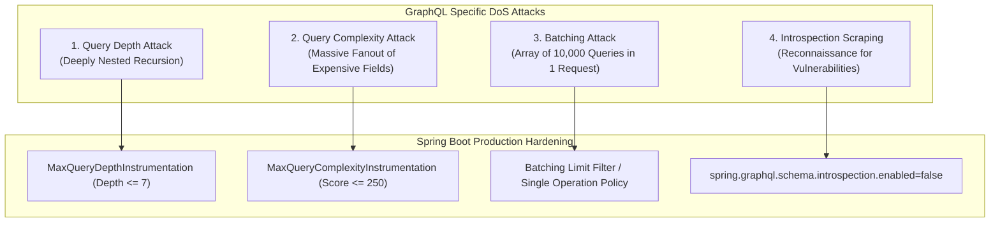
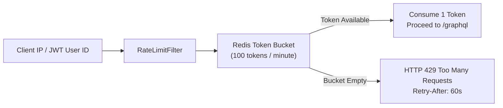
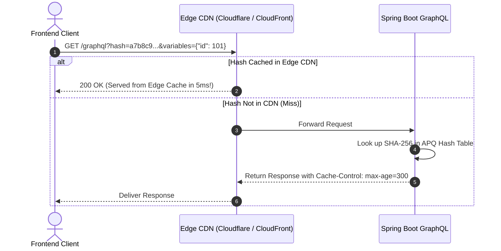

# Module 11: Security Hardening & Performance Optimization

Welcome to Module 11 of the **GraphQL Mastery Guide**. This module explores enterprise **Production Security Hardening and High-Throughput Performance Tuning** in **Spring Boot 3.x**. We cover Denial of Service (DoS) mitigation via query depth and complexity analysis, Automated Persisted Queries (APQ), Redis caching strategies, rate limiting, and Prometheus observability.

---

## 1. Denial of Service (DoS) Attack Vectors in GraphQL

Because GraphQL allows clients to specify arbitrary query shapes, unhardened endpoints are vulnerable to catastrophic resource-exhaustion attacks that do not exist in traditional REST APIs.



---

## 2. Query Depth & Complexity Instrumentation

### 2.1 Query Depth Attack
An attacker exploits recursive relationships (e.g., `user -> friends -> friends -> friends`):

```graphql
query ExplodingNestingAttack {
    user(id: 1) {
        friends {
            friends {
                friends {
                    friends {
                        friends {
                            friends {
                                friends { id }
                            }
                        }
                    }
                }
            }
        }
    }
}
```
**Impact:** A single HTTP request with a depth of 15 levels can generate millions of database joins, saturating CPU and crashing the JVM with an `OutOfMemoryError`.

### 2.2 Query Complexity Analysis (Field Weighting)
Even a shallow query can crash a server if it requests massive fan-out:
```graphql
query ShallowComplexityAttack {
    allCustomers(limit: 1000) {      # Cost: 1,000
        orders(limit: 500) {         # Cost: 1,000 * 500 = 500,000
            lineItems(limit: 100) {  # Cost: 500,000 * 100 = 50,000,000 records!
                productSku
            }
        }
    }
}
```

### 2.3 Spring Boot Java Implementation: Depth & Complexity Rules
We configure custom `Instrumentation` beans that analyze the query Abstract Syntax Tree (AST) **before** execution begins. If a query exceeds the configured threshold, execution is aborted immediately without querying PostgreSQL.

```java
package com.upskill.graphql.security;

import graphql.analysis.MaxQueryComplexityInstrumentation;
import graphql.analysis.MaxQueryDepthInstrumentation;
import graphql.execution.instrumentation.Instrumentation;
import org.springframework.beans.factory.annotation.Value;
import org.springframework.context.annotation.Bean;
import org.springframework.context.annotation.Configuration;

@Configuration(proxyBeanMethods = false)
public class GraphQlDefenseConfiguration {

    @Value("${app.graphql.security.max-depth:7}")
    private int maxDepth;

    @Value("${app.graphql.security.max-complexity:250}")
    private int maxComplexity;

    /**
     * Rejects any query document whose AST depth exceeds 'maxDepth'.
     * Typical enterprise threshold: 6 to 9 levels.
     */
    @Bean
    public Instrumentation maxQueryDepthInstrumentation() {
        return new MaxQueryDepthInstrumentation(maxDepth);
    }

    /**
     * Evaluates total query cost by assigning weights to fields and list multipliers.
     * Scalar fields cost 1; paginated lists multiply child costs by their limit argument.
     */
    @Bean
    public Instrumentation maxQueryComplexityInstrumentation() {
        return new MaxQueryComplexityInstrumentation(maxComplexity);
    }
}
```

---

## 3. Disabling Introspection & Enforcing Request Size Limits

### 3.1 Disabling Schema Introspection in Production
Schema introspection (`__schema` and `__type` queries) exposes your entire API structure, field descriptions, internal types, and deprecations to anyone on the internet.

```yaml
# application-prod.yml
spring:
  graphql:
    graphiql:
      enabled: false  # Disable interactive web console in production
    schema:
      introspection:
        enabled: false # Strictly disables __schema reflection in production!
```

### 3.2 Enforcing Request Size & Batch Limits
An attacker can send a 50MB HTTP POST request containing 10,000 queries in a single JSON array.
We bound HTTP payload size and enforce single-operation policies:

```yaml
server:
  tomcat:
    max-http-form-post-size: 50KB  # GraphQL query strings should never exceed 50KB
    max-swallow-size: 50KB
```

---

## 4. Rate Limiting with Bucket4j & Redis (Token Bucket Algorithm)

To protect your `/graphql` endpoint against brute-force attacks and abuse, implement rate limiting using the **Token Bucket Algorithm** backed by Redis.



### Spring Boot Rate Limiting Interceptor:
```java
package com.upskill.graphql.security;

import jakarta.servlet.*;
import jakarta.servlet.http.HttpServletRequest;
import jakarta.servlet.http.HttpServletResponse;
import org.springframework.core.annotation.Order;
import org.springframework.data.redis.core.StringRedisTemplate;
import org.springframework.http.HttpStatus;
import org.springframework.stereotype.Component;

import java.io.IOException;
import java.time.Duration;

@Component
@Order(1)
public class GraphQlRateLimitFilter implements Filter {

    private final StringRedisTemplate redisTemplate;
    private static final int MAX_REQUESTS_PER_MINUTE = 60;

    public GraphQlRateLimitFilter(StringRedisTemplate redisTemplate) {
        this.redisTemplate = redisTemplate;
    }

    @Override
    public void doFilter(ServletRequest request, ServletResponse response, FilterChain chain)
            throws IOException, ServletException {
        
        HttpServletRequest httpRequest = (HttpServletRequest) request;
        HttpServletResponse httpResponse = (HttpServletResponse) response;

        if (httpRequest.getRequestURI().startsWith("/graphql")) {
            String clientIp = httpRequest.getRemoteAddr();
            String key = "rate:graphql:" + clientIp;

            Long currentCount = redisTemplate.opsForValue().increment(key);
            if (currentCount != null && currentCount == 1) {
                redisTemplate.expire(key, Duration.ofMinutes(1));
            }

            if (currentCount != null && currentCount > MAX_REQUESTS_PER_MINUTE) {
                httpResponse.setStatus(HttpStatus.TOO_MANY_REQUESTS.value());
                httpResponse.setContentType("application/json");
                httpResponse.getWriter().write("{\"errors\": [{\"message\": \"Rate limit exceeded. Try again in 1 minute.\"}]}");
                return;
            }
        }

        chain.doFilter(request, response);
    }
}
```

---

## 5. Caching Strategies: Overcoming the GraphQL Caching Dilemma

### 5.1 Why Traditional HTTP Caching Breaks in GraphQL
In REST, an HTTP GET to `/api/v1/products/101` returns `Cache-Control: max-age=3600, public`. Edge CDNs (Cloudflare, Akamai, CloudFront) cache this response globally.
In GraphQL:
1. Requests use **HTTP POST**, which CDNs do not cache by default.
2. Even if sent via GET, every client requests a slightly different selection set (`id, name` vs `id, price, reviews`), causing cache fragmentation.

### 5.2 Enterprise Solution 1: Automated Persisted Queries (APQ)
**Automated Persisted Queries (APQ)** solves this by sending a deterministic SHA-256 hash of the query string over HTTP GET:



### 5.3 Enterprise Solution 2: Multi-Level Redis Cache-Aside for Resolvers
For expensive subgraphs (e.g., catalog product details, product categories), cache the resolved DTOs in Redis:

```java
package com.upskill.graphql.service;

import com.upskill.graphql.dto.CatalogDtos.ProductDto;
import com.upskill.graphql.repository.ProductRepository;
import org.springframework.cache.annotation.CacheConfig;
import org.springframework.cache.annotation.Cacheable;
import org.springframework.stereotype.Service;

@Service
@CacheConfig(cacheNames = "products")
public class CachedProductService {

    private final ProductRepository productRepository;

    public CachedProductService(ProductRepository productRepository) {
        this.productRepository = productRepository;
    }

    /**
     * Results cached in Redis under key "products::101".
     * Consecutive GraphQL queries for this product hit Redis in 0.8ms rather than PostgreSQL!
     */
    @Cacheable(key = "#id")
    public ProductDto findProductById(Long id) {
        return productRepository.findById(id)
                .map(e -> new ProductDto(e.getId(), e.getSku(), e.getTitle(), e.getUnitPrice()))
                .orElse(null);
    }
}
```

---

## 6. Observability: Monitoring GraphQL with Prometheus & Grafana

Spring for GraphQL integrates directly with **Micrometer**, automatically emitting metrics for every query, mutation, and data fetcher execution.

### 6.1 Core GraphQL Metrics Exposed:
- `graphql.timer`: Measures execution duration of the overall GraphQL document.
- `graphql.datafetcher.timer`: Measures execution duration of individual `@SchemaMapping` and `@BatchMapping` resolvers (identifies slow database calls!).
- `graphql.error`: Counter tagged by `errorType` (e.g., `BAD_REQUEST`, `FORBIDDEN`, `INTERNAL_ERROR`).

### 6.2 Enabling Detailed Metrics in `application.yml`
```yaml
management:
  endpoints:
    web:
      exposure:
        include: health,info,prometheus,metrics
  metrics:
    tags:
      application: graphql-enterprise-service
    distribution:
      percentiles-histogram:
        graphql.timer: true
        graphql.datafetcher.timer: true
```

---

## 7. Common Mistakes & Pitfalls

### Mistake 1: Leaving Introspection Enabled in Production
Allows adversaries to reverse-engineer hidden administrative queries and unpublished internal fields.

### Mistake 2: Missing Complexity Limits on Batched Queries
Configuring max depth limits is not enough. A query with depth 2 that requests 10,000 items with 10 child fields each can still crash your database. Always combine depth limits with complexity analysis.

### Mistake 3: Cache Invalidation Failures in Distributed Environments
Using local in-memory caches (Caffeine) without a cache invalidation bus. When a mutation updates a product on Instance 1, Instance 2 continues serving stale data. Use Redis with TTLs or event-driven invalidation.

---

## 8. Senior Interview Questions & Production Scenarios

### Question 1 (Basic): What is a GraphQL Query Depth attack and how do you protect against it in Spring Boot?
**Answer:**
A Query Depth attack occurs when a client submits a deeply recursive query (e.g., `user { friends { friends { friends ... } } }`) that forces the server to execute exponential database queries and build an immense in-memory AST. In Spring Boot, we protect against this by registering a `MaxQueryDepthInstrumentation` bean from `graphql-java`. This instrumentation analyzes the AST during validation and immediately rejects any query whose tree depth exceeds the configured limit (typically 7–9 levels).

---

### Question 2 (Intermediate): How do Automated Persisted Queries (APQ) enable edge CDN caching for GraphQL APIs?
**Answer:**
Standard GraphQL queries use HTTP POST with arbitrary JSON bodies, making edge CDNs (like Cloudflare or CloudFront) unable to cache responses. 
With APQ:
1. The client sends a SHA-256 hash of the query via HTTP GET: `GET /graphql?hash=<sha256>&variables={...}`.
2. The CDN checks its edge cache using the URL query string as the cache key. On a cache hit, the CDN serves the cached JSON immediately without touching the origin server.
3. On a miss, the request forwards to Spring Boot, which looks up the registered query by hash, executes it, and returns `Cache-Control` headers allowing the CDN to cache the result.

---

### Question 3 (Advanced): How do you calculate and enforce query complexity when queries accept dynamic pagination arguments?
**Answer:**
Complexity calculation uses a scoring algorithm:
- Every scalar field has a base cost of 1.
- Object fields have a base cost of 1.
- For list/connection fields taking a pagination limit (e.g., `first: 50`), the complexity engine multiplies the cost of all child fields by the limit argument:
  $\text{Field Cost} = \text{baseCost} + (\text{limit} \times \sum \text{Child Costs})$.
We implement this via `MaxQueryComplexityInstrumentation` and custom field cost calculators in `graphql-java`. If the calculated score exceeds our configured budget (e.g., 250 points), execution is rejected before hitting any database.
