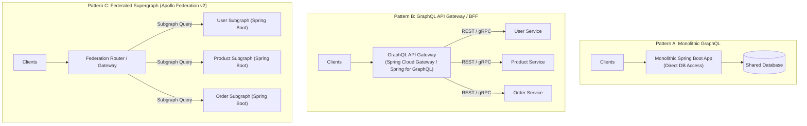
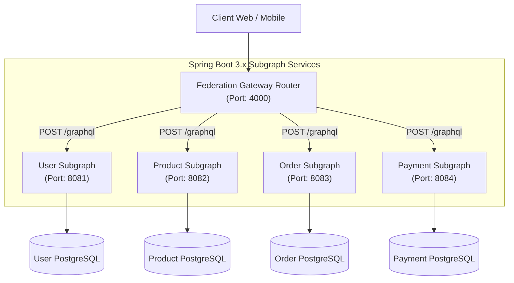
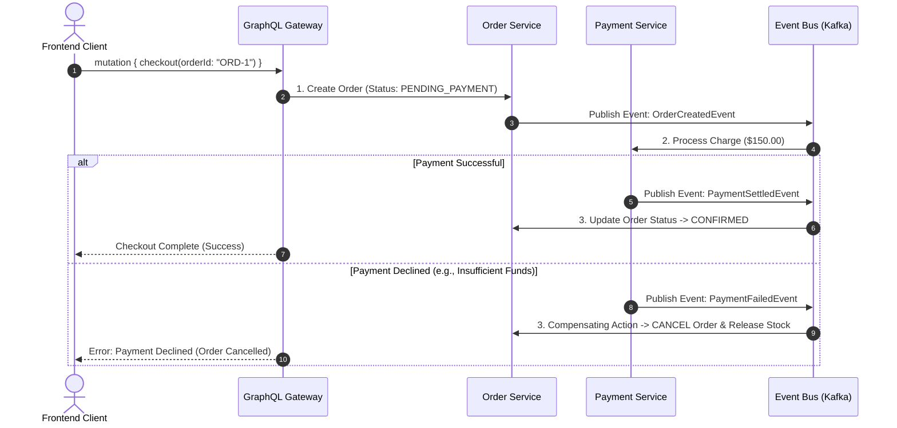
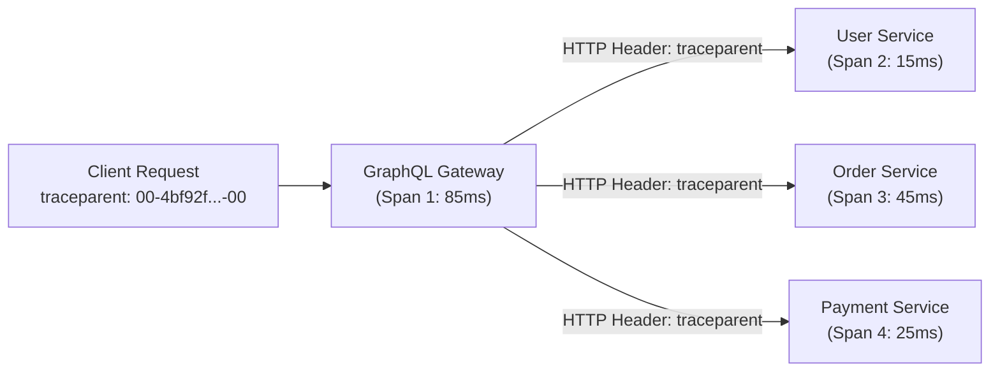

# Module 12: GraphQL in Microservices & Distributed Architectures

Welcome to Module 12 of the **GraphQL Mastery Guide**. This module explores how to architect, aggregate, and scale GraphQL across a distributed microservices ecosystem. We examine **GraphQL as an API Gateway / BFF (Backend-for-Frontend)**, compare **Apollo Federation v2 with Schema Stitching**, implement subgraph entity resolution, and handle distributed errors and tracing across **User, Product, Order, and Payment Services**.

---

## 1. Architectural Patterns: Monolith vs. BFF vs. Supergraph Federation



### 1.1 Pattern Comparison Matrix

| Dimension | Pattern A: Monolithic GraphQL | Pattern B: Gateway / BFF Aggregator | Pattern C: Federated Supergraph (v2) |
| :--- | :--- | :--- | :--- |
| **Team Autonomy** | Low (All teams work in a single codebase). | Medium (Gateway team becomes a coordination bottleneck). | **High** (Each team owns their independent subgraph and deploys autonomously). |
| **Schema Ownership** | Centralized repository. | Centralized gateway repository. | **Decentralized**: Teams define entities; Gateway composes them automatically. |
| **Performance Overhead**| **Lowest** (Direct in-process database access). | Medium (Gateway makes downstream REST/gRPC HTTP calls). | Medium (Router generates query execution plan across subgraphs). |
| **Failure Isolation** | Poor (One memory leak takes down entire API). | Good (Downstream service failure isolates to partial errors). | **Excellent** (Subgraphs scale and fail independently). |
| **Best Used For** | Startups, single-team apps (< 20 devs). | Brownfield migration over existing REST microservices. | Large enterprise engineering organizations (50+ backend engineers). |

---

## 2. Apollo Federation v2 Core Concepts & Directives

In **Apollo Federation**, multiple independent GraphQL services (called **Subgraphs**) are composed into a single unified API (the **Supergraph**) via an edge router (Apollo Router or Hive Gateway).

### 2.1 The Core Federation Directives

```mermaid
classDiagram
    class UserSubgraph {
        +ID id @key
        +String email
        +String fullName
    }
    class OrderSubgraph {
        +ID id @key
        +BigDecimal totalAmount
        +User user @key
    }
    class ReviewSubgraph {
        +ID id @key
        +String comment
        +Product product @key
    }

    OrderSubgraph ..> UserSubgraph : References User via @key(fields: "id")
```

| Directive | Purpose | Example |
| :--- | :--- | :--- |
| **`@key(fields: "id")`** | Declares an entity's primary identifier. Allows other subgraphs to reference or extend this entity. | `type User @key(fields: "id") { id: ID! }` |
| **`@shareable`** | Indicates that a field can be resolved by more than one subgraph. | `type Product @key(fields: "id") { title: String @shareable }` |
| **`@external`** | Marks a field as being owned by another subgraph, but needed locally to compute another field. | `type User @key(fields: "id") { id: ID! @external }` |
| **`@requires(fields: "...")`**| Specifies that a local field requires values from an external field before it can resolve. | `deliveryEstimate: String @requires(fields: "zipCode")` |
| **`@provides(fields: "...")`**| Optimizes execution by declaring that a resolver can return fields owned by another service. | `user: User @provides(fields: "name")` |

---

## 3. Real-World Architecture: 4 Enterprise Microservices

Let us design a production federated architecture across 4 microservices:
1. **User Service:** Owns user identity, names, and contact emails.
2. **Product Service:** Owns catalog, SKUs, and pricing.
3. **Order Service:** Owns customer orders, tracking, and links users to products.
4. **Payment Service:** Owns payment settlements and credit transactions.



---

## 4. Subgraph Implementation in Spring Boot: Order Service Extending User

In this architecture, the **User Service** defines the `User` entity. The **Order Service** needs to attach a list of orders to that `User` without modifying the User Service codebase!

### 4.1 Order Service SDL (`order-subgraph.graphqls`)
```graphql
extend schema
  @link(url: "https://specs.apollo.dev/federation/v2.0",
        import: ["@key", "@shareable"])

type Order @key(fields: "id") {
    id: ID!
    orderNumber: String!
    totalAmount: Float!
    status: String!
}

"""
Extends the User entity owned by User Service
"""
type User @key(fields: "id") {
    id: ID!
    """
    Orders placed by this user, resolved by Order Service!
    """
    orders: [Order!]!
}
```

### 4.2 Entity Representation Resolver in Spring Boot
When the Gateway needs the Order Service to resolve orders for a specific user, it sends an `_entities` query with a representation map: `{"__typename": "User", "id": "101"}`.

```java
package com.upskill.graphql.federation;

import com.upskill.graphql.dto.OrderDto;
import com.upskill.graphql.service.OrderService;
import org.springframework.graphql.data.method.annotation.BatchMapping;
import org.springframework.graphql.data.method.annotation.SchemaMapping;
import org.springframework.stereotype.Controller;

import java.util.List;
import java.util.Map;
import java.util.stream.Collectors;

@Controller
public class FederatedUserController {

    private final OrderService orderService;

    public FederatedUserController(OrderService orderService) {
        this.orderService = orderService;
    }

    /**
     * Resolves the 'orders' field for external User entities
     */
    @BatchMapping(typeName = "User", field = "orders")
    public Map<FederatedUserDto, List<OrderDto>> orders(List<FederatedUserDto> users) {
        List<Long> userIds = users.stream().map(FederatedUserDto::id).toList();
        
        // Single batched SQL query across orders table
        Map<Long, List<OrderDto>> ordersByUserId = orderService.findByUserIdsGrouped(userIds);

        return users.stream().collect(Collectors.toMap(
                user -> user,
                user -> ordersByUserId.getOrDefault(user.id(), List.of())
        ));
    }

    public record FederatedUserDto(Long id) {}
}
```

---

## 5. Distributed Transactions & Resiliency (The Saga Pattern)

### 5.1 Why Two-Phase Commit (2PC) Fails in GraphQL Microservices
A client issues a mutation:
```graphql
mutation CheckoutOrder($input: CheckoutInput!) {
    checkout(input: $input) {
        orderId
        paymentConfirmed
    }
}
```
If Order Service creates the order in DB, but Payment Service fails to charge the card:
- You **cannot** run a distributed database transaction (`@Transactional` across two different microservices and PostgreSQL databases).
- Holding database locks open across HTTP/network boundaries causes connection starvation and cascade failures.

### 5.2 The Orchestrated Saga Pattern
Instead of distributed ACID locks, enterprise architectures use the **Saga Pattern** with asynchronous compensating transactions:



---

## 6. Distributed Tracing & Error Propagation Across Microservices

In a microservices architecture, a single GraphQL query might traverse 4 different backend services. Debugging latency requires **W3C Distributed Tracing** (`traceparent` headers) using **OpenTelemetry, Micrometer Tracing, and Zipkin/Jaeger**.



### Propagating Trace Headers in Spring Boot:
Spring Boot 3.x includes `Micrometer Tracing`. Any `RestClient` or `WebClient` bean configured by Spring automatically injects the active trace context into downstream HTTP requests:

```java
@Bean
public RestClient restClient(RestClient.Builder builder) {
    // Automatically propagates traceparent and baggage headers to downstream microservices!
    return builder.baseUrl("http://payment-service:8084").build();
}
```

---

## 7. When NOT to Use GraphQL as an API Gateway

While GraphQL excels at client-facing aggregation, applying it everywhere is an anti-pattern:

1. **High-Throughput Internal Service-to-Service Communication:**
   - For backend-to-backend calls between Order Service and Inventory Service, **use gRPC over HTTP/2**. Protobuf serialization is 5–10x faster than JSON parsing, and gRPC avoids the CPU overhead of AST parsing.
2. **Binary Streaming & Large File Transfers:**
   - Uploading video files or downloading 500MB CSV exports should be routed through dedicated REST streaming endpoints or pre-signed S3 URLs.
3. **Pure Asynchronous Event Pipes:**
   - If a service simply needs to broadcast audit logs or database CDC events, use **Apache Kafka** directly rather than wrapping events in GraphQL mutations.

---

## 8. Common Mistakes & Pitfalls

### Mistake 1: Chatty Gateways (N+1 Across Microservices)
A naive Gateway resolver that iterates over 50 orders and makes 50 individual HTTP REST calls to User Service (`GET /users/{id}`). This replaces database N+1 with **Network N+1**, spiking response latency to seconds. Always use batch endpoints (`POST /users/batch-lookup`).

### Mistake 2: Leaking Downstream Network Failures
If Payment Service returns an HTTP 504 Gateway Timeout, passing the raw 504 to the frontend crashes the client. Map downstream errors into structured `GraphQLError` extensions with fallback defaults.

### Mistake 3: Breaking Subgraph Schemas Without Supergraph Validation
Modifying a subgraph SDL in a pull request without validating composition against the schema registry (Apollo Studio / Hive) breaks the supergraph during production deployment. Always run composition checks in CI/CD.

---

## 9. Senior Interview Questions & Production Scenarios

### Question 1 (Basic): What is the core difference between Schema Stitching and Apollo Federation?
**Answer:**
- **Schema Stitching:** A centralized approach where a gateway service fetches raw schemas from downstream services and manually merges them using imperative glue code and type extension resolvers written at the gateway layer.
- **Apollo Federation:** A decentralized, declarative architecture. Downstream subgraphs declare entity boundaries and relationships directly within their SDL using standardized directives (`@key`, `@shareable`, `@external`). The gateway automatically composes the supergraph AST without manual resolver glue code.

---

### Question 2 (Intermediate): How does the Apollo Federation Router execute a query that spans multiple subgraphs?
**Answer:**
1. **Query Planning:** The router inspects the incoming client query against the composed supergraph schema.
2. **Execution Plan Generation:** It breaks the query into a directed acyclic graph (DAG) of subgraph fetch stages.
3. **Root Subgraph Query:** The router queries the primary subgraph (e.g., fetching orders from `Order Subgraph`).
4. **Entity Resolution (`_entities` query):** The router extracts the entity keys (e.g., `userId: 101`) and issues a batched `_entities` query to the secondary subgraph (`User Subgraph`), injecting the representation keys.
5. **Response Merging:** The router merges the JSON responses from all subgraphs into the single client-requested selection set.

---

### Question 3 (Advanced): How do you handle authentication tokens across a federated GraphQL gateway and its downstream subgraphs?
**Answer:**
1. The client sends an `Authorization: Bearer <JWT>` header to the Gateway.
2. The Gateway authenticates the token, verifies the digital signature, and validates claims.
3. In Apollo Router / Gateway configuration, configure **Header Forwarding** or inject token claims into downstream HTTP headers (e.g., `X-User-Id: 101`, `X-User-Roles: ROLE_USER,ROLE_MANAGER`).
4. Downstream Spring Boot subgraphs read the forwarded `X-User-Id` header (via a servlet filter) and populate their local `SecurityContext`, ensuring fine-grained method security (`@PreAuthorize`) executes correctly within each microservice boundary.
