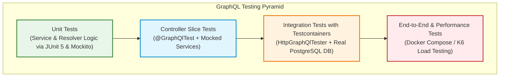

# Module 13: Testing, CI/CD & Production Deployment

Welcome to Module 13 of the **GraphQL Mastery Guide**. This module explores enterprise-grade **Automated Testing, Containerization, and Production Deployment** for Spring Boot 3.x GraphQL applications. We cover `@GraphQlTest`, `HttpGraphQlTester`, `WebSocketGraphQlTester`, **PostgreSQL Testcontainers**, multi-stage Docker builds, and GitHub Actions CI/CD automation.

---

## 1. Testing Pyramid for Spring for GraphQL



Spring for GraphQL provides first-class testing utilities through the **`spring-graphql-test`** module, centered around the **`GraphQlTester`** interface.

---

## 2. Controller Slice Testing with `@GraphQlTest`

`@GraphQlTest` is a specialized test slice annotation that loads only the GraphQL presentation layer (Controllers, Schema, Converters) without booting the entire Spring ApplicationContext or connecting to a database.

### 2.1 Testing Queries with Mocked Services
```java
package com.upskill.graphql.controller;

import com.upskill.graphql.dto.CatalogDtos.OrderDto;
import com.upskill.graphql.service.CustomerService;
import com.upskill.graphql.service.OrderService;
import org.junit.jupiter.api.DisplayName;
import org.junit.jupiter.api.Test;
import org.springframework.beans.factory.annotation.Autowired;
import org.springframework.boot.test.autoconfigure.graphql.GraphQlTest;
import org.springframework.boot.test.mock.mockito.MockBean;
import org.springframework.graphql.test.tester.GraphQlTester;
import org.springframework.security.test.context.support.WithMockUser;

import java.math.BigDecimal;
import java.time.Instant;

import static org.mockito.ArgumentMatchers.eq;
import static org.mockito.Mockito.when;

@GraphQlTest(OrderGraphQlController.class)
class OrderGraphQlControllerTest {

    @Autowired
    private GraphQlTester graphQlTester;

    @MockBean
    private OrderService orderService;

    @MockBean
    private CustomerService customerService;

    @Test
    @WithMockUser(username = "alice", roles = {"USER"})
    @DisplayName("Should successfully fetch order details by ID")
    void testOrderByIdSuccess() {
        // Given
        Long orderId = 101L;
        OrderDto mockOrder = new OrderDto(
                orderId, "ORD-2026-X", new BigDecimal("199.99"), 42L, "CONFIRMED", Instant.now());
        when(orderService.findById(eq(orderId))).thenReturn(mockOrder);

        // When & Then
        String query = """
            query FetchOrder($id: ID!) {
                orderById(id: $id) {
                    id
                    orderNumber
                    totalAmount
                    status
                }
            }
            """;

        this.graphQlTester.document(query)
                .variable("id", orderId)
                .execute()
                .errors()
                .verify() // Asserts 0 errors returned
                .path("orderById.id").entity(Long.class).isEqualTo(orderId)
                .path("orderById.orderNumber").entity(String.class).isEqualTo("ORD-2026-X")
                .path("orderById.totalAmount").entity(BigDecimal.class).isEqualTo(new BigDecimal("199.99"))
                .path("orderById.status").entity(String.class).isEqualTo("CONFIRMED");
    }
}
```

---

## 3. End-to-End Integration Testing with PostgreSQL Testcontainers

For robust production validation, tests must execute against a **real PostgreSQL database instance** inside a Docker container, executing actual Hibernate SQL, unique constraints, and transaction rollbacks.

### 3.1 Dependencies (`pom.xml`)
```xml
<dependency>
    <groupId>org.testcontainers</groupId>
    <artifactId>postgresql</artifactId>
    <scope>test</scope>
</dependency>
<dependency>
    <groupId>org.testcontainers</groupId>
    <artifactId>junit-jupiter</artifactId>
    <scope>test</scope>
</dependency>
```

### 3.2 Full Integration Test with `HttpGraphQlTester`
```java
package com.upskill.graphql.integration;

import com.upskill.graphql.customer.dto.CustomerPayloads.CreateCustomerPayload;
import org.junit.jupiter.api.DisplayName;
import org.junit.jupiter.api.Test;
import org.springframework.beans.factory.annotation.Autowired;
import org.springframework.boot.test.autoconfigure.jdbc.AutoConfigureTestDatabase;
import org.springframework.boot.test.context.SpringBootTest;
import org.springframework.boot.test.web.server.LocalServerPort;
import org.springframework.graphql.test.tester.HttpGraphQlTester;
import org.springframework.test.context.DynamicPropertyRegistry;
import org.springframework.test.context.DynamicPropertySource;
import org.springframework.test.web.reactive.server.WebTestClient;
import org.testcontainers.containers.PostgreSQLContainer;
import org.testcontainers.junit.jupiter.Container;
import org.testcontainers.junit.jupiter.Testcontainers;

import java.util.Map;

import static org.assertj.core.api.Assertions.assertThat;

@SpringBootTest(webEnvironment = SpringBootTest.WebEnvironment.RANDOM_PORT)
@AutoConfigureTestDatabase(replace = AutoConfigureTestDatabase.Replace.NONE)
@Testcontainers
class CustomerMutationIntegrationTest {

    @Container
    static PostgreSQLContainer<?> postgres = new PostgreSQLContainer<>("postgres:16-alpine")
            .withDatabaseName("testdb")
            .withUsername("testuser")
            .withPassword("testpass");

    @DynamicPropertySource
    static void configureProperties(DynamicPropertyRegistry registry) {
        registry.add("spring.datasource.url", postgres::getJdbcUrl);
        registry.add("spring.datasource.username", postgres::getUsername);
        registry.add("spring.datasource.password", postgres::getPassword);
        registry.add("spring.jpa.hibernate.ddl-auto", () -> "create-drop");
    }

    @LocalServerPort
    private int port;

    @Test
    @DisplayName("Should execute createCustomer mutation and persist to real PostgreSQL")
    void testCreateCustomerPersistsToDatabase() {
        WebTestClient client = WebTestClient.bindToServer()
                .baseUrl("http://localhost:" + port + "/graphql")
                .build();
        
        HttpGraphQlTester tester = HttpGraphQlTester.create(client);

        String mutation = """
            mutation CreateNewCustomer($input: CreateCustomerInput!) {
                createCustomer(input: $input) {
                    success
                    customer {
                        id
                        fullName
                        email
                    }
                    userErrors {
                        field
                        message
                    }
                }
            }
            """;

        Map<String, Object> input = Map.of(
                "fullName", "Enterprise Engineer",
                "email", "engineer@testcontainers.org",
                "phoneNumber", "+15551234567"
        );

        CreateCustomerPayload response = tester.document(mutation)
                .variable("input", input)
                .execute()
                .path("createCustomer")
                .entity(CreateCustomerPayload.class)
                .get();

        assertThat(response.success()).isTrue();
        assertThat(response.customer()).isNotNull();
        assertThat(response.customer().fullName()).isEqualTo("Enterprise Engineer");
        assertThat(response.customer().email()).isEqualTo("engineer@testcontainers.org");
    }
}
```

---

## 4. Testing Subscriptions with `WebSocketGraphQlTester`

Testing reactive streams requires `WebSocketGraphQlTester` combined with Project Reactor's **`StepVerifier`**:

```java
package com.upskill.graphql.integration;

import com.upskill.graphql.realtime.dto.OrderStatusEvent;
import com.upskill.graphql.realtime.publisher.OrderEventPublisher;
import org.junit.jupiter.api.DisplayName;
import org.junit.jupiter.api.Test;
import org.springframework.beans.factory.annotation.Autowired;
import org.springframework.boot.test.context.SpringBootTest;
import org.springframework.boot.test.web.server.LocalServerPort;
import org.springframework.graphql.test.tester.WebSocketGraphQlTester;
import org.springframework.web.reactive.socket.client.ReactorNettyWebSocketClient;
import reactor.core.publisher.Flux;
import reactor.test.StepVerifier;

import java.net.URI;
import java.time.Duration;
import java.time.Instant;

@SpringBootTest(webEnvironment = SpringBootTest.WebEnvironment.RANDOM_PORT)
class OrderSubscriptionIntegrationTest {

    @LocalServerPort
    private int port;

    @Autowired
    private OrderEventPublisher orderEventPublisher;

    @Test
    @DisplayName("Should receive live WebSocket events via GraphQL subscription")
    void testSubscriptionLiveStream() {
        URI url = URI.create("ws://localhost:" + port + "/graphql");
        WebSocketGraphQlTester tester = WebSocketGraphQlTester.create(url, new ReactorNettyWebSocketClient());

        String subscriptionQuery = """
            subscription TrackOrder($id: ID!) {
                orderStatusUpdated(orderId: $id) {
                    orderId
                    status
                }
            }
            """;

        Long orderId = 888L;

        Flux<OrderStatusEvent> stream = tester.document(subscriptionQuery)
                .variable("id", orderId)
                .executeSubscription()
                .toFlux("orderStatusUpdated", OrderStatusEvent.class);

        StepVerifier.create(stream)
                .thenAwait(Duration.ofMillis(200)) // Allow WebSocket handshake to complete
                .then(() -> {
                    // Trigger backend event
                    orderEventPublisher.publish(new OrderStatusEvent(
                            orderId, "ORD-888", "SHIPPED", Instant.now(), "Dispatched from warehouse"));
                })
                .assertNext(event -> {
                    org.junit.jupiter.api.Assertions.assertEquals(orderId, event.orderId());
                    org.junit.jupiter.api.Assertions.assertEquals("SHIPPED", event.status());
                })
                .thenCancel()
                .verify(Duration.ofSeconds(5));
    }
}
```

---

## 5. Production Docker Deployment: Multi-Stage Layered Builds

Spring Boot 3 allows **Layered JARs** to maximize Docker layer caching and minimize container footprint.

### 5.1 Enterprise `Dockerfile`
```dockerfile
# Stage 1: Dependency Extraction
FROM eclipse-temurin:17-jre-alpine AS builder
WORKDIR /workspace
ARG JAR_FILE=target/*.jar
COPY ${JAR_FILE} application.jar
RUN java -Djarmode=layertools -jar application.jar extract

# Stage 2: Hardened Production Runtime
FROM eclipse-temurin:17-jre-alpine
WORKDIR /application

# Create non-root user for security compliance
RUN addgroup -S appgroup && adduser -S appuser -G appgroup
USER appuser:appgroup

# Copy layers separately to optimize Docker cache
COPY --from=builder /workspace/dependencies/ ./
COPY --from=builder /workspace/spring-boot-loader/ ./
COPY --from=builder /workspace/snapshot-dependencies/ ./
COPY --from=builder /workspace/application/ ./

# Production JVM Flags for Container Awareness
ENV JAVA_OPTS="-XX:+UseContainerSupport -XX:MaxRAMPercentage=75.0 -XX:+UseG1GC -XX:+ExitOnOutOfMemoryError"

EXPOSE 8080
ENTRYPOINT ["sh", "-c", "java $JAVA_OPTS org.springframework.boot.loader.launch.JarLauncher"]
```

---

## 6. GitHub Actions CI/CD Pipeline

Enterprise workflow executing compile checks, Testcontainers integration tests, schema linting, and container publishing:

```yaml
# .github/workflows/graphql-ci.yml
name: GraphQL Enterprise CI/CD Pipeline

on:
  push:
    branches: [ main ]
  pull_request:
    branches: [ main ]

jobs:
  build-and-test:
    runs-on: ubuntu-latest

    services:
      postgres:
        image: postgres:16-alpine
        env:
          POSTGRES_DB: graphql_db
          POSTGRES_USER: postgres
          POSTGRES_PASSWORD: postgrespassword
        ports:
          - 5432:5432
        options: >-
          --health-cmd pg_isready
          --health-interval 10s
          --health-timeout 5s
          --health-retries 5

    steps:
      - name: Checkout Code
        uses: actions/checkout@v4

      - name: Set up JDK 17
        uses: actions/setup-java@v4
        with:
          java-version: '17'
          distribution: 'temurin'
          cache: maven

      - name: Build with Maven & Run Unit + Integration Tests
        run: mvn clean verify -B

      - name: Schema Linting & Breaking Change Detection
        run: |
          echo "Validating GraphQL SDL syntax and backward compatibility..."
          mvn compile

      - name: Build Docker Container Image
        if: github.ref == 'refs/heads/main'
        run: |
          docker build -t enterprise/graphql-service:${{ github.sha }} .
```

---

## 7. Common Mistakes & Pitfalls

### Mistake 1: Relying Exclusively on Mocked Tests
Only using `@GraphQlTest` with Mockito. Mocked tests will **never** detect N+1 query loops, missing `@BatchMapping` resolvers, or SQL constraint violations. Always maintain Testcontainers integration tests.

### Mistake 2: Missing StepVerifier Cancellation in Subscription Tests
Subscribing to a `Flux` with `StepVerifier` without calling `.thenCancel()` causes tests to hang indefinitely until JUnit times out.

### Mistake 3: Running Containers as `root`
Deploying Docker containers running as the root user violates CIS Docker Benchmarks. Always use an unprivileged system user (`appuser`).

---

## 8. Senior Interview Questions & Production Scenarios

### Question 1 (Basic): What is `GraphQlTester` and how does it simplify testing compared to Spring MVC `MockMvc`?
**Answer:**
`MockMvc` tests raw HTTP endpoints by asserting JSON strings or JSONPath expressions against an HTTP response body. 
`GraphQlTester` is a fluent testing SPI designed specifically for the GraphQL protocol. It handles operation documents, variables, error verification (`.errors().verify()`), and type-safe response extraction (`.path("order.id").entity(Long.class)`), abstracting away whether the underlying transport is HTTP, WebSocket, or direct in-memory execution.

---

### Question 2 (Intermediate): How do you test that a GraphQL mutation successfully rolled back a database transaction when an exception occurred?
**Answer:**
Using Spring Boot `@SpringBootTest` with a real database (Testcontainers):
1. Execute the mutation using `HttpGraphQlTester`, supplying input that triggers a business violation.
2. Assert that the response contains an error under `errors`.
3. Directly inject the Spring Data JPA repository into the test class and verify that the target entity was **not** persisted (`assertThat(repository.existsById(id)).isFalse()`).

---

### Question 3 (Advanced): How do you structure CI/CD pipelines to detect breaking schema changes before deploying to production?
**Answer:**
1. Maintain an authoritative schema registry (such as Apollo Schema Registry or Hive).
2. In the GitHub Actions CI pipeline, run a schema comparison tool (e.g., `rover subgraph check` or `graphql-inspector`).
3. The tool compares the PR's SDL changes against the current active production schema and historical client traffic.
4. If a field deletion, field renaming, or non-null type change is detected that would break active production clients, the CI job fails immediately and blocks the PR from merging.
