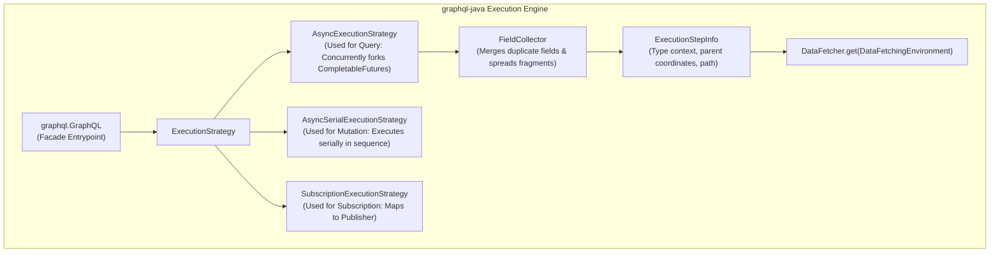
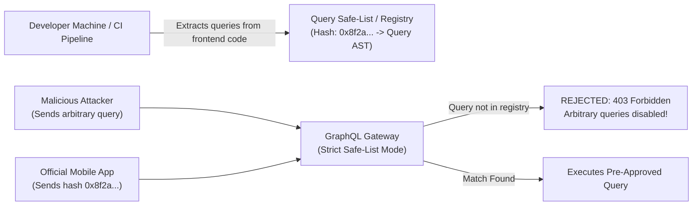

# Module 14: GraphQL Engine Internals & Advanced Architecture

Welcome to Module 14 of the **GraphQL Mastery Guide**. This module explores the low-level internals of the **`graphql-java` execution engine**, custom `Coercing` scalar implementations, **Schema Directive Wiring**, `DataLoader` caching lifecycles, and **Incremental Delivery (`@defer` and `@stream`)**.

---

## 1. Deep Dive: The `graphql-java` Execution Engine Internals

To diagnose complex race conditions and optimize thread performance, a senior architect must understand the exact class hierarchy inside `graphql-java`.



### 1.1 Field Collection & Merging
When a query contains multiple fragments spreading the same field, or multiple fields with identical names, `FieldCollector.collectFields()` executes:
```graphql
query MergedFields {
    customer(id: "1") {
        fullName
        ... on Customer {
            fullName  # Duplicate! FieldCollector merges these into a single resolution.
            email
        }
    }
}
```
The engine guarantees that `fullName` is resolved **only once** by the underlying `DataFetcher`.

---

## 2. Implementing a Custom Scalar from Scratch (`Coercing<I, O>`)

While `ExtendedScalars` provides common scalars, enterprise platforms often require proprietary types (e.g., a validated 3-letter ISO-4217 `CurrencyCode`).

### 2.1 The 3 Coercing Methods
To define a custom scalar, you implement `graphql.schema.Coercing<I, O>`:
1. **`serialize(Object input)`:** Server-to-Client. Converts the internal Java object (`Currency` or `String`) into a valid JSON scalar output.
2. **`parseValue(Object input)`:** Client-to-Server (Variables). Converts an incoming JSON variable into the target Java object.
3. **`parseLiteral(Value<?> input)`:** Client-to-Server (Inline AST). Parses an AST literal node (e.g., `StringValue`) from the raw query string into the target Java object.

### 2.2 Complete Java Implementation: `CurrencyCodeScalar`
```java
package com.upskill.graphql.scalars;

import graphql.GraphQLContext;
import graphql.execution.CoercedVariables;
import graphql.language.StringValue;
import graphql.language.Value;
import graphql.schema.Coercing;
import graphql.schema.CoercingParseLiteralException;
import graphql.schema.CoercingParseValueException;
import graphql.schema.CoercingSerializeException;
import graphql.schema.GraphQLScalarType;

import java.util.Currency;
import java.util.Locale;
import java.util.regex.Pattern;

public final class CurrencyCodeScalar {

    private static final Pattern ISO_CURRENCY_PATTERN = Pattern.compile("^[A-Z]{3}$");

    public static final GraphQLScalarType INSTANCE = GraphQLScalarType.newScalar()
            .name("CurrencyCode")
            .description("A validated ISO-4217 three-letter currency code (e.g., USD, EUR, JPY)")
            .coercing(new Coercing<String, String>() {
                
                @Override
                public String serialize(Object dataFetcherResult, GraphQLContext context, Locale locale)
                        throws CoercingSerializeException {
                    if (dataFetcherResult instanceof String code && isValidCurrency(code)) {
                        return code.toUpperCase(Locale.ROOT);
                    }
                    if (dataFetcherResult instanceof Currency currency) {
                        return currency.getCurrencyCode();
                    }
                    throw new CoercingSerializeException("Expected valid CurrencyCode, but got: " + dataFetcherResult);
                }

                @Override
                public String parseValue(Object input, GraphQLContext context, Locale locale)
                        throws CoercingParseValueException {
                    if (input instanceof String code && isValidCurrency(code)) {
                        return code.toUpperCase(Locale.ROOT);
                    }
                    throw new CoercingParseValueException("Invalid ISO-4217 currency code: " + input);
                }

                @Override
                public String parseLiteral(Value<?> input, CoercedVariables variables, GraphQLContext context, Locale locale)
                        throws CoercingParseLiteralException {
                    if (input instanceof StringValue stringValue && isValidCurrency(stringValue.getValue())) {
                        return stringValue.getValue().toUpperCase(Locale.ROOT);
                    }
                    throw new CoercingParseLiteralException("Expected 3-letter currency literal, but got: " + input);
                }
            })
            .build();

    private static boolean isValidCurrency(String code) {
        if (code == null || !ISO_CURRENCY_PATTERN.matcher(code).matches()) {
            return false;
        }
        try {
            Currency.getInstance(code);
            return true;
        } catch (IllegalArgumentException ex) {
            return false;
        }
    }
}
```

---

## 3. Custom Directives & `SchemaDirectiveWiring`

Directives allow you to alter schema behavior or transform field values dynamically.

### 3.1 SDL Declaration
```graphql
"""
Transforms a String field value to uppercase before serialization
"""
directive @uppercase on FIELD_DEFINITION

type Customer {
    id: ID!
    fullName: String! @uppercase
    email: String!
}
```

### 3.2 Java Implementation with `SchemaDirectiveWiring`
```java
package com.upskill.graphql.directives;

import graphql.schema.DataFetcher;
import graphql.schema.GraphQLFieldDefinition;
import graphql.schema.idl.SchemaDirectiveWiring;
import graphql.schema.idl.SchemaDirectiveWiringEnvironment;
import org.springframework.context.annotation.Bean;
import org.springframework.context.annotation.Configuration;
import org.springframework.graphql.execution.RuntimeWiringConfigurer;

@Configuration(proxyBeanMethods = false)
public class DirectiveConfiguration {

    @Bean
    public RuntimeWiringConfigurer directiveWiringConfigurer() {
        return wiringBuilder -> wiringBuilder.directive("uppercase", new SchemaDirectiveWiring() {
            @Override
            public GraphQLFieldDefinition onField(SchemaDirectiveWiringEnvironment<GraphQLFieldDefinition> env) {
                GraphQLFieldDefinition field = env.getElement();
                DataFetcher<?> originalDataFetcher = env.getCodeRegistry().getDataFetcher(env.getFieldsContainer(), field);

                // Wrap the original DataFetcher to transform string output
                DataFetcher<?> transformingFetcher = dataFetchingEnvironment -> {
                    Object rawValue = originalDataFetcher.get(dataFetchingEnvironment);
                    if (rawValue instanceof String str) {
                        return str.toUpperCase(java.util.Locale.ROOT);
                    }
                    return rawValue;
                };

                env.getCodeRegistry().dataFetcher(env.getFieldsContainer(), field, transformingFetcher);
                return field;
            }
        });
    }
}
```

---

## 4. Incremental Delivery: `@defer` and `@stream`

### 4.1 The Slow Child Problem
Imagine a product page query:
```graphql
query ProductPage($id: ID!) {
    product(id: $id) {
        title
        price
        # Slow recommendation ML algorithm taking 1,200ms!
        recommendedAccessories {
            sku
            title
        }
    }
}
```
Without incremental delivery, the client waits 1,200ms before it can display the product title or price.

### 4.2 How `@defer` Solves This (HTTP Multipart Streaming)
With the proposed `@defer` directive, the server immediately returns the fast data, followed by a second chunk over the same HTTP stream:

```graphql
query ProductPage($id: ID!) {
    product(id: $id) {
        title
        price
        ... on Product @defer(label: "accessories") {
            recommendedAccessories {
                sku
                title
            }
        }
    }
}
```

#### Chunk 1 (Delivered in 25ms):
```json
{
  "data": {
    "product": { "title": "Wireless Headphones", "price": 199.99 }
  },
  "hasNext": true
}
```

#### Chunk 2 (Streamed in 1,200ms over same connection):
```json
{
  "data": {
    "recommendedAccessories": [{ "sku": "CASE-10", "title": "Hard Travel Case" }]
  },
  "label": "accessories",
  "path": ["product"],
  "hasNext": false
}
```

> [!NOTE]
> **Implementation Status:** Incremental Delivery is specified in the GraphQL Working Group draft and supported in experimental builds of `graphql-java` 22+ and Apollo Router.

---

## 5. Persisted Operations & Safe-Listing (The Ultimate Security Tier)

In high-security enterprise environments (banking, healthcare), you can completely eliminate query injection, depth attacks, and complexity attacks by **disabling arbitrary queries entirely**:


By enforcing **Query Safelisting**, the `/graphql` endpoint behaves like a strictly validated RPC service, denying all ad-hoc or malicious queries at the network edge.

---

## 6. Common Mistakes & Pitfalls

### Mistake 1: Blocking the AsyncExecutionStrategy Thread Pool
Executing blocking synchronous calls (e.g., `Thread.sleep()` or blocking REST calls) inside a `CompletableFuture` in a custom `DataFetcher` without offloading to an isolated `ExecutorService`. This starves the common ForkJoinPool and halts all other concurrent field resolutions.

### Mistake 2: Throwing Generic Exceptions in Custom Scalars
Throwing `RuntimeException` instead of `CoercingParseValueException` or `CoercingParseLiteralException`. The engine catches standard coercing exceptions and formats proper `BAD_REQUEST` error locations; throwing arbitrary exceptions results in unhandled `INTERNAL_ERROR` classifications.

---

## 7. Senior Interview Questions & Production Scenarios

### Question 1 (Basic): What is the role of `AsyncExecutionStrategy` in `graphql-java`?
**Answer:**
`AsyncExecutionStrategy` is the default execution strategy used for `Query` operations in `graphql-java`. It traverses the selection set and dispatches resolvers as asynchronous tasks using Java `CompletableFuture`. Sibling fields at the same level of the query tree execute concurrently, allowing multiple independent database queries or microservice calls to proceed in parallel, minimizing total response latency.

---

### Question 2 (Intermediate): What are the three methods required to implement a custom GraphQL scalar, and what does each do?
**Answer:**
The `Coercing<I, O>` interface requires:
1. `serialize(Object input)`: Validates and converts the Java domain object returned by a resolver into the scalar format sent over the wire in the JSON response.
2. `parseValue(Object input)`: Parses and validates an input variable (from the JSON variables dictionary) into the corresponding Java domain object.
3. `parseLiteral(Value<?> input)`: Parses and validates an inline AST literal node written directly in the query text into the corresponding Java domain object.

---

### Question 3 (Advanced): How does Query Safelisting (Persisted Queries) neutralize GraphQL-specific security vulnerabilities?
**Answer:**
Query Safelisting forces the server to accept only pre-registered, pre-approved query documents (usually referenced by a cryptographic hash). 
Because arbitrary client query strings are rejected at the edge:
1. **DDoS Depth & Complexity Attacks are neutralized:** Attackers cannot submit deeply recursive or expensive queries.
2. **Schema Introspection is obsolete:** Even if an attacker knows the schema, they cannot construct custom queries.
3. **GraphQL Injection is eliminated:** The query structure is immutable, with dynamic values strictly bound through parameterized variables.
