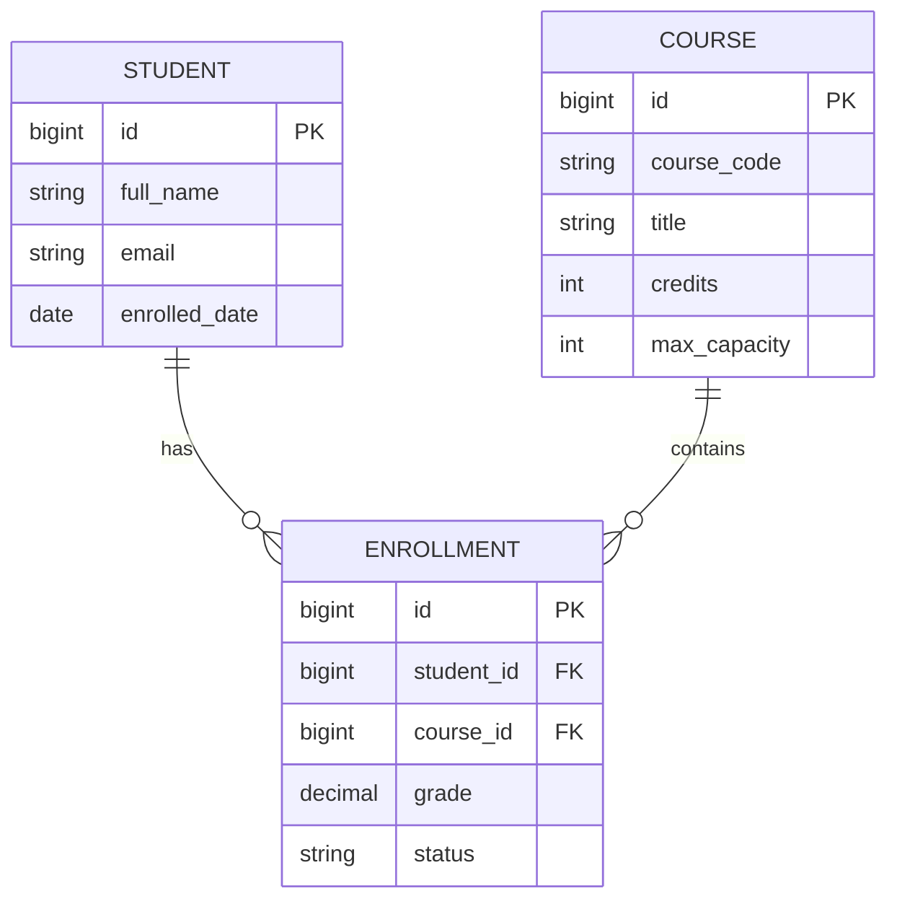
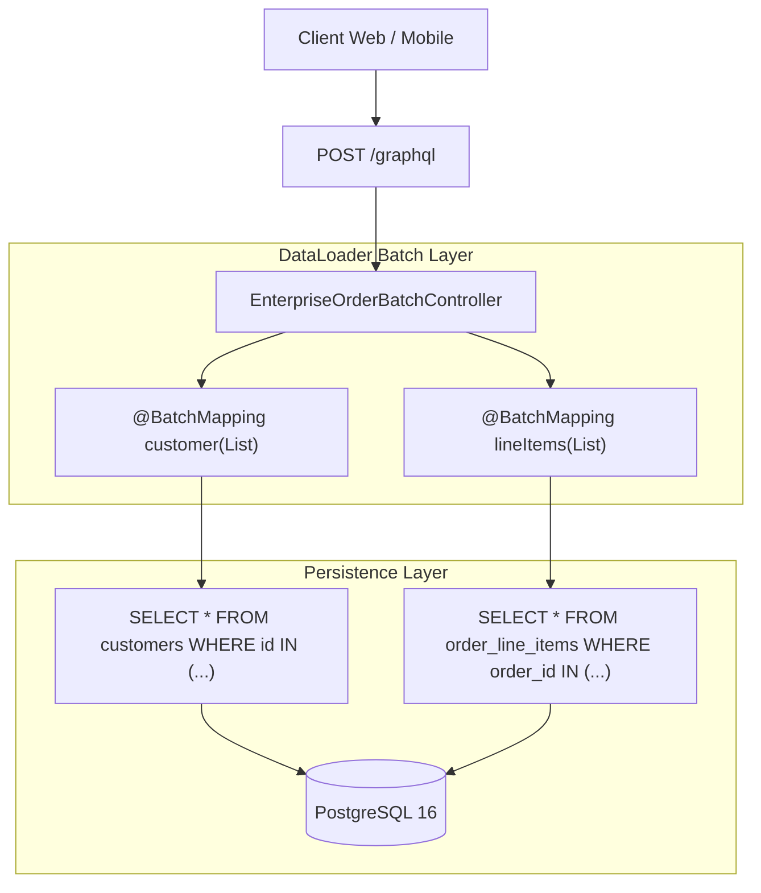
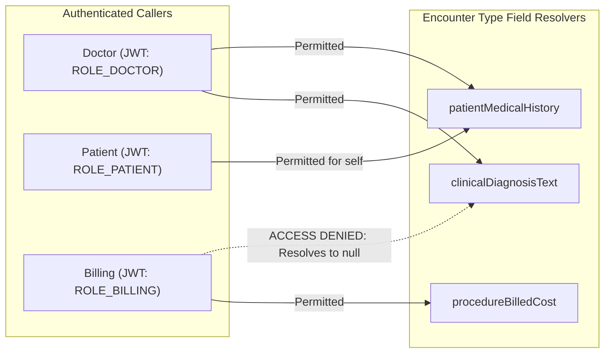
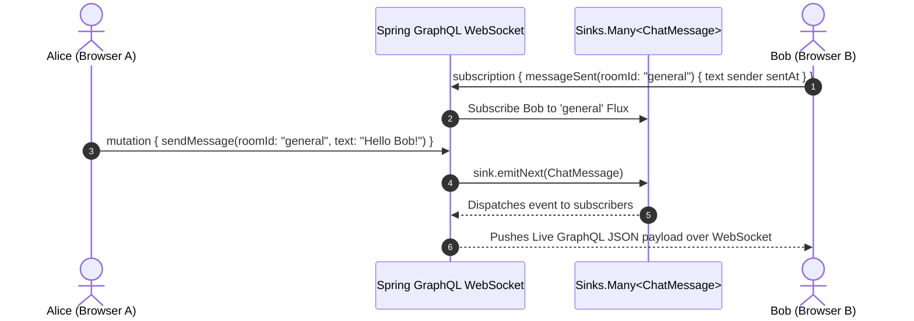
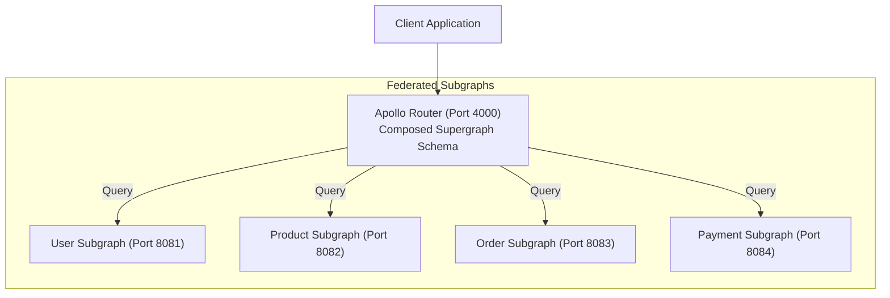

# Module 15: 5 Production Real-World Enterprise Projects

Welcome to Module 15 of the **GraphQL Mastery Guide**. This module provides complete, production-grade architectural blueprints and working code for **5 enterprise systems**, progressing from beginner foundations to complex distributed microservices:

1. **Student Management System** *(Level: Beginner — Core SDL, CRUD, JPA Mapping)*
2. **E-Commerce GraphQL API** *(Level: Intermediate — Keyset Pagination, DataLoader, N+1 Elimination)*
3. **Hospital Information System** *(Level: Advanced — Role-Based Security, Field Redaction, Audit Trails)*
4. **Real-Time Collaborative Chat** *(Level: Advanced — Reactive WebSockets, Project Reactor, Subscriptions)*
5. **Multi-Service Order Management Supergraph** *(Level: Principal Architect — Apollo Federation v2)*

---

# Project 1: Student Management System (Level: Beginner)

### 1.1 Requirements & Domain Scope
- Manage students, academic courses, and course enrollments.
- Students can enroll in multiple courses; courses have enrollment capacity limits.
- Compute student GPA and current active credit load dynamically.

### 1.2 Architecture Diagram


### 1.3 PostgreSQL DDL
```sql
CREATE TABLE students (
    id BIGSERIAL PRIMARY KEY,
    full_name VARCHAR(150) NOT NULL,
    email VARCHAR(150) NOT NULL UNIQUE,
    enrolled_date DATE NOT NULL DEFAULT CURRENT_DATE
);

CREATE TABLE courses (
    id BIGSERIAL PRIMARY KEY,
    course_code VARCHAR(20) NOT NULL UNIQUE,
    title VARCHAR(200) NOT NULL,
    credits INT NOT NULL CHECK (credits > 0),
    max_capacity INT NOT NULL DEFAULT 50
);

CREATE TABLE enrollments (
    id BIGSERIAL PRIMARY KEY,
    student_id BIGINT NOT NULL REFERENCES students(id) ON DELETE CASCADE,
    course_id BIGINT NOT NULL REFERENCES courses(id) ON DELETE RESTRICT,
    grade NUMERIC(3, 2),
    status VARCHAR(30) NOT NULL DEFAULT 'ACTIVE',
    CONSTRAINT uq_student_course UNIQUE (student_id, course_id)
);
```

### 1.4 GraphQL SDL (`student-system.graphqls`)
```graphql
type Query {
    studentById(id: ID!): Student
    allCourses: [Course!]!
}

type Mutation {
    registerStudent(input: RegisterStudentInput!): Student!
    enrollCourse(studentId: ID!, courseId: ID!): EnrollmentPayload!
}

type Student {
    id: ID!
    fullName: String!
    email: String!
    enrolledDate: String!
    enrollments: [Enrollment!]!
    totalCredits: Int!
}

type Course {
    id: ID!
    courseCode: String!
    title: String!
    credits: Int!
    maxCapacity: Int!
    enrolledStudentsCount: Int!
}

type Enrollment {
    id: ID!
    course: Course!
    grade: Float
    status: EnrollmentStatus!
}

enum EnrollmentStatus {
    ACTIVE
    COMPLETED
    DROPPED
}

input RegisterStudentInput {
    fullName: String!
    email: String!
}

type EnrollmentPayload {
    success: Boolean!
    message: String!
    enrollment: Enrollment
}
```

### 1.5 Spring Boot Controller & Field Resolvers
```java
package com.upskill.graphql.student.controller;

import com.upskill.graphql.student.dto.StudentDtos.*;
import com.upskill.graphql.student.service.StudentService;
import org.springframework.graphql.data.method.annotation.Argument;
import org.springframework.graphql.data.method.annotation.MutationMapping;
import org.springframework.graphql.data.method.annotation.QueryMapping;
import org.springframework.graphql.data.method.annotation.SchemaMapping;
import org.springframework.stereotype.Controller;

import java.util.List;

@Controller
public class StudentSystemController {

    private final StudentService studentService;

    public StudentSystemController(StudentService studentService) {
        this.studentService = studentService;
    }

    @QueryMapping
    public StudentDto studentById(@Argument Long id) {
        return studentService.getStudentById(id);
    }

    @QueryMapping
    public List<CourseDto> allCourses() {
        return studentService.getAllCourses();
    }

    @MutationMapping
    public StudentDto registerStudent(@Argument RegisterStudentInput input) {
        return studentService.registerStudent(input);
    }

    @MutationMapping
    public EnrollmentPayload enrollCourse(@Argument Long studentId, @Argument Long courseId) {
        return studentService.enroll(studentId, courseId);
    }

    /**
     * Resolves dynamically computed credit load
     */
    @SchemaMapping(typeName = "Student", field = "totalCredits")
    public int totalCredits(StudentDto student) {
        return studentService.calculateTotalCredits(student.id());
    }

    @SchemaMapping(typeName = "Student", field = "enrollments")
    public List<EnrollmentDto> enrollments(StudentDto student) {
        return studentService.getEnrollmentsByStudent(student.id());
    }
}
```

---

# Project 2: E-Commerce GraphQL API (Level: Intermediate)

### 2.1 Requirements & Performance Goals
- Product Catalog, Customer Orders, and Inventory management.
- Eliminate N+1 queries when fetching orders with customer and line items using `@BatchMapping`.
- Support Relay-compliant Keyset Cursor Pagination for catalog browsing.
- Protect checkout mutations with atomic database transactions and optimistic locking.

### 2.2 Architecture Diagram


### 2.3 GraphQL SDL (`ecommerce.graphqls`)
```graphql
type Query {
    productsConnection(first: Int, after: String, category: String): ProductConnection!
    order(id: ID!): Order
}

type Mutation {
    checkoutCart(input: CheckoutInput!): CheckoutPayload!
}

type ProductConnection {
    edges: [ProductEdge!]!
    pageInfo: PageInfo!
}

type ProductEdge {
    node: Product!
    cursor: String!
}

type Product {
    id: ID!
    sku: String!
    title: String!
    unitPrice: BigDecimal!
    inStock: Boolean!
}

type Order {
    id: ID!
    orderNumber: String!
    totalAmount: BigDecimal!
    customer: Customer!
    lineItems: [LineItem!]!
}

input CheckoutInput {
    customerId: ID!
    items: [CartItemInput!]!
    paymentNonce: String!
}

input CartItemInput {
    productSku: String!
    quantity: Int!
}

type CheckoutPayload {
    success: Boolean!
    order: Order
    errorMessage: String
}
```

### 2.4 High-Performance Batched Order Resolver
```java
package com.upskill.graphql.ecommerce.controller;

import com.upskill.graphql.ecommerce.dto.EcommerceDtos.*;
import com.upskill.graphql.ecommerce.service.EcommerceService;
import org.springframework.graphql.data.method.annotation.BatchMapping;
import org.springframework.graphql.data.method.annotation.QueryMapping;
import org.springframework.stereotype.Controller;

import java.util.List;
import java.util.Map;

@Controller
public class EcommerceBatchController {

    private final EcommerceService ecommerceService;

    public EcommerceBatchController(EcommerceService ecommerceService) {
        this.ecommerceService = ecommerceService;
    }

    @QueryMapping
    public OrderDto order(Long id) {
        return ecommerceService.findOrderById(id);
    }

    /**
     * Solves N+1: Loads customers for 50 orders in a single SQL query
     */
    @BatchMapping(typeName = "Order", field = "customer")
    public Map<OrderDto, CustomerDto> customer(List<OrderDto> orders) {
        return ecommerceService.batchLoadCustomers(orders);
    }

    /**
     * Solves N+1: Loads all line items for 50 orders in a single SQL query
     */
    @BatchMapping(typeName = "Order", field = "lineItems")
    public Map<OrderDto, List<LineItemDto>> lineItems(List<OrderDto> orders) {
        return ecommerceService.batchLoadLineItems(orders);
    }
}
```

---

# Project 3: Hospital Information System (Level: Advanced)

### 3.1 Requirements & Regulatory Compliance (HIPAA / GDPR)
- Manage Patients, Doctors, Medical Encounters, and Prescriptions.
- Strict Role-Based Access Control:
  - `DOCTOR`: Can view medical encounters, vitals, and diagnose patients.
  - `PATIENT`: Can view their own appointments; cannot view internal clinical notes.
  - `BILLING_ADMIN`: Can view financial costs; strictly forbidden from viewing clinical diagnosis text.
- Field-Level Security: Automatic redaction of sensitive medical records based on the caller's JWT claims.

### 3.2 Security Access Matrix & Data Flow


### 3.3 GraphQL SDL (`hospital.graphqls`)
```graphql
type Query {
    patientMedicalRecord(patientId: ID!): PatientRecord
}

type PatientRecord {
    id: ID!
    patientName: String!
    dateOfBirth: String!
    encounters: [ClinicalEncounter!]!
}

type ClinicalEncounter {
    id: ID!
    encounterDate: DateTime!
    attendingDoctorName: String!
    
    """
    HIPAA-Protected: Only accessible by DOCTOR role!
    """
    clinicalDiagnosisText: String
    
    """
    Financial: Accessible by BILLING and DOCTOR
    """
    procedureBilledCost: BigDecimal
}
```

### 3.4 Fine-Grained Field Redaction Implementation
```java
package com.upskill.graphql.hospital.controller;

import com.upskill.graphql.hospital.dto.HospitalDtos.ClinicalEncounterDto;
import org.springframework.graphql.data.method.annotation.SchemaMapping;
import org.springframework.security.core.Authentication;
import org.springframework.security.core.context.SecurityContextHolder;
import org.springframework.stereotype.Controller;

import java.math.BigDecimal;

@Controller
public class HospitalSecurityFieldController {

    @SchemaMapping(typeName = "ClinicalEncounter", field = "clinicalDiagnosisText")
    public String clinicalDiagnosisText(ClinicalEncounterDto encounter) {
        Authentication auth = SecurityContextHolder.getContext().getAuthentication();
        
        boolean isDoctor = auth != null && auth.getAuthorities().stream()
                .anyMatch(a -> a.getAuthority().equals("ROLE_DOCTOR"));

        if (!isDoctor) {
            // Silently redacts the confidential medical diagnosis for non-physicians
            return null;
        }

        return encounter.diagnosisNotes();
    }

    @SchemaMapping(typeName = "ClinicalEncounter", field = "procedureBilledCost")
    public BigDecimal procedureBilledCost(ClinicalEncounterDto encounter) {
        Authentication auth = SecurityContextHolder.getContext().getAuthentication();
        
        boolean canViewBilling = auth != null && auth.getAuthorities().stream()
                .anyMatch(a -> a.getAuthority().equals("ROLE_BILLING") || a.getAuthority().equals("ROLE_ADMIN"));

        if (!canViewBilling) {
            return null;
        }

        return encounter.billedAmount();
    }
}
```

---

# Project 4: Real-Time Collaborative Chat (Level: Advanced)

### 4.1 Requirements
- Multi-room collaborative messaging.
- Real-time message streaming via WebSocket subscriptions.
- Typing indicators ("Alice is typing...") with automated 3-second expiration.
- Project Reactor reactive backpressure handling.

### 4.2 Reactive Architecture Topology


### 4.3 Reactive Chat Controller (`ChatSubscriptionController.java`)
```java
package com.upskill.graphql.chat.controller;

import com.upskill.graphql.chat.dto.ChatDtos.*;
import com.upskill.graphql.chat.service.ChatBroadcastService;
import org.springframework.graphql.data.method.annotation.Argument;
import org.springframework.graphql.data.method.annotation.MutationMapping;
import org.springframework.graphql.data.method.annotation.SubscriptionMapping;
import org.springframework.stereotype.Controller;
import reactor.core.publisher.Flux;

@Controller
public class ChatSubscriptionController {

    private final ChatBroadcastService chatService;

    public ChatSubscriptionController(ChatBroadcastService chatService) {
        this.chatService = chatService;
    }

    @MutationMapping
    public ChatMessageDto sendMessage(@Argument SendMessageInput input) {
        return chatService.postMessage(input);
    }

    @SubscriptionMapping
    public Flux<ChatMessageDto> messageSent(@Argument String roomId) {
        return chatService.subscribeToRoom(roomId);
    }

    @SubscriptionMapping
    public Flux<UserTypingEvent> userTyping(@Argument String roomId) {
        return chatService.subscribeToTyping(roomId);
    }
}
```

---

# Project 5: Multi-Service Order Management Supergraph (Level: Principal Architect)

### 5.1 Architecture & Federation Topology
A distributed supergraph combining 4 microservices via **Apollo Federation v2**:
- **User Subgraph:** Owns user identity.
- **Product Subgraph:** Owns catalog inventory and prices.
- **Order Subgraph:** Owns orders; extends `User` with `User.orders` and references `Product`.
- **Payment Subgraph:** Processes asynchronous credit card authorizations.



### 5.2 Order Subgraph SDL Extension
```graphql
extend schema
  @link(url: "https://specs.apollo.dev/federation/v2.0",
        import: ["@key", "@shareable"])

type Order @key(fields: "id") {
    id: ID!
    orderNumber: String!
    totalAmount: Float!
    status: OrderStatus!
    items: [OrderItem!]!
}

type OrderItem {
    id: ID!
    product: Product!
    quantity: Int!
}

"""
Stub representation of external Product owned by Product Subgraph
"""
type Product @key(fields: "id") {
    id: ID!
}

"""
Extends the User entity owned by User Subgraph
"""
type User @key(fields: "id") {
    id: ID!
    orders: [Order!]!
}
```

### 5.3 Docker Compose Production Stack (`docker-compose.yml`)
```yaml
version: '3.8'

services:
  apollo-router:
    image: ghcr.io/apollographql/router:v1.45.0
    container_name: federation-router
    ports:
      - "4000:4000"
    volumes:
      - ./router-config.yaml:/dist/config/router.yaml
      - ./supergraph-schema.graphql:/dist/config/supergraph.graphql
    command: ["--config", "/dist/config/router.yaml", "--supergraph", "/dist/config/supergraph.graphql"]
    depends_on:
      - user-service
      - product-service
      - order-service

  user-service:
    build: ./user-subgraph
    environment:
      SPRING_DATASOURCE_URL: jdbc:postgresql://user-db:5432/user_db
    ports:
      - "8081:8080"

  product-service:
    build: ./product-subgraph
    environment:
      SPRING_DATASOURCE_URL: jdbc:postgresql://product-db:5432/product_db
    ports:
      - "8082:8080"

  order-service:
    build: ./order-subgraph
    environment:
      SPRING_DATASOURCE_URL: jdbc:postgresql://order-db:5432/order_db
    ports:
      - "8083:8080"
```

---

## 6. Summary of Architectural Takeaways Across All 5 Projects

1. **Start Simple, Evolve Toward Batching:** Begin with clean domain models and DTOs; add `@BatchMapping` the moment a collection has nested relationships.
2. **Push Authorization to the Field Level:** Sensitive fields (HIPAA, GDPR, Financials) must have explicit resolver security rather than relying on global URL filters.
3. **Subscriptions Need Distributed Event Buses:** Single-node `Sinks.Many` is ideal for local prototypes; multi-instance production requires Apache Kafka or Redis Pub/Sub.
4. **Federation Decouples Teams:** Apollo Federation v2 enables independent microservice deployments while presenting a unified, elegant schema to frontend developers.
